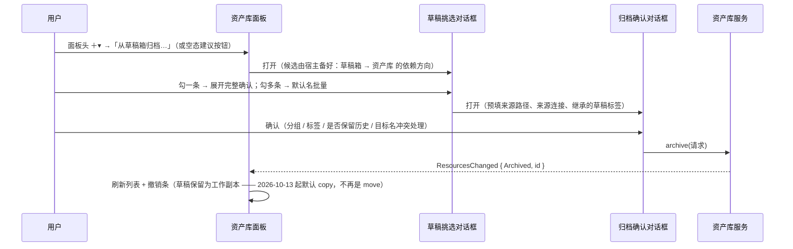

# 资产库 / 分析存档模块（M6）· 原型设计

> 状态：**设计定稿（原型 v1，2026-09-15）；Phase 0–4 主体已落地（归档/取回/版本/组织/检索/回收站/索引修复 + 五个对话框，162 单测 + 35 窗口测试全绿）；2026-10-13 语义裁决（copy 两档粒度 / TableRef 划掉 / A2 洞察归档）与 T18–T21 洞察联动增量见 §12** · 关联文件：`analytics-resource-prototype.html`（可交互原型）、`analytics-resource-architecture.md`（语义裁决与数据流）、`analytics-resource-dev-plan.md`（开发方案）、`analytics-resource-gap-review.md`（2026-10-22 差距清单）
> 技术栈：gpui-kit 0.7.1（五段布局见 `../layout/layout-design.md`；左 Dock 起步宽 15rem = 240px，右侧详情面板默认 20rem）
> 前置：v1 蓝本 `v1/frontend/extensions/builtin/analytics-resource/`（**前端仅占位卡片列表**，15 个组件未接线，见 §10）
> 关联文档：`../overview.md`（M6 定位）、`../ui/ui-design-spec.md`（三层约束）、`../database/database-navigator-prototype-design.md`（连接行降密与属性面板先例）、`../scratchpad/scratchpad-prototype-design.md`（归档上游）

## 1. 设计基准

| 项 | 取值 | 来源 |
| --- | --- | --- |
| 面板位置 | 左 Dock（活动栏第 3 项） | `workbench/src/view.rs:35-44` `LeftPanel::Resources` |
| 面板宽 | 起步 15rem = 240px，可拖拽 | `ui::LEFT_DOCK_WIDTH` |
| 详情面板 | 编辑区右侧，默认 20rem，范围 13.75–47.5rem，**宽度记忆存 `settings.json`** | `ui::PROPERTY_PANEL_*`（沿用 M4 决策 3） |
| 行高 | 1.5rem = 24px（与 M4 树 / M5 列表一致） | `ui::ROW_HEIGHT` |
| 面板头高 | 2.25rem = 36px | `ui::PANEL_HEADER_HEIGHT` |
| 契约 | 零裸色值 / 零裸 `px`；组件不手搓；render 期零 I/O | `../ui/ui-design-spec.md`、`.agents/skills/rds-ui-spec/SKILL.md`（仓库根相对，下同） |

**三条界面原则**（由语义裁决推出，不是审美偏好）：

1. **复现强度必须可见**：`已归档`（强）/ `分析表`（中）/ `引用`（弱）在列表行与详情面板都要常显 —— 用户必须一眼知道"这东西半年后还打不打得开"。
2. **本体与显示名分离**：`name` 是显示名（可改），`file_rel_path` 是物理路径（归档时定，**不随重命名变化**）。改显示名不动文件，避免破坏外部引用与 git 历史。
3. **只读是常态**：存档本体不可写。要改 → 走"取回"（检出）。面板上不提供"编辑资源"入口（有入口就一定有用户点了才发现不能存）。

## 2. 面板解剖

```
┌──────────────────────────────────────────┐  ┌─ 活动栏
│ ⛁ 资产库                    ＋ ▾   ⋯     │  │
├──────────────────────────────────────────┤  │
│ ⌕ 搜索存档            [筛选 ▾]  [排序 ▾] │  │
├──────────────────────────────────────────┤  │
│ ▾ 全部分组                    12 项      │  │  ← 分组折叠区
│   ▾ 未分组                               │  │
│     ▤ dau_report.sql        v3  ●已归档  │  │  ← 行：图标 名称 版本 强度
│     ▤ 临时订单分析.sql      v1  ●已归档  │  │
│   ▾ 报表                                 │  │
│     ▤ monthly.md            v2  ●已归档  │  │
│     ▦ mock_orders           v1  ●分析表  │  │
├──────────────────────────────────────────┤  │
│ 12 项 · 已归档 11 · 分析表 1 · 缺失 0     │  │  ← 状态行
└──────────────────────────────────────────┘  │
```

### 2.1 面板头（高 2.25rem）

| 元素 | 规格 | 行为 |
| --- | --- | --- |
| 标题 | `text_sm` + 中等字重；前缀图标 `icons/chart-column.svg` | 点击 = 折叠/展开（沿用 M4/M5 面板头行为） |
| `＋ ▾` 主操作 | `CONTROL_HEIGHT_SM` 紧凑按钮 | 菜单两项：**从草稿箱归档…**（打开草稿多选对话框）/ **从本地文件归档…**（系统文件选择） |
| `⋯` 更多 | 同上 | 重建索引… / 打开资源目录 / 回收站… / 刷新 |

> **为什么主操作不是"新建存档"**：存档的本体必须来自某处（草稿 / 本地文件 / 分析表），**不存在凭空创建的存档**。这与 v1"填 JSON 建资源"的入口形成对照——v1 正是因此没人用。
>
> **落地现状（2026-09-17，两批，2026-09-18 补一笔）**：`＋ ▾` 两项已落（**从草稿箱归档…** 走草稿多选对话框：单选→完整确认、多选→默认名批量；**从本地文件归档…** 走系统文件选择）；`⋯` 四项**均为真实现**（**重建索引…** 与状态行「修复…」同一条路、**打开资源目录** 用系统文件管理器开 `resources/`、**回收站…** 开回收站对话框（P0.8 已落）、**刷新** 与切换项目同一条取数路径）；标题前缀图标已落。**标题点击折叠/展开未落**：M4/M5 面板头由 Dock 的 tab 呈现、不自绘，单独给 M6 会让同一个动作只在一处可用——等“自绘面板头统一”那一批一起做。**草稿箱右键**那个入口属草稿箱 crate，仍未接。

### 2.2 工具栏（高 2rem）

| 控件 | 规格 | 说明 |
| --- | --- | --- |
| 搜索框 | 高 `CONTROL_HEIGHT_SM`，占满剩余宽 | 匹配 **显示名 / 别名 / 标签 / 来源表**（不再只 `LIKE name OR alias`）；`Ctrl+F` 聚焦；`Esc` 清空 |
| `筛选 ▾` | 紧凑按钮 + 弹层 | 三维：**kind**（文件 / 分析表 / 引用）、**强度**（已归档 / 分析表 / 引用 · 可"仅显示可能失效"）、**标签**（多选 · **已落，见下**） |
| `排序 ▾` | 紧凑按钮 + 弹层 | 名称 / 归档时间 / 更新时间 / 大小 / 版本号；箭头上再点翻转（沿用 M4 与 v1 `use-pagination` 语义）。按钮上显示当前字段 + 箭头（四个字的字段在按钮上用两字短名：归档 / 更新） |

> **落地现状（2026-09-18，第四刀）**：**五个排序键已全部落地**（`filter::SortField::ALL` 就是菜单顺序的单一来源）。与规格的一处补强：比较的是**行上的原始值**（时间戳 / 字节数）而不是尾巴里格式化过的字符串（`1.2 KB` vs `900 B` 会得出错误顺序），且**缺值（无体积 / 无归档时间）在两个方向上都排最后**——“不知道”不该在降序里冒充“最大”。为了「大小」不是空功能，归档 / 再归档 / 版本还原 / 补登 / 接受当前内容这五条路径都在写指纹时同批登记本体字节数（`PayloadStore::file_size`）。按钮文案用两字短名（归档 / 更新 / 版本），**四个字的全名留在菜单里**——按钮要跟搜索框抢 240px 面板的宽度。
> **排序会被记住（2026-09-18，第六刀）**：面板里点一次排序就写回设置 `resources.default_sort`，下次打开项目还是这一列（“默认排序” = 上次用的那个，不另给一份设置）；只存**字段**不存方向，方向按字段惯例（名称升序，时间 / 大小 / 版本降序）。
> 搜索框的**匹配面已按规格到齐**（2026-09-20，第十一刀）：显示名 / 别名 / 标签 / 来源表 + 尾部字段，**大小写不敏感**。与规格的一处补充：**匹配面比展示面宽**（别名 / 标签 / 来源表行上不显示，面板只有 240px）——与 quick_open 的 `keywords` 同口径：**可搜、不高亮**。字段之间留一个空格：不留的话跨字段的偶然连缀（名尾 + 尾巴首）会造出假命中。搜索范围不可见，故“搜不到”的无匹配空态会列出可搜字段（`filter::SEARCH_FIELDS` / `no_match_hint`，单一来源）。筛选菜单的**强度维**仍未单做（kind 维 + “只看需处理”已覆盖它的实际用途——强度由 kind 决定，多一维就是同一个条件说两遍）。

### 2.3 列表行解剖（高 1.5rem）

```
▤  dau_report.sql            v3   ●已归档   1.2 KB   3 天前
│  │                          │    │          │        └ 相对时间（悬浮显示绝对时间）
│  │                          │    │          └ 大小（analysis 型显示"行数 × 列数"）
│  │                          │    └ 复现强度徽标（唯一色块，见 §6）
│  │                          └ 版本徽标（v1 时不显示，减少噪声）
│  └ 显示名（text_sm）；本体缺失时加删除线 + `danger` 点
└ kind 图标：文件 / 分析表 / 引用（三档形状不同，不只靠颜色）
```

| 交互 | 行为 |
| --- | --- |
| 单击 | 选中（右侧详情面板随之切换） |
| Ctrl / Shift + 单击 | 多选 / 区间选择 |
| 双击 / Enter | **打开（只读）**：`File` → 编辑器只读模式；`Analysis` → 结果表格；`TableRef` → 先校验存在性 |
| ↑ / ↓ | 键盘漫游（含跨分组） |
| F2 | 重命名**显示名**（不重命名文件，见 §1 原则 2） |
| Delete | 移入回收站（底部出现撤销条，沿用 M5） |

> **落地现状（2026-09-18，第二刀补一笔；2026-09-20 第十三刀补齐）**：`↑/↓` 的“含跨分组”已满足——分组头也是列表的一项（它参与漫游位置但不参与选中：头被点 / 选到时面板的选中不会被改成一条分组），所以上下键会跨过分组头继续走到下一组的行。**`F2` 重命名已落**（单输入小对话框 + 行右键「重命名…」，只改显示名）。
| Ctrl+A | 全选当前分组 |
| 右键 | 见 §3.2 |

> **落地现状（2026-09-17）**：行渲染用 `list::List`（虚拟化 + 组件化 hover / 选中 / 键盘漫游），**行首 kind 图标已接**（`FileText` / `Table` / `ExternalLink`，一律 `muted`），**行内不摆常驻按钮**——动作走右键菜单（§3.2）。键鼠交互已归位：**单击=选中、`Ctrl`=切换入选择集、`Shift`=区间、双击=打开**（行自己接管点击，因为组件默认把单击也接到确认上）、`Ctrl+A` 全选可见行、`Enter` 打开、`↑↓` 漫游、`Delete` 对选择集生效。**`F2` 重命名已落（第十三刀）**；行内 hover 动作仍未做（原型把它们归给详情面板批）。
>
> **行态口径（2026-09-20，UI 收尾 / V3·V4·V8）**：①**行距钉在 `ui::ROW_HEIGHT`（24px）**——`List` 的行距是**单一值**（只量一个样本行），而 `ListItem` 自带的 `py_1` 会让每项实际 32px，现统一走 `list_row()` 压掉（窗口测试按「两个分组头之间每项正好 24px」钉住；分组头与存档行必须同形同高）；②**悬停不覆盖选中**：面板行的 hover / 选中都由组件承担（`ListItem`），版本历史行同批换成 `ListItem`（原先手搓的 `when(selected, bg) + hover(bg)` 会把选中底盖掉）；③**分组头也是列表的一项**：鼠标点、或**停在它上面按 Enter**，都能折叠 / 展开（Enter 走 `List` 自己的确认通道，不另做自绘焦点）；④可点元素一律语义控件（`Button` / `Checkbox`），不再用「文本 div + `cursor_pointer` + `on_click`」。

**字段优先级（240px 内的取舍规则）**：显示名 > 复现强度徽标 > 版本徽标 > 相对时间 > 大小。

- `version = 1` 时**不显示**版本徽标（减少噪声）；
- `File` 行：大小与相对时间合并为一个 `muted` 字段；
- `Analysis` 行：显示「行数 × 列数」替代大小；
- `TableRef` 行：显示「无指纹」替代大小；
- 放不下的信息一律省略号 + hover tooltip 补全（**不缩减行高、不做两行行**——紧凑一致性优先于信息完整）。

### 2.4 分组折叠区（替代文件夹树）

- 分组 = **单层**（`../analytics-resource-architecture.md` D8）：`全部分组` → `未分组` → 各分组。
- 分组头：左侧 2px 色条（`ui::GROUP_BAR_WIDTH`，沿用 M4 分组头做法：`primary` + 圆头 `0.875rem`）+ **展开指示**（走共用原语 `tree::disclosure_slot` + `disclosure_icon`，与 M4/M5 同一个 10px 槽）+ 名称 + **「默认」标记**（本项目设为归档默认落点的那个分组）+ 计数；折叠状态持久化（**按项目分开记**）。
- 缩进是**固定两级**（`depth ∈ {0,1}`）的局部内距（`pl_2`），**不套** `TREE_BASE_PADDING + depth × TREE_INDENT` 那条树公式（这里没有第 N 层，套了会把 depth=1 的头右移 14px）。
- 拖动行到分组头 = 移动（沿用 M4 的行拖拽形态：载荷带一批 id、落点决定语义、出口与右键菜单同一条；不做"拖到编辑器"）。
- **不做**：多级嵌套、面包屑、排序号手动调整。

> **落地现状（2026-09-18，第二 / 三 / 七刀；拖拽见第十二刀）**：**三层分区、折叠、管理入口与折叠态持久化均已落**（`filter::build_visible_items` + 分组头行 + 分组头右键菜单；色条用 `list_active_border`）——分组头与存档行一样是列表的一项（虚拟化 / 漫游 / 滚动只维护一份）；**计数从当前可见行现算**（筛选后头里的数就是眼前的行数），没分组时不出头（空库不多两行噪声）；分组头右键：重命名… / 设为|取消归档默认分组 / 删除分组（成员回未分组）/ 新建分组…（完整顺序与置灰口径见 §3.2）；**折叠态写进设置**（`resources.collapsed_groups`，按项目根分桶——分组 id 是每项目独立生成的，平铺一份列表会在“打开另一个项目”时被清掉）。
>
> **落地现状（2026-09-20，UI 收尾 / V1·V2·V4）**：①展开指示的字符载体 `▸/▾` **退场**，改 `tree::disclosure_icon`（与 M4 导航 / M5 草稿箱同一套；`tree.rs` 头注点名的「第三处」就是这里）；②色条改 `primary`（与 M4 分组头同角色，两者在 `rds-theme.json` 里明暗同值 → **零视觉变化**），几何改成 `0.875rem` + 圆头；③**停在头上按 Enter = 折叠 / 展开**（与鼠标点同一条路，走 `List` 的 `confirm` 通道）。
>
> **落地现状（2026-09-20，第十二 / 十五刀）**：**拖拽已落**（规格那条「拖动行到分组头 = 移动」）。与规格的两处补充：① 落点**只有分组头**（多选时拖一条 = 拖整个选集；拖到「未分组」头 = 移出全部分组）；② 「全部分组」是聚合头**不接落点**，而「拖到某一行」也不接——资产库没有手工排序，拖到行上会承诺一个做不到的语义。悬停高亮用 `list_active`（与选中底同 token）；只读项目不给拖；拖到当前所在分组不发请求（与菜单里当前项置灰同一口径）。
>
> **默认分组（第十五刀）**：分组头右键多了「设为 / 取消归档默认分组」，设中的那个头上有「默认」小字。它只影响**下一次归档的预选值**，不碰已有存档的归属；语义取**显式设置**（案 A，不是“跟随上次”），理由与两案对比见 `analytics-resource-dev-plan.md` §4 表末。

#### 2.4.1 分组对话框（21 页）实现复核（2026-11-07）

> 逐条对回 `dialogs/group.rs`、`resource_host/group_actions.rs`、`jobs/tag/group.rs` 与 `store/folder.rs`。

- **一个形状两个动作**：新建与重命名共用同一个对话框，形态由 `GroupNameKind::{Create, Rename{id}}`（`group.rs:24-29`）决定；提交事件 `GroupNameEvent::{Create{name}, Rename{id,name}}`（`:33-36`）。标题取 `dialog.title(title)`，`Dialog::title` 只吃一个元素（vendor `dialog/dialog.rs:402`）——**没有副标题槽**，原型旧稿的「项目「营销分析」」/「3 个存档」无实现位置。
- **四元表是这一处唯一的文案源**（`group.rs:50-60`）：Create =（「新建分组」/「分组名」/「创建」/「分组是单层的：没有子分组，也不影响存档本体」）；Rename =（「重命名分组」/「分组名」/「保存」/「只改显示名：组里的存档不动」）。
- **宽度 384px**：`.w(cx.theme().font_size * ui::NAME_DIALOG_WIDTH)`（`:109`），与存档重命名同一个常量。右上 `✕` 来自 `Dialog::close_button` 默认 `true`。
- **footer 只有两枚按钮**：`group-name-cancel`（Secondary）/ `group-name-ok`（Primary），都 `.small()`，`debug_selector` 同名（`:111-136`）；没有左侧文字槽——「项目「营销分析」」这类信息无处可放。
- **占位符其实由宿主设**：`InputState::new(window, cx).placeholder("分组名")` 在 `request_create_group` / `request_rename_group` 里建输入时给（`group_actions.rs:17-19`、`:54-56`）；对话框自己算出 `placeholder` 后 **`let _ = placeholder;` 丢掉**（`group.rs:67`）——视觉无影响，但把占位符挪进对话框会踩空。
- **闸门只有一条**：`value.trim().is_empty()` → 「分组名不能为空」，转 `warning` 色（`group.rs:64-66`、`:95-105`）。**没有 `Unchanged` 那一档**——这是它与 20 页存档重命名最大的差别；名字没改也能点「保存」，而 `rename_folder` 对「改成当前名」是**幂等返回原行**（`store/folder.rs:107-109`），于是回执照样说「已把分组改名为「X」」。
- **`Enter` 同款关窗缺口**：`on_ok` 恒返回 `true`（`group.rs:137-140`）→ 空名时按 `Enter` 仍然关窗，分组没建成、也没有提示。保存按钮那条被 `.disabled(!can_submit)` 挡住了，键盘这条路没挡（与 `rename.rs:212-215` 同一写法）。
- **三处入口，没有「＋ 新建分组」按钮**：`request_create_group` 只有三个调用点——分组头右键「新建分组…」（`resource_view/list_delegate/group_header.rs:147-149`）、行右键「移动到分组 ›」末项（`list_delegate/menu.rs:241-244`）、详情「移动…」末项（`detail_view/body_sections.rs:237-239`）。重命名入口只有一个：分组头右键「重命名…」。
- **前置拒绝三句**：无项目根 → 「资产库：无法新建分组：还没有打开项目」/「…无法重命名分组…」/「…无法删除分组…」（`group_actions.rs:7`、`:42`、`:176` 各经 `require_project`）；只读项目三条统一「资产库：项目为只读模式，不能改分组」（`:10-13`、`:45-48`、`:179-182`）——分组动作在只读下整类禁止，不像改名那样分成「显示名 / 别名」两句。
- **删除走组件 `AlertDialog`，不是自绘**：`window.open_alert_dialog` + `alert.confirm().title("删除分组「{name}」？").description("组里的存档不会被删，它们会回到「未分组」。")`（`group_actions.rs:189-203`）。因此：宽 **448px**（`Dialog` 默认宽，`vendor/dialog/dialog.rs:223`）、**没有 ✕**（`AlertDialog::new` 自带 `.close_button(false)`，`vendor/alert_dialog.rs:80-84`）、**没有图标**（本处没调 `.icon(…)`）、标题是问句、确认键 `ok_variant(Danger)` = 淡红底实心（`theme/schema.rs:937-947`）。
- **取消按钮显示英文「Cancel」**：只设了 `ok_text("删除")` 与 `show_cancel(true)`，**`cancel_text` 留空**（`group_actions.rs:198-203`）→ 组件库按 `rust_i18n` 默认给「Cancel」。本仓从未把组件库 locale 设为中文，与 15 / 16 页同一条欠债；本处连「取消」两个字都没传。
- **回执分两段**：提交那一刻「正在新建分组「X」…」/「正在重命名分组为「X」…」/「正在删除分组…」（`group_actions.rs:35`、`:78`、`:213`）；工作线程回来后「已新建分组「X」」/「已把分组改名为「X」」/「分组已删除（里面没有存档）」或「分组已删除，N 条存档回到未分组」（`jobs/tag/group.rs:33-57`）——删除的两条按 `delete_folder` 的返回值分开说。
- **删除是事务**：`BEGIN IMMEDIATE` 里软删分组行 + 清成员关联（返回回到未分组的资源数）；成员不跟着删，理由写在注释——「只软删会让关联留在库里，重建同名分组会把旧成员带回来；只清关联又会在列表里留一条空分组」（`store/folder.rs:129-146`）。
- **分组名查重，存档名不查**：`create_folder` / `rename_folder` 都用 `folder_name_taken`（同 `scope` 且 `deleted_at IS NULL`）比一次，撞了报「已经有同名分组「X」」（`store/folder.rs:52-54`、`:110-112`、`:84-96`）。对话框本身不查——用户点「创建」后才在回执里知道。对照 20 页：**两条存档可以同名**，这是两个「改显示名」对话框最实质的口径差异。
- **`scope` 不可编辑**：分组住哪个库决定 `scope`，改名只动 `name`（`store/folder.rs:98` 注释）；`parent_folder_id` 恒 `None`，真传了父分组会被拒（「分组是单层的（没有子分组）——不能指定父分组」，`:46-51`）。

### 2.5 底部状态行（高 1.5rem）

`N 项 · 已归档 X · 分析表 Y · 引用 Z · 缺失 W · 索引异常 V`

- `缺失` / `索引异常` 非 0 时，该段可点击 → 打开"索引修复"对话框（§4.6）。这是把"文件系统 + 索引"双真相源的代价**变成可见、可处理**的入口。

> **落地现状（2026-11-07 按 `view_model/row.rs` + `panel_render/banners.rs` 复核，原型 05 页据此重改）**：
> - **零桶不显示**。`ArchiveCounts::line()` 恒给 `N 项 · 已归档 X`，其余四桶（分析表 / 引用 / 缺失 / 索引异常）只在 `count > 0` 时出现——常态一行就是「8 项 · 已归档 5 · 分析表 2 · 引用 1」，不是把六个桶都列出来（更不是写「缺失 0」）。零项时只有「0 项 · 已归档 0」。
> - **异常不做分段高亮**：`render_status_bar` 判 `counts.has_issues()`，为真时**整行文字色换 `warning`** 并在右侧摆一颗 `Button::ghost`「修复…」，与 `⋯ → 重建索引…` 调同一个 `request_index_repair`。整行变色表达「这一屏有东西要处理」，省掉两个段级热区。
> - **全局实例整块替换**：文案变「全局 N 项」，异常入口不摆（`ArchiveCounts` 是项目口径，全局行没有 kind 桶与异常桶）。
> - **加载中不抹计数**：`status_line(true)` 只给上一轮 `line()` 加「加载中… · 」前缀；列表区同时摆 `Skeleton`（列表已有行时不摆）。
> - **撤销条**（`render_undo_bar`）是**归档之后**出现的 24px 行（`ROW_HEIGHT`、`py_0p5`、底 `list_hover`），文案「已归档「显示名」」+ `Button::ghost`「撤销」（`primary` 色、带 tooltip）。它只服务归档的立即反悔（5 秒窗口，`status.rs` 里 `timer(from_secs(5))`）；移入回收站没有这条，回收站有自己的还原。

## 3. 详情面板与操作

### 3.1 右侧详情属性面板（默认 20rem）

按 kind 分派分节，`File` 型如下：

| 分节 | 内容 |
| --- | --- |
| 头部 | kind 图标 + 显示名（可点改）+ 别名 + 版本徽标 |
| 基本信息 | 大小 / 修改时间 / 归档时间 / 只读态（锁形标记 + "归档后不可写，需取回编辑"提示） |
| 来源 | 来源草稿路径 / 来源连接（可点跳 M4 定位）/ 来源表 / 内容指纹（前 12 位，可复制） |
| 版本 | 最近 3 条 + "查看全部…"（打开版本历史对话框） |
| 标签与分组 | 标签 chips（可加/删）+ 分组选择 |

> **落地现状（2026-09-18，Phase 2 第一刀；2026-11-06 补齐版本明细与分组选择）**：**标签那一半已落**——详情面板新增「标签」分区：chips（每枚带 ×，点了就去掉）+ 「＋ 标签」开标签对话框（勾选 / 新建并打上 / 差集提交）；筛选菜单也多了标签组（id 多选、并集、带用量）。与规格的一处差异：**标签颜色不上色**（用户填的 hex 不进 UI；颜色一律走主题 token）。**分组选择已落**（2026-11-06）：「组织」区分组值下面挂「移动…」下拉，列出「未分组」/ 各分组（当前项置灰）/「新建分组…」，与行右键「移动到分组 ›」同一套宿主动作；未分组时这一区也出现（值为「未分组」），否则没有地方把未分组的存档移进某个组。**多选时动整集**（2026-11-06 补齐）：详情面板只显示焦点行，但下拉作用于面板选集（`DetailActions.selected_ids`，与右键同一口径），按钮上标条数「移动 N 条…」，菜单不再标当前项（整集未必同组）。**版本区「最近 3 条」已落**（2026-11-06）：每行「版本号 + 时间 · 体积」，条数上限由 `present::DETAIL_RECENT_VERSIONS` 一处控制（SQL top-N 与面板行数一起变）。
| 内容预览 | 文本型显示前 20 行（**只读**）；二进制/大文件显示"仅元信息" |

> **落地现状（2026-09-20，第十四 / 十六刀）**：内容预览与**头部可编辑均已落**。预览与规格的两处补充：① **只有文本型且不太大（≤ 1 MiB）才读**——按本体路径的扩展名判断（显示名改过可能不再带扩展名），二进制（开头带 NUL）与超阀值都给“仅元信息”；② 预览块里**一行一条、不折行**（长行省略号）——折行会让“前 20 行”变成“前 20 行的一部分”；末尾多一句说明（截断时说“仅显示前 20 行”，否则不说）。读数只读开头 8 KiB，截断处切在最后一个换行上；读失败**只记日志、不打断刷新**（预览是附加信息，不是刷新能否成功的前提）。头部可编辑：**显示名**点一下就开重命名（与 `F2` / 行右键**同一条链路**），**别名**点一下开别名对话框（**留空 = 清除**）；只读项目不摆这两个入口，本体缺失时名字不给改（别名仍可编）。
| 危险区 | 移入回收站（`danger` 文字按钮） |

> `TableRef` 型的详情面板**必须在最顶部显示失效警告条**（`warning` 描边，沿用编辑器只读条样式）："这是引用，源表可能已变更或被删除" + "立即校验"按钮。（⚠️ `TableRef` 已于 2026-10-13 划掉——跨文件表引用归编辑器 / 联邦层语义；本规格仅对旧行保留读取兼容，不新增能力。）

**落地现状**：只读信息区（头部 / 基本信息 / **来源** / **版本** / 标签与分组 / **内容预览**）+ **底部动作区「打开（只读）」与「取回（检出）…」** + **危险区「移入回收站」**（P0.8，danger 按钮）已实现，落在**右 Dock 的「存档详情」档位**（`RightPanel::Archive`）而不是本节说的编辑区右侧 20rem 属性面板——`h_resizable` 属性面板那条路要等 M4 接线，宽度口径按 `RIGHT_DOCK_WIDTH`（**代码现值 20rem = 320px**，与原型 06 页一致；本节标题的 20rem 即此值）。**版本分区自 2026-09-17 起总是出现**（值为“N 个历史版本”或“只有当前版本”）并带「查看全部…」入口（打开版本历史对话框）；**「最近 3 条」明细已于 2026-11-06 补齐**（一次批量取数 `recent_versions_by_resource`，不逐行查）。**头部可编辑已落（第十六刀）**：显示名与别名都可点改；**内容预览已落（第十四刀）**，详情面板的「组织」分区同批把**分组名真的填上**；**分组选择已落（2026-11-06）**（「移动…」下拉，见 §3.1 表下的落地现状）；`TableRef` 的提示条已由 `alert_line` 覆盖（引用型常态提示）。**原型 06 页按实现顺序画成八块**（基本信息 / 来源 / 版本 / 组织 / 标签 / 内容预览 + 动作区 + 危险区——「组织」与「标签」在代码里是两个分区，原型此前合成「标签与分组」一节，已拆开），并补画了「移动…」按钮与菜单的单选 / 多选两态。

> **列表行与分组头的现状（2026-11-07 按 `resource_view` 核）**：原型 03 / 04 两页已按此重画。
> - **一行只有一个徽标位**：`row.rs` 里 `badge` 是二选一——全局行取「全局」（info 色），项目行取 `strength_badge(kind, status)`。所以项目行**没有**实例徽标，全局行的强度徽标**不再出现**。
> - **异常态是「换」不是「加」**：`strength_badge` 先看 status——缺失 →「缺失」（danger）、内容已变 →「内容已变」（warning），都顶掉原本的「已归档 / 分析表 / 引用」。缺失行只把名称转 `muted`，**没有删除线、没有 danger 小圆点**（它仍可被选中、仍能走索引修复，不做禁用感）。
> - **徽标与计数都是纯文本**：`div().text_xs().text_color(color)` + 18px 行高（`ui::ARCHIVE_BADGE_HEIGHT`），没有底色块、描边、圆点；分组计数是 `format!("{count}")`，无单位。**没用 `badge::Badge`**（`rds-design` 要求状态徽标走组件）——属欠债，原型里的胶囊底是设计意图、实现尚未跟上。
> - **没有行 tooltip**：`row.rs` 与 `list_delegate/mod.rs` 都没有 `.tooltip()`；宽度不够时只有一种裁法（名字 `flex_1` + `text_ellipsis` 先让位，尾部整段被面板右缘裁掉），没有按宽度分级省字段的逻辑。
> - **分组头**：色条取 `primary`（`ui::GROUP_BAR_WIDTH` 2px、高 0.875rem、圆头）、展开指示走 `tree::disclosure_slot() + disclosure_icon`（10px 槽）、缩进只有 `depth > 0 → pl_2`（8px，不套 TREE 公式）、「全部分组」自己也能折（`__all__`）；真分组头才有右键菜单（重命名… / 设为|取消归档默认分组 / 删除分组 / 新建分组…），两个虚拟头（`__all__` / `__ungrouped__`）既无菜单也不接拖拽落点；折叠状态按项目写 `resources.collapsed_groups`。

### 3.2 右键菜单

| 项 | 条件 | 说明 |
| --- | --- | --- |
| 打开（只读） | 单/多选 → 单选可用 | 等效双击 |
| **取回（检出）…** | 单选 | 打开取回对话框（§4.2） |
| 版本历史… | 单选 | 版本对话框 |
| 重命名 / 打标签 / 移动到分组 | 多选时分别变为"批量打标签 / 批量移动"（**重命名不给批量**：改哪一条都是猜） | — |
| 在系统中显示 · 复制路径 | 单选 | 调 `opener`（沿用 `project` 的 `reveal_in_explorer`） |
| ────── | | 破坏性项用分隔线隔离 |
| 移入回收站 | 多选可用 | 二次确认（多选时显示数量） |

> **落地现状（2026-09-17，2026-09-18 补两笔，2026-09-20 补第三 / 四笔）**：打开（只读）/ **取回（检出）…（已接对话框与真执行）** / 版本历史…（已接对话框与三个真动作）/ **重命名…（第十三刀：单输入小对话框，只改显示名）** / **移入回收站（P0.8 起是真执行：本体进项目级回收站 + 登记行软删，可从「⋯ → 回收站…」还原）** / **移动到分组 ›（Phase 2 第三刀：子菜单列出未分组与各分组 + 新建分组…；多选也走这一条）** / **复制路径** / **在系统中显示** 已接在行的右键菜单上，破坏性项用分隔线隔离；**多选态已接**：选择集 > 1 时单选项（含打开 / 取回 / 版本历史 / 复制路径 / 在系统中显示）全部置灰，**「移入回收站（N 项）」** 与 **「编辑标签（N 项）…」** 对整个选择集生效（批量中途失败时回执会交代“改了 / 移入了 N 处”）。本体异常（缺失 / 内容已变）与只读项目下「取回」置灰（详情面板的动作区同一判据）；**本体不可定位**（缺失 / 旧行没登记路径）时「复制路径」「在系统中显示」也置灰。**打标签**已落地（2026-09-20 第十刀）：行右键「编辑标签…」/ 多选「编辑标签（N 项）…」与详情面板「＋ 标签」共用同一个对话框；多选时标签集分**全有 / 部分**两态（「部分」= 只有一部分项有它，点一下让全部都有），语义写在对话框里不靠猜。

> **2026-11-07 按 `list_delegate/menu.rs::build` 复核（原型 10 页据此重排）**：
> - **清单与顺序**是 打开（只读）→ 分发到本项目… → 查看统计 → 升级到全局… → 取回（检出）… → 版本历史… → 重命名… → 复制路径 → 在系统中显示 → 编辑标签… → 移动到分组 › → （分隔线）→ 移入回收站。**只有破坏性项前一条分隔线**；原型此前按「日常 / 组织 / 位置」画了三条，实现没分组。
> - **两项恒在清单里**：`分发到本项目…`（判据 `!is_global || 多选 || 只读`，项目行就是置灰那态）与 `查看统计`（`can_view_stats`）。原型两处都没画。
> - **菜单不渲染快捷键**：全部项走 `PopupMenuItem::new(文案)`，不带 `action`；快捷键提示只由挂了 action 的项渲染。所以 `Enter` / `F2` / `Del` 不会出现在菜单右侧（`F2` 键本身绑在面板 `key_context` 上）。
> - **置灰判据分三档**：`can_open`（`status != Missing` 且 `payload_rel_path.is_some()`）同时管打开 / 复制路径 / 在系统中显示；`can_checkout`（非全局 + 常态 + 非只读）管取回；`can_open + 非只读` 管升级。多选（`multi_count > 1`）让所有单选项置灰，只剩编辑标签（N 项）/ 移动到分组 / 移入回收站（N 项）。
> - **分组头菜单**（`group_header.rs`，只挂在 `is_real_group` 头上）：重命名… → 设为|取消归档默认分组 → **删除分组** → 分隔线 → 新建分组…。`__all__` / `__ungrouped__` **完全没有菜单**（不是「只留新建分组」）。
> - **拖拽的不对称**：`__ungrouped__` 是落点（`GroupDrop::Ungroup` = 移出分组）但没有右键菜单；`__all__` 是 `NotATarget`，连 `drag_over` 都不挂。`rows_to_move` 只发**真正要改归属**的行（已在目标分组的、认不出的 id 都不发），所以「拖到当前分组」是静默无操作，不是发一次空请求。

#### 3.9 重命名 / 别名（20 页）实现复核（2026-11-07）

> 逐条对回 `dialogs/rename.rs`、`resource_host/group_actions.rs`、`jobs/rename.rs` 与 `store/resource/write.rs`。

- **形状与宽度**：单输入 + 一行提示 + 两枚按钮；`.w(cx.theme().font_size * ui::NAME_DIALOG_WIDTH)` = 16 × 24 = **384px**（`dialogs/rename.rs:166-167`）。标题恒为「重命名」/「编辑别名」，`Dialog::title` 只吃一个元素（vendor `dialog/dialog.rs:402`）——**没有副标题槽**，原型旧稿的「dau_report.sql · File 型」无实现位置。右上 `✕` 来自 `close_button` 默认 `true`（`dialog.rs:228`、渲染在 `:846-859`）。
- **footer 只有两枚按钮**：取消（Secondary）/ 保存（Primary），都 `.small()`，`debug_selector` 为 `archive-rename-cancel` / `archive-rename-ok`（`rename.rs:186-211`）。旧稿 footer 左侧的两段文字（「项目「营销分析」」/「留空保存 = 清除该别名」）**没有实现位置**；「留空 = 清除」这层意思只出现在占位符里。
- **闸门是纯函数**：`rename_gate(field, current, value)`（`rename.rs:89-110`）。显示名先走 `name_hint` 挡空（消息「显示名不能为空」出自 `dialogs/archive/mod.rs:153-155`），再判 `trimmed == current.trim()` → `Unchanged`；别名**不查空名**、只判 `Unchanged`（空是合法输入 = 清除）。两条单测覆盖「首尾空格不算改动 / 只改大小写算真改动 / 别名清空是合法改动」（`:230-255`）。
- **提示行每帧从输入值重算**（`:127-133`）：`Ready` → 字段说明；`Unchanged` → 「值没变」且 `is_error = false`（muted，**不算错**）；`Blocked` → `name_hint` 的原文且 `is_error = true`（warning）。因为不是标志位，改回去提示自然消失。
- **两份字段说明**：显示名「只改显示名：resources/ 下的文件名与路径不变」/ 别名「别名只是另一个叫法：不影响显示名、文件名与路径」（`:80-85`）。**占位符**：显示名「显示名」/ 别名「别名（留空 = 清除）」（`:71-76`），宿主经 `rename_placeholder` 取同一份字符串（`:221-223`）。
- **四处入口、四套判据**：行右键「重命名…」`can_rename && !is_global`（`resource_view/list_delegate/menu.rs:144`）；`F2` 只走 `can_rename`（`resource_view/groups.rs:54-58`，**不看全局**）；详情头部点名字 `!read_only && status != Missing`（`detail_view/tag_preview.rs:106`）；详情头部点别名 `!read_only`（`:136`，不看 status）。`can_rename(multi_count, read_only)` 本身只有「单选 && 非只读」两条（`resource_view/row_meta.rs:137-139`）。
- **判据不一致的后果**：① 全局实例上右键置灰、`F2` 却能按下，按下后 `require_project` 报「资产库：无法重命名：还没有打开项目」（`resource_host/helpers.rs:17-25`）——全局实例明明开着项目，话术答非所问；② 本体缺失行右键能改、详情头部名字却点不动。
- **`Enter` 在闸门不过时仍会关窗**：`on_ok` 恒返回 `true`（`rename.rs:212-215`），而 `true` 的语义就是关窗（vendor `dialog.rs:91`）。保存按钮那条被 `.disabled(!can_submit)` 挡住，键盘这条路没挡：空名时按 `Enter`，对话框关闭、名字没改、也没有任何提示。
- **前置拒绝（对话框不开）**：无项目根 → 「资产库：无法重命名：还没有打开项目」/「…无法编辑别名…」；只读项目 → 「资产库：项目为只读模式，不能改显示名」/「…不能改别名」（`group_actions.rs:85-91`、`:131-137`）。
- **初值来源不同**：改名取**面板快照** `row_name`（取不到就空着）；别名取**详情** `row_alias`（`Option<Option<String>>`，两层 `unwrap_or_default` 展平）（`group_actions.rs:92-93`、`:138-142`）。取不到时 `seed.name` 为空串——此时显示名会被 `name_hint` 先挡，别名则任何输入都算改动。
- **提交链路与两条回执**：`enqueue_rename` / `enqueue_set_alias` + `refresh_resources` + 立即回执「资产库：正在把「旧」改名为「新」…」/「资产库：正在更新别名…」（`group_actions.rs:112-125`、`:161-171`）；作业完成后的回执「资产库：已改名为「新」」（**不复述旧名**，`panels/resources.rs:641-642`）/「已把「X」的别名设为「Y」」/「已清除「X」的别名」（`jobs/rename.rs:70-75`）。失败两侧统一「资产库：{action}{reason}」，action 是「重命名」/「编辑别名」。
- **不涨版本**：`rename_resource` / `set_alias` 只 `UPDATE` 一列，**不走 `update_resource`**（后者要 `version + 1` 并写版本快照）（`store/resource/write.rs:58-110`）；`updated_at` 由表上 `trg_ar_updated_at` 触发器维护（`UPDATE OF name` 在其触发列里），代码不重复写。
- **不查重名**：SQL 只有 `UPDATE analytics_resources SET name = ? WHERE id = ? AND deleted_at IS NULL`，`affected = 0` 才报「资源不存在或已删除」（`write.rs:75-84`）。**两条存档可以同名，界面上不提示**——§1 原则 2 只说「显示名与路径分离」，没规定显示名唯一。
- **别名存 NULL 不存空串**：`set_alias` 里 `alias.map(str::trim).filter(|v| !v.is_empty())`（`write.rs:97`），理由写在注释：空串会在界面上变成「有一行空别名」。

## 4. 核心交互

### 4.1 归档（M6 自有入口发起）



> **第二条入口（2026-11-06 接上）**：草稿箱面板的文件行右键也有「归档为存档…」——
> 序列图的后半段完全相同（从 `PD` 往后），只是起点换成 `S 草稿箱行`：
>
> ```
> U->>S: 文件行右键 →「归档为存档…」
> S->>P: 宿主端口 archive_drafts（只递绝对路径）
> P->>PD: 一条 → 直接进 D；多条 → 预勾上的挑选框
> ```
>
> 分工是依赖方向决定的：只有 `analytics_resource → scratchpad`（候选要读草稿目录与
> `file_meta`），所以草稿箱只开端口、不碰归档逻辑。`Ctrl+Shift+A` 仍只落到
> 「从本地文件归档…」（见 §9），草稿行那条**没有快捷键**。

归档确认对话框字段：

| 字段 | 默认 | 说明 |
| --- | --- | --- |
| 显示名 | 文件名（去扩展名） | 可改 |
| 别名 | 空 | 可空（空 = 不设；只影响检索与显示，不动物理文件名） |
| 目标位置 | `resources/<草稿相对路径>` | 不可编辑（保留目录结构，避免同名冲突） |
| 分组 / 标签 | 空 / 空 | 可空；**标签按名找、找不到就建**（同名复用） |
| 来源连接 | 草稿 `file_meta.preferred_connection()`（显式绑定优先，其次 `last_connection_id`） | **自动带出**（归档凭证的关键一环）；存的是连接 **id**，见 §4.1.1 |
| 保留历史内容 | 跟随设置（默认 5 份） | 对话框里可单次覆盖；填 `-1` = 全部保留 |
| 冲突处理 | 询问 | 目标已存在 → 改名 / 取消（不静默覆盖） |

**归档后给撤销条**：底部出现撤销条（沿用 M5 撤销栏；自动消失时长随 M5 一并补）——**撤回 = 删掉 `resources/` 副本 + 删除登记行**（copy 模式；源文件本来就在原处——归档是复制不是搬走，2026-10-13 裁决）；reference 模式只删登记行（本体留原位）。必须给一个立即反悔的窗口。

> **落地现状（2026-09-17，两批，2026-09-18 补两笔）**：对话框已落（crate 内 `dialogs/archive.rs`）——来源 / 目标位置 / 来源连接只读摆出，**显示名 / 别名 / 分组 / 标签 / 保留历史内容都可填**（与原型 §4.1 的字段表一一对应），**目标被占时把"将归档为 resources/x-2.sql"原样摆出**（确认按钮同步改文案）。**撤销栏已落**（面板底部，5 秒窗口；撤回 = 删副本 + 删登记行，见 `service.rs::undo_archive`——copy / reference 两模式已按 2026-10-13 裁决分派；版本 > 1 拒绝，回退请走版本历史）。**草稿来源已接**（面板头 `＋ ▾` → 草稿多选 → 单选展开本对话框）：`source_connection` 与 `promoted_from` 由草稿的 `file_meta` 与相对路径自动带出，**目标位置保目录结构**（`resources/reports/a.sql`）。本地文件那条的这两项仍留空（它没有草稿来路）。**多选那条走默认值批量**：显示名取文件名去扩展名、归档方式固定 copy、分组恒空（没有逐个选分组的输入框），口径与代价见 §4.1.1。
> **字段真的生效（2026-09-18，第八刀）**：填的**标签 / 分组 / 别名真的落库**——之前 `ArchiveRequest.{tags, group_id}` 没人消费，填了等于白填（已修）。标签按名找、找不到就建（同名复用），分组走移动语义；这两项失败**不回滚归档**，但会在同一句回执里说明（如“（分组未归入：…”）。**分组下拉不做「新建分组…」**：那要“先建组再归档”的两步提交，而面板的行菜单 / 分组头右键已有建组入口。
> **保留历史内容已接设置**（2026-09-18，P2.4 前半）：“跟随设置”读的是设置页「资产库 › 历史内容保留」（`resources.keep_versions`，含 `-1` = 全部保留）；对话框里填了值就单次覆盖，填 `-1` 时行下会给一句“全部保留：不裁剪任何历史内容副本”（哨兵值不说明就等于让用户猜）。

> **2026-11-07 按 `dialogs/archive/*` + `service/archive.rs` 复核（原型 11 页据此重画）**：
> - **结构**是「只读三行（来源 / 目标位置·源位置 / 来源连接）+ 六个字段（显示名 / 别名 / 分组 / 归档方式 / 标签 / 保留历史内容）」。只读块**标签在左**（"告诉你"），表单**标签在上**（"要你填"）——原型把表单也画成左标签的 92px 网格，与实现不同形。
> - **目标位置不给输入框**：它是只读块第二行，复制模式给 `resources/<已避让路径>`、引用模式换成源绝对路径；没有顶部 `srcbar` 卡片、没有类型徽标，也没有「内容指纹」那一行（指纹在归档动作里算）。
> - **标签是一个输入框**（占位「标签，逗号分隔（可空）」，`,` / `，` / 空白分隔、去重保序），不是 chip + 「＋ 添加」。
> - **分组是 ghost 按钮 + 下拉菜单**（首项是小节标题「分组」，其后「未分组」与各分组、当前项打勾、名单里查不到的 id 按「未分组」显示）；**不做「新建分组…」**。不是自绘的带框下拉。
> - **归档方式**：两条竖向单选，每行 = 主文案 `PayloadMode::label()`（「复制」/「引用」）+ 说明小字 `hint()`，选中后在下方再给一段 `note()`。**File 档两条都摆、默认 `Copy`**；**Analysis 档不摆单选**，只显示一行「分析快照固定为复制存档」。原型那句「外部文件只剩引用」是错的——档位由扩展名决定（`archive_kind_for` 走 `engine::duckdb::file_reader_function`，csv / parquet / xlsx / json → `Analysis`），而「引用」只对受管文件开放（`allow_reference = kind == File`）。
> - **冲突不是二选一**：表单上方一行 warning「{taken} 已被占用：本次将归档为 {resolved}（不覆盖）」+ 主按钮文案变「改名归档」；避让是主名加 `-2` / `-3`…（保留目录与扩展名，试到 `-999`），开窗前就算好，所以只读行里已经是最终名字。
> - **footer 只有两个按钮**（取消 Secondary small + 归档 / 改名归档 Primary small），左侧不写项目名与守卫说明；原型那句「应用守卫会拒写 resources/」是自造术语（真实守卫是只读项目在入口被挡回）。`on_ok` / `on_cancel` 让 Enter 确认、Esc 取消。
> - **批量草稿不展开这张确认**：多条走挑选对话框后按默认名逐个入队（回执交代「N 个目标被占，已自动改名」），那一批没有改名 / 分组 / 保留策略的机会。**入口只有两处**（草稿箱、本地文件）；「洞察画像」不是归档入口（洞察是归档后看统计）。
> - **撤销凭据只在首次归档给**（`jobs/archive/run.rs`：`existing_resource_id.is_none()` 才生成 `ArchiveUndo`）；再归档的「撤销」是版本回退，服务层也会挡版本 > 1。
> - **顺带修的一处真 bug（2026-11-07，`6d0b29a8`）**：草稿单条归档把 `group_id` 写死 `None`，用户在对话框里选的分组被静默丢掉（本地文件那条传的是 `result.group_id`，服务层也确实会 `apply_labels(..., req.group_id)`）。已抽纯函数 `draft_archive_request` 逐字段透传，补两条用例（lib 185 → 187）。

#### 4.1.1 草稿选择对话框（22 页）实现复核（2026-11-07）

> 逐条对回 `dialogs/pick.rs`、`resource_host/archive_actions.rs`、`scratchpad/src/models.rs` 与 `crates/analytics_resource/src/ui.rs`。

- **形状与尺寸**：宽 `.w(cx.theme().font_size * ui::PICK_DIALOG_WIDTH)` = 16 × 34 = **544px**（`ui.rs:47`）；列表区 `.max_h(rems(ui::PICK_LIST_MAX_HEIGHT))` = **288px**（`ui.rs:49`）+ `overflow_y_scrollbar`（`pick.rs:226-229`）；候选超过 `MAX_DRAFT_ROWS = 50`（`:29`）只列前 50 条，末尾补一行「还有 N 个未列出（一次最多选 50 个）」（`:179-190`）。
- **没有副标题**：标题只有 `dialog.title("从草稿箱归档")`（`:193`）。旧稿头部的「项目「营销分析」」无实现位置（`Dialog::title` 单元素槽，同 §2.4.1 / §3.9）。
- **列表是三列，第三列是连接 id 不是连接名**：`Checkbox` + 相对路径（`flex_1` + `min_w_0` + `text_ellipsis`）+ `candidate.connection_id` 原样当文本（`pick.rs:149-177`，`child(connection)`）。`connection_id` 来自 `FileMeta::preferred_connection()`（显式绑定优先、其次最近执行用过的那条，`scratchpad/src/models.rs:107-115`），而 `FileMeta` 的字段注释写明「仅存 ID，凭据在 auth_store」（`:94`）。**界面上因此显示的是 `conn_mkt_01` 这类 id**，没有「id → 连接显示名」这一层解析——原型旧稿画的「营销分析库」是显示名，属假陈述。
- **只有勾选框可点**：`h_flex` 行本身不挂 `on_click`，点路径文字不会勾上；行高也不是 `ROW_HEIGHT`，由 `Checkbox` 自身撑开（容器只给 `gap_1`，`:140`）。
- **顶部计数与全选**：`justify_between` 一行——左「已选 n / 共 N 个」（muted），右 `Checkbox::new("draft-pick-all").label("全选")`（`:200-222`）。**全选是一个开关**：`set_all(!all_selected)`（`:132-138`），已全选时再点 = 全清——省一个按钮，但也意味着它没有「三态」（部分选中时勾选框显示未勾，再点一次会变成全选，而不是「补齐」）。
- **全选与 50 条错位**：`set_all` 作用于**候选全集**，而可见的只有前 50 行——勾 68 条时用户只看到 50 个勾，剩余 18 条在「未列出」里被一起勾上。行内一句说明能补这个坑（现无）。
- **footer 两枚按钮、主按钮带计数**：`draft-pick-cancel`（Secondary）/ `draft-pick-ok`（Primary），都 `.small()`；文案「归档 {n} 个」，n = 0 时退回「归档」并 `.disabled(true)`（`:235-269`）。旧稿的「归档 2 个」与实现一致。
- **没有 `on_ok`，所以 `Enter` 不提交**：全文只调了 `.on_cancel(...)`（`:271`），footer 是自画的两枚 `Button`。于是 `Esc` 能取消、「归档」只能用鼠标点。与 §3.9 / §2.4.1 刚好相反：那两处 `on_ok` 恒返回 `true`，`Enter` 会关窗（哪怕该拦的没拦住）。
- **两条入口，预选策略不同**：① 面板头 `＋▾` 第一项 `request_archive_from_drafts`——候选 = 草稿箱里**全部**可归档文件，**一条都不预勾**（`archive_actions.rs:7-33`）；② 草稿箱文件行右键「归档为存档…」→ `request_archive_drafts`——候选由**调用方点名**，多条时**预勾上**、单条**跳过本对话框直进归档确认**（`:44-106`）。点名只认候选里还在的路径（`named_candidates`，`:112-117`，防「文件刚被移走却按旧快照归档」）。
- **候选为空不开窗**：宿主先判 `candidates.is_empty()` → 「资产库：草稿箱里还没有可归档的文件」（`:18-21`）。所以对话框本身不存在「空列表」态。
- **前置拒绝两句**：无项目根 → 「资产库：无法归档：还没有打开项目」（`require_project`）；只读 → 「资产库：项目为只读模式，不能归档」（`:8-14`）。
- **收尾一（只勾一条）→ 完整归档确认**：先 `window.close_dialog(cx)` 再 `on_submit`（`pick.rs:264-266`，注释写明「回调里可能再开一个对话框」），落到 `open_archive_for_draft`——与「从本地文件归档…」同一条路，显示名 / 别名 / 分组 / 归档方式 / 标签都可改，草稿标签**预填进对话框**可改可删（`archive_actions.rs:180-218`）。
- **收尾二（勾多条）→ 默认值批量入队**：`name` = 文件名去扩展名、`PayloadMode::Copy`、**`group_id` 恒 `None`**、`keep_versions` 按设置批带入（`:221-282`）。目标被占就 `free_rel_path` 自动改名并计数，回执「资产库：已提交 N 个归档…（M 个目标被占，已自动改名）」（`:276-281`）。**多选没有分组可选**——分组只存在于「只勾一条」那条路，这是对话框刻意不做假批量编辑的代价（理由写在其文件头注释 `pick.rs:6-11`）。
- **选中态由外部持有**：builder 每帧重建，`PickDialogState` 必须建在闭包外（`Rc<RefCell<Vec<bool>>>`，`pick.rs:50-86`）；窗口测试从 `open_draft_pick_dialog_with` 这条缝把状态递进来（`:116-122`）。单测只钉住「全不选 = 不提交」与「顺序跟列表一致」（`:297-318`）。

### 4.2 取回（检出）

- 触发：右键"取回（检出）…"。
- 对话框：目标名（默认 `<显示名>（工作副本）<扩展名>`）、目标目录（默认草稿箱根）、"是否同时打开"。
- 结果：草稿箱出现副本（本体不动）；草稿侧记录 `derived_from_resource_id`；回执提示"修改后再次归档将生成 v4"。

> **落地现状（2026-09-17）**：对话框与真执行已落（`dialogs/checkout.rs` + workbench `resource_host` / `resource_jobs`）——三字段齐备（目标目录只读展示，由宿主解析），重名避让（`-2`…）在动文件前定死，回执提示"改完再归档将生成 vN+1"，勾了"打开"就递 `Shared::request_open_in_editor`。**未做**：草稿侧记 `derived_from_resource_id`（需草稿箱侧加字段，属 M5）。

> **2026-11-07 按 `dialogs/checkout.rs` + `resource_host/detail_actions.rs::request_checkout` 复核（原型 12 页据此重画）**：
> - **只有两个可改项**：文件名 + 「取回后打开」（默认勾上）。原型画的「拷回草稿箱 / 在编辑器中打开只读副本 / 另存为…」三选一并不存在——取回只有一种去向（草稿箱里的可写副本），「只读打开」是详情面板「打开（只读）」那一入口的事。所以表格里「目标目录」不算字段：它是只读行，且只给**目录**（`root/scratchpad` 的绝对路径文案），文件名单独填。
> - **只读两行**是 存档（`{名}（v{N}）`）与 目标目录，标签在左（`DETAIL_LABEL_WIDTH`）；标题「取回（检出）」**没有副标题**（版本信息搬到「存档」行里）。
> - **默认文件名 = `<显示名>（工作副本）<扩展名>`，扩展名在括号外**（放括号里会让编辑器按未知类型打开）；扩展名取自 `payload_rel_path`，不从显示名里猜（显示名本身已去扩展名）。
> - **文件名校验只拦注定失败的几条**：空 / `.` / `..` / 路径分隔符与 Windows 非法字符 `\ / : * ? " < > |` / 保留设备名（CON、PRN、AUX、NUL、COM1-9、LPT1-9，按**去扩展名的主干**比较，`console.sql` 不误伤）。提示是 danger 色一行小字，提交被挡时**对话框不关窗**。
> - **重名避让不在对话框里**：改名在 `run_checkout` 动文件前由 `free_dest` 做，对话框显示的只是「你起的名字」，真实落点由回执交代。原型那个只读的 `dau_report-2.sql` 输入框画在了开窗时——那会儿目录快照到提交之间还可能变，所以实现不承诺。
> - **footer 只有取消 / 取回两个 small 按钮**，左侧不写项目名（原型那句「项目「营销分析」」是加戏）。
> - **只读项目不展开这张对话框**：`request_checkout` 入口判到只读就先回执「资产库：项目为只读模式，不能取回」并返回；原型 B 的「打开后顶部 warning + 三个动作灰两个」并不存在（菜单项置灰只是第二道防「从菜单点进来」）。

### 4.3 版本历史对话框

| 区域 | 内容 |
| --- | --- |
| 版本列表 | 版本号 / 归档时间 / 大小 / 指纹前 12 位 / 内容副本是否存在（`缺失` 徽标） |
| 差异 | 相邻版本显示"大小 ±N · 指纹变化"（**不做行级 diff**——文本 diff 归编辑器） |
| 动作 | **选中版本后出现在表格下方的动作栏**（而非每行行内按钮，768px 装不下 7 列）：还原为当前版本（生成新版本，不覆盖历史）/ 取回该版本为草稿 / 删除该版本的内容副本（保留元数据行） |

> **不做"原地回滚"**：存档只追加不修改。回滚在语义上是"用旧内容产生新版本"，与 git `revert` 同构。

> **落地现状（2026-09-17）**：对话框已落（`dialogs/version.rs` + `present::build_version_rows` + 宿主接线）。六列**含当前版本那一行**（写前快照语义下版本表里没有它）；动作栏选中历史行后出场，三个动作都是真执行（还原 = 生成新版本；取回该版本 = 草稿箱里一份“（vN 工作副本）”文件；删副本走 `AlertDialog` 二次确认，副本不进回收站）；动作完成后宿主**再取一次版本并把行换掉**，所以不必关窗重开。**两处有意留白**：版本列表最多 50 行（多的明说“还有 N 个更早的未列出”，不静默截断，也不为它手搓虚拟化）；列里不给“最近 3 条”那种明细。

> **按 `dialogs/version/{mod,open,render}.rs` + `present/versions.rs` 复核（2026-11-07）**：上面三行表与「落地现状」都是设计语气，实现把细节定成了下面这些（原型页已按此重画）。

> - **列序与列名**：六列是 `版本 | 时间 | 大小 | 指纹 | 变化 | 副本`——「变化」在**指纹之后**（原型把`相邻版本差异`放第 4、`指纹前 12 位`放第 5，正好对调）。列宽 `VERSION_COL_VERSION 3.5rem` / `TIME 8.0` / `SIZE 5.0` / `HASH 9.0` / `COPY 5.0`，变化列 `flex_1`；表头是 `header_line()` 的 `px_2 py_1 + border_b(HAIRLINE)`，行是 `ListItem`（`.px_2().selected().on_click()`，`debug_selector("version-row-{v}")`），不是 `table.dt`。
> - **「当前」是版本列里的一段 success 色文字**，追加在 `vN` 后面（不是带框角标）。另外标题就是 `版本历史 · {name}`（无副标题行），而「当前版本 vN」是**内容末尾**再加的一行 muted 小字（`open.rs` 里 `.footer(...)` 之后又 `.child(...)`）——它在动作栏下方、footer 上方，不是标题下。
> - **副本列是纯文本「在位」/「副本缺失」**（后者 danger 色），不是 `存在`/`缺失` 徽标；`has_copy` 对当前版本恒为真（本体在位）。顺带一处欠债：这里与列表徽标、分组计数一样都是纯文本，`rds-design` 要求状态徽标走 `badge::Badge`。
> - **变化列文案由 `version_delta` 生成**：`较 vN 大小不变|大小+{size}|大小-{size} · 指纹相同|指纹已变`，前后两版**都有该字段**才比（快照缺字段就不编），两样都比不出来时给**空串**；最旧一版没有可比的前一版，所以**空着**（不是「—（初始版本）」）。行构造只认 `version - 1` 那一行（`candidates.get(index + 1).filter(...)`），中间缺号时宁可空着。
> - **列表上方一行「共 N 个版本」**（`justify_between` 的左侧），右侧是动作期提示（warning 色，如 `正在还原 v2…`）。**footer 只有一个「关闭」**（Secondary small）；原型那句「共 3 个版本 · 2 份内容副本 · 保留策略「最近 5 份」」不存在——副本份数与保留策略要遍历目录才知道，对话框不做计算。
> - **未选中时动作栏整块不渲染**（`if let Some(row) = state.selected_row()` 才 `child(action_bar(...))`），所以原型 A 的「选中一行历史版本后可对比 / 还原 / 取回 / 删除副本」提示条也不存在。
> - **动作栏四按钮的真实文案与样式**：`与当前版本对比…`（ghost）/ `还原为当前版本（生成 v{N+1}）`（**唯一的非 ghost**，当前行时文案变 `当前版本` 且置灰）/ `取回该版本为草稿`（ghost）/ `删除内容副本`（ghost，不带「该版本的」）。按钮下方一行 `hint()` 小字，按状态四选一：只读「项目处于只读模式：还原 / 取回 / 删副本都是写操作」；当前行「这是当前版本（本体上的内容）：取回请用详情面板的「取回（检出）…」」；无副本「该版本只留了元数据（内容副本已被保留策略裁剪），不能还原或取回」；常态「还原 = 用这一版的内容生成新版本；取回 = 复制一份可写草稿（本体不动）」。
> - **可用性是两条式子**：`can_act = !is_current && has_copy && !busy && !read_only` 管还原 / 取回 / 删副本；`can_diff = !is_current && has_copy && !busy`（**不看 read_only**）管对比。由此两处与原型不同：**副本缺失的行四个动作全灰**（连「删除内容副本」也灰，副本本来就不在了），不是「只留删除副本」；**只读项目下对话框照常打开**、写动作灰、对比仍可点（这也与 §4.2 取回相反——取回在入口就挡回，版本历史是要让人看得到的）。
> - **删副本先过一次 `AlertDialog`**：标题「删除 vN 的内容副本？」，正文「版本记录会保留（列表里仍能看到这一版），但它的内容将无法再还原或取回。副本不入回收站，删除后不可恢复。」；确认后置忙并给提示。还原 / 取回也都会先 `set_busy(true)` + `set_note`（`正在还原 vN…` / `正在取回 vN…`），**对比不置忙、不开回执**（它只打开 `version_diff` 查看器）。动作执行完宿主 `set_rows` 换行、**不关窗**；选中项不在新行里才清空，否则保持选中。
> - **列表高度 `VERSION_LIST_MAX_HEIGHT 20.0rem` 内滚动**（`max_h + overflow_y_scrollbar`）；超过 `MAX_VERSION_ROWS = 50` 时末尾补一句「还有 N 个更早的版本未列出（一次最多列 50 个）」。行点击只写 `set_selected(Some(version))`——**再点同一行不会取消选中**。
> - 原型常驻的那段说明（「不做原地回滚：还原 = 用旧内容生成新版本（与 git revert 同构）…内容副本按「最近 5 份」保留」）在实现里**不常驻**，只剩动作栏下方那一行 hint；「不做原地回滚」这条语义本身是对的，只是搬进了 hint 与提示语。

> **版本对比对话框（§4.3 扩展）按 `dialogs/version_diff.rs` + `jobs/version.rs` 复核**（2026-11-07，14 页）：
> - **尺寸是两个常量**：`DIFF_DIALOG_WIDTH 64.0`（`font_size * 64` = **1024px**）、`DIFF_LIST_MAX_HEIGHT 28.0`（**448px**）。标题 `{name} · v{old} → v{new}`，**没有副标题**（原型写的「只读 · 文本 diff」不存在）；标题里的 `old → new` 是「被比的那一版 → 打开时的当前版本」。
> - **顶栏是一行 + 两个按钮**：左侧 `v{old} → v{current} 的差异（只读）`（`text_xs` + muted），右侧 `h_flex().gap_1()` 里两个 **ghost small `Button`**（`diff-mode-unified` / `diff-mode-split`，`.toggled(...)` 表示当前形态）——**不是分段控件**（原型 `.mode-sw` 那种）。点击只做 `state.set_mode(DiffMode::Unified|Split)` + `window.refresh()`，**不重算 patch**。
> - **主体是组件不是自绘表格**：`Diff::new(&state).line_number(true).syntax_highlight(true).hover_highlight(DiffHoverHighlight::Line).max_h(rems(28.0))`。由此三处与原型不同：① 行号是**旧 / 新两条 gutter**（删行只有左号、增行只有右号），不是共用一列；② 有**文件头**（`document.path()`，本仓即 `dau_report.sql@3`，右侧 `+N −M` 统计，左侧 `collapse-file` 折叠箭头可整块收起）与 **`@@` hunk 行**；③ `soft_wrap` 默认 `false` → **不折行、横向滚动**（组件自带 `ScrollableMask`），原型那句「超长行一律省略号 + tooltip」不成立。
> - **footer 只有一个按钮**（`diff-close`「关闭」，Secondary small）；原型的「2 处变更 · 8 行上下文」不存在——增删统计在文件头。也没有表单、没有确认动作：这个对话框**只读**，不写库、不产生版本。
> - **入口只有一处**：版本历史动作栏的「与当前版本对比…」（`Dialogs` 里 `VersionAction::Diff` 分支只开这个查看器）。原型标的「第二入口 = 详情面板版本区『查看全部…』」**是假的**：那个按钮走 `host.request_version_history` → `enqueue_versions`，**只开版本历史对话框**，不直接开 diff（`detail_view` 里 `grep 对比|version_diff|Diff` 零命中）。
> - **只读项目也能看**：宿主 `request_version_action` **先判 Diff** → `enqueue_version_diff` + `ensure_resources_pump` 后直接 `return`，注释写明「只读项目也能看差异」；只有其余三个动作才走 `if read_only { finish_version_action("项目为只读模式，不能改版本") }`。这与 §4.2 取回相反（取回在入口就挡回），口径是「版本历史 / 对比是要让人看得到的」。
> - **`DiffState` 必须在 `open_dialog` 之前建好**：builder 是 `Fn`（每帧调），在 builder 里新建 state 会每帧丢。`parse_display_patch` 只在 `DiffFile::parse` 成功**且非空**时返回 `Some`；`open_version_diff_dialog` 收到 `None` 时先 `on_close(cx)` 再 `return`——**连窗都不开**。
> - **失败不走版本动作回执**：成功时 `shared.version_diff_pending.pending = Some(rows)` + `notify_host` + `cx.notify()`；失败时直接 `shared.say_error(format!("资产库：无法对比版本：{err}"))`（面板通知条）。`VersionAction::Diff` 在 `run_version_action` 里是 `unreachable!`——diff 不走后台动作队列，由 `enqueue_version_diff` 单走一条通道。
> - **两版文本怎么取**：新侧 `read_resource_text`（按本体路径读），旧侧 `payload().version_copy_file(...)`（读那一版的内容副本）。旧副本缺失的文案是「该版本的内容副本不在（已被保留策略裁剪），无法对比」；**两侧都超限才挡**（`DIFF_MAX_TEXT_BYTES = 512 KB`，单侧超也挡那侧）。
> - **四种「打不开」的文案都在 `jobs/version.rs`**：无 `file_rel_path`「该存档没有本体路径（可能是分析表档），无法对比」/ 本体不在位「本体不在位（可能是缺失存档），无法对比」/ 非 UTF-8「该文件不是文本（可能是二进制），无法对比」/ 过大 `DIFF_TOO_LARGE`「文件过大，请用编辑器查看差异」。**都不弹窗**，全走面板通知条。
> - **patch 由 `unified_patch` 生成**：`similar::TextDiff` + `.context_radius(3)`（前后 3 行上下文），头两行 `a/{name}@{old}` / `b/{name}@{new}`——所以文件头显示的 `@3` 是**版本号**不是行号。
> - **三条单测钉住边界**（`dialogs/version_diff.rs`）：`real_patch_yields_one_file`（一个 patch 只出一个文件、`files[0].path() == "dau.sql@3"`、`additions() == 1`）、`empty_patch_opens_nothing`、`garbage_patch_opens_nothing`（后两条断言「不弹窗」）。
> - 原型 `.diffview` / `.drow` / `.dno` / `.dc` / `.difftool` / `.mode-sw` 是照「共用一列行号 + 分段控件 + 自绘行」画的旧账，现页已改用内联样式自绘；这六条 CSS 目前**无任何页面引用**（要不要从 `proto.css` 删掉待定，删会动「320 个 css_class」的计数口径）。

### 4.4 回收站对话框

沿用 M5 的回收站对话框形态（列表 + 还原 + 永久删除 + 清空），**但只显示 `origin = "resources"` 的条目**，并在跨模块条目上显示"属于草稿箱，请在草稿箱还原"的禁用提示（语义已在 `ProjectTrash` 层保证，UI 只做呈现）。

> **落地现状（2026-09-18，P0.8）**：对话框已落（`dialogs/trash/` + `present::build_trash_snapshot` + 宿主接线，入口 = 面板头「⋯ → 回收站…」）。表单：条目行（名称+类型 / **原位置** / 删除时间 / 大小）+ 行内动作（**还原**、**永久删除**（`AlertDialog` 确认））+ 页脚「**清空回收站**」（`AlertDialog` 确认，文案说明**只清资产库的条目**）+ 「关闭」；行多时滚动，最多列 100 条并**明说**还有多少未列。与规格的一处差异：跨模块条目**不列成行**，只在下方给一句“另有 N 条「草稿箱」的条目共用一个回收站——请在那个模块的界面里处理”——列出来等于摆一个必然被拒的「还原」（origin 校验在服务层）。只读项目下三个动作全部置灰；忙态由对话框自己置上、宿主在动作后重取时清除（就地换行，不关窗）。

> **按 `dialogs/trash/{mod,open,render}.rs` + `present/trash.rs` + `jobs/archive/trash.rs` 复核**（2026-11-07，15 页）：
> - **尺寸与标题**：`TRASH_DIALOG_WIDTH 40.0`（**640px**）、`TRASH_LIST_MAX_HEIGHT 20.0`（**320px**）。标题只有「回收站」（`dialog.title("回收站")`）——**没有副标题、标题行没有图标**；旧稿那句「只显示 origin = "resources" 的条目」在实现里不存在，这条语义靠「别人的条目不列行」体现。
> - **行是自绘 div 不是表格**：`header_line` + `trash_line` 都是 `h_flex().items_center().gap_2().px_2().py_1().rounded_sm()`。五格表头是「**名称 / 原位置 / 删除时间 / 大小 / ""**」（第五格表头是空串，行内放两个按钮）；列宽 `TRASH_COL_NAME 9.0`（144px）/ 原位置 `flex_1().min_w_0()`（**原位置不是定宽**）/ `TRASH_COL_TIME 7.5`（120px）/ `TRASH_COL_SIZE 4.0`（64px）/ `TRASH_COL_ACTION 9.0`（144px）。固定列合计 472px，640 宽下再扣对话框内距与行内距，「原位置」只剩约 88px，长路径必然被省略号截断——把动作列收窄或把原位置折成第二行，都还没做。
> - **行不给 hover**：注释写明「这一行不是可点行，动作全在行内的两个按钮上，所以不给 hover 反馈」，原先那层 `accent.opacity(0.3)` 已删。
> - **删除时间是绝对时间**：`format_timestamp` = `%Y-%m-%d %H:%M`（UTC 直显），注释「回收站是查凭证的地方，相对时间不够用」。旧稿的「昨天 18:20 / 3 天前 / 2 周前」是假的。
> - **名称后面跟类型**：实体条目按 `TrashKind` →「文件」/「目录」；reference 登记行走 `detail_view::kind_label(ArchiveKind)` →「受管文件」/「分析表」/「远端引用」。
> - **「原位置」与「大小」按来源分派**：实体条目 `original_label = "{RESOURCES_DIR_NAME}/{original_rel_path}"`（rel_path 为空则退回文件名）；reference 条目取 `source_path` 或 `file_rel_path` 或 `name`（**不加 `resources/` 前缀**）。`size_label` 走 `format_size`（`B` / `KB`，1024 基准，一位小数），**目录留空**（不是写 0），reference 的 `file_size` 为 `None` 时也留空。
> - **跨模块条目不列行**：`build_trash_snapshot` 把非 `ORIGIN_RESOURCES` 的条目只按 origin 计数，列表下方逐 origin 给一句「另有 N 条「X」的条目共用一个回收站——请在那个模块的界面里处理」；`module_label` 只认 `scratchpad::ORIGIN_SCRATCHPAD` → 「草稿箱」，其余原样显示代号（宁可见生，不编名字）。
> - **汇总在列表上方、提示在右侧**：一行 `justify_between`，「共 N 项」（`text_xs` muted、`text_ellipsis`）+ `.when_some(note, …)` 的 warning 提示。空态是一句「回收站是空的」（`py_2` + muted），**没用 `empty::Empty`**——与 13 页「当前 / 在位」纯文本、徽标未迁 `badge::Badge` 是同一类欠债。
> - **footer 只有两个按钮**：`trash-empty`「清空回收站」（**Danger small**，`disabled(!can_write || rows.is_empty())`）+ `trash-close`「关闭」（Secondary small）。旧稿的「还原选中」**不存在**（没有选中概念，还原是行内的）。`can_write = !busy && !read_only`。
> - **行内动作是两个 ghost small 按钮**：`trash-restore-{index}`「还原」/ `trash-purge-{index}`「永久删除」，**不带省略号**，`disabled(!can_write)`。
> - **两个确认都走 `window.open_alert_dialog`**（不是就地展开的 `.alertbox`）：永久删除标题 `format!("永久删除「{name}」？")` + `ok_text("永久删除")` + `Danger` + 取消，描述按粒度分两支（copy「本体将从回收站里彻底删除，不可恢复；登记记录一并删除。」/ reference「本体留在源位置不受影响；登记记录与版本元数据将彻底删除，不可恢复。」）；清空标题「清空资产库的回收站？」+ 正文「将彻底删除资产库的 {count} 项（本体不再保留，不可恢复）；其他模块共用的条目不会被删。」+ `ok_text("清空")` + `Danger` + 取消。
> - **忙态由对话框置上、宿主收尾**：确认后先 `set_busy(true)` + `set_note(...)`（还原按粒度「正在还原登记记录…」/「正在还原…」、永久删除「正在永久删除…」、清空「正在清空…」），宿主只校验与送作业；动作完成后 `apply_trash_rows` 里 `set_busy(false)` + `set_note(None)` + `set_rows` + `set_foreign` 就地换行，**不关窗**（窗还没开就置 `pending` 等开窗），失败走 `finish_trash_action("读取回收站失败：{err}")`。
> - **只读项目对话框照常打开**：三个写动作全灰（`can_write = false`），宿主 `request_trash_action` 另挡一道「项目为只读模式，不能改回收站」，无 root 时「还没有打开项目」。与 §4.2 取回相反（取回在入口就挡回）。
> - **两个来源归并**：`load_trash` 把 `PayloadStore::trash().list()` 的实体条目（走文件系统，不碰项目库）与 `service.deleted_reference_archives()` 的软删 reference 登记行（没有本体可搬）按删除时间**双指针归并**成一份倒序清单；项目库读不到时只 `tracing::warn`，**不弄砸实体清单**（reference 条目不显示）。`TrashRow` 九个字段：`trash_id` / `name` / `original_label` / `kind_label` / `time_label` / `size_label` / `payload_mode` / `resource_id` / `has_payload`。
> - **落地路径是目录不是单文件**：`crates/analytics_resource/src/dialogs/trash/{mod,open,render,tests}.rs`；旧稿写的 `dialogs/trash.rs` 是假的（本段已把上面「落地现状」段的同一处一并改成目录口径）。
> - **回收站 TTL 未做**：没有自动过期清理，条目只增不减。一次最多列 `MAX_TRASH_ROWS = 100` 条，末行「还有 N 项未列出（一次最多列 100 项）」——不静默截断，也不为这个对话框手搓虚拟化。

### 4.5 索引修复对话框（§4.6 同）

三类问题分组呈现，每组给"修复"动作：

| 分组 | 呈现 | 动作 |
| --- | --- | --- |
| 有文件、无记录 | 文件路径列表 | 补登为存档（选择 kind / 来源留空） |
| 有记录、无文件 | 存档名 + 期望路径 | 从回收站还原 / 删除记录 |
| 指纹不匹配 | 存档名 + 期望/实际指纹 | 接受当前内容（生成新版本）/ 从历史还原 |

**不做自动修复**：全部需要用户确认（静默导入会让“资源”变成用户没同意过的东西）。

> **落地现状（2026-09-17，2026-09-18 补一笔）**：对话框已落（`dialogs/index_repair/{mod,open,render}.rs` + `present::build_repair_rows` + 宿主接线），两个入口（状态行「修复…」/ 面板头「重建索引…」）都是真实现。三组行内动作：**补登为存档**（固定文件型——`resources/` 里只可能是文件，所以不摆只有一项的 kind 选择器；来源无从得知留空）/ **从回收站还原**（P0.8 起可用：按登记行的原相对路径去回收站里找条目；找不到就明说“本体已不可恢复，只能删掉这条记录”）/ **删除记录**（`AlertDialog` 确认）/ **接受当前内容**（回执明说“旧内容不可得，那一版只留元数据”）；第三组的“从历史还原”在本对话框里就是**「打开版本历史…」**（挑哪一版是版本历史的活，不在这里重复挑选 UI）。修完一项自动重扫并换行，对话框不关。

> **按 `dialogs/index_repair/*` + `present/repair.rs` + `jobs/index.rs` 复核（2026-11-07 16 页批）**
>
> 尺寸是对的，其余多处要推翻——这一节按真实渲染重写：
>
> - **864px / 列表 384px 封顶**：`ui::REPAIR_DIALOG_WIDTH = 54.0`、`ui::REPAIR_LIST_MAX_HEIGHT = 24.0`（↔ 原型稿「宽 54rem、列表最高 24rem」）。标题是 `dialog.title("索引修复")`——**没有副标题**，**标题行没有图标**；原型旧稿那句「孤儿检测 · 文件系统是本体权威，登记表是索引」与 `#i-warn` 都不在实现里。
> - **只有三组，不是四类**：`RepairGroup::ALL = [Untracked, Missing, Changed]`，`title()` 依次是「有文件、无记录」/「**有记录、无本体**」/「指纹不匹配」——旧稿表格第二行写「有记录、无文件」是错的（本体不在了不等于文件不存在，`Missing` 这一档也可能是个目录）。
> - **组头是「标题 + 纯数字计数」，下面必有 `group.hint()`**：组头 = `h_flex` + `gap_2`，标题 `text_xs` + `FontWeight::MEDIUM` + `foreground`，计数 `text_xs` + `muted`（**`{}` 纯数字，没有「项」字**）；紧随其后的是一行 `text_xs` muted 的 `hint()`（「本体在 resources/ 里但登记表不认识它；补登后就是一个正常存档」/「本体不在了：从回收站还原（若当初进了回收站），或删掉记录」/「本体被绕过只读改过：接受当前内容（生成新版本），或到版本历史里挑一版还原」）。旧稿的 `.rgroup-h` 序号圆点（`.sym 1/2/3`）与「N 项」都不存在，**组说明那一行整块是新增的**。
> - **空组直接跳过**：`if in_group.is_empty() { continue; }`——不会留一个「0 项」的组头。旧稿 B 变体那种「0 项 + 虚线框『已无待处理项』」是假的。
> - **整体干净时只有一行 success 字**：`py_2` + `text_xs` + `theme.colors.success` 的「索引与本体一致：没有需要处理的问题」（**不是灰字**、不是「全绿收尾 note」、也不是 `empty::Empty`——见文末欠债）。
> - **行是自绘浅底块**：`h_flex` + `w_full` + `min_w_0` + `items_center` + `gap_2` + `px_2 py_1` + `rounded_sm` + `bg(theme.colors.list_hover)`——**整行静态底色**，不是 `danger` 边框的卡片（旧稿 `.rrow.err` 不存在）；行内**没有图标**（旧稿每行前的 `#i-doc` 没有）。左侧 `flex_1().min_w_0()` 里是 `v_flex().gap_0p5()` 的**最多三行**：标题（`text_xs` ellipsis foreground）→ `detail`（`text_xs` ellipsis muted）→ `.when(!hash_detail.is_empty())` 的指纹行（同款 `text_xs` muted）。行里**没有**「文件不存在 / 内容已变」状态标、**没有**大小与修改时间（旧稿 `.rp` 路径列与「2.3 KB · 修改于 3 天前」都没有）。
> - **三行文字由 `present/repair.rs::build_repair_rows` 拼**：`Untracked` 标题 = **文件名**（`file_name_of` 取 `rsplit('/')` 最后一段；完整路径在 detail 里），detail「本体 resources/{rel_path}：存在但没有登记记录」；`Missing` 标题 = 存档名，detail「期望位置 resources/{rel_path}：本体不在了」；`Changed` 标题 = 存档名，detail「本体 resources/{rel_path}：内容与登记不符」，第三行 `hash_detail = "登记 {12位} · 实际 {12位}"`（`detail_view::short_hash`）——旧稿「期望 … / 实际 …」的措辞是假的。排序 = 组序（`RepairGroup::ALL` 下标）再 `rel_path`。
> - **三组的按钮变体刻意不一样**（一行最多两个动作，装得下）：`Untracked` → `Button::new(("repair-adopt", index)).small()`「补登为存档」（**非 ghost**）；`Missing` → 两个 ghost「从回收站还原」+「删除记录」；`Changed` → `.small()`「接受当前内容」（**非 ghost**）+ ghost「打开版本历史…」。**文案全都不带括号说明**：旧稿的「补登为存档（选择 kind / 来源留空）」「接受当前内容（生成新版本）」「从历史还原」都不对；**没有「从历史还原」这个按钮**——那一步就是「打开版本历史…」（注释写明「挑哪一版是版本历史的活，不在这里重复一遍挑选 UI」）。
> - **可写性口径**：`can_write = !busy && !read_only`，挂在四个写动作上；**「打开版本历史…」不接 `disabled`**（注释「跳转不受只读与忙态影响」）。宿主 `request_repair_action`：无 root →「还没有打开项目」；**先判 `OpenVersions`**（`enqueue_versions` + `ensure_resources_pump` + return，在 read_only 判断**之前**）；再 `read_only` →「项目为只读模式，不能修复索引」；最后 `enqueue_index_repair_action`。
> - **只有「删除记录」带确认框**：`window.open_alert_dialog` 标题「删除这条登记记录？」+ 正文「本体已经不存在，删掉记录后这个存档就彻底没了（不含回收站）。」+ `show_cancel(true)`，确认后 `set_busy(true)` + `set_note("正在删除记录…")`。**「补登为存档」与「接受当前内容」都没有确认框**（后者虽会生成新版本，但回执已明说「旧内容不可得，那一版只留元数据」）。
> - **确认框的按钮文案是欠债**：这一处只设了 `title` / `description` / `show_cancel`，**没设 `ok_text` / `ok_variant` / `cancel_text`**，所以确认按钮是组件库默认的「OK」（`ButtonVariant::Primary`）、取消是「Cancel」。本仓组件库的语言（`gpui_kit::component::set_locale` → `rust_i18n`，`fallback = "en"`）与业务文案的 `shared::i18n` 是**两套**，而前者**从未被设置过**，所以中文界面里这里会冒出英文按钮（15 页两个确认框同样只设了 `ok_text`，取消按钮也是「Cancel」）。修法两条：本处显式 `ok_text("删除记录")` + `ok_variant(Danger)` + `cancel_text("取消")`；或在 app 启动时把组件库 locale 跟着设置里的语言一起设（一处修、全仓受益）。
> - **footer 只有一个按钮**：`repair-close`（`Secondary` + `small` +「关闭」，带 `debug_selector`）。**没有「重新扫描」**、**没有「共 N 项待处理 · 上次扫描 今天 09:02」**——`IndexScanRows` 只有 `rows` 一个字段，界面也没有「上次扫描时间」这个概念。
> - **顶部只有一行**：`justify_between` + `gap_2`——左「共 {} 项需要处理」（`text_xs` muted ellipsis），右侧 `.when_some(note)` 的 `warning` 色提示。四句 note：补登「正在补登…」/ 还原「正在从回收站还原…」/ 删记录「正在删除记录…」/ 接受「正在接受当前内容…」，都由**对话框自己** `set_busy(true)` + `set_note(...)` 立即置上（按钮当帧就灰）。旧稿那条「不做自动修复」的 `.note.warn` 提示条**不在实现里**——那个原则只活在 `mod.rs` 文件头注释。
> - **每组上限 50 行**：`MAX_REPAIR_ROWS_PER_GROUP = 50`，超限补 `py_1` + `text_xs` muted「还有 {} 项未列出（每组一次最多列 50 项）」——**不静默截断**（扫描一次可能报出成百个未登记文件），也不为这个对话框手搓虚拟化；整块挂在 `max_h(rems(24.0)) + overflow_y_scrollbar()` 上。
> - **重扫不在对话框里**：入口两处（状态行异常段的「修复…」`index-repair` ghost、面板头「⋯ → 重建索引…」`HeaderMenuAction::RebuildIndex`）都只做 `enqueue_index_scan(root)` + `notice("资产库：正在检查索引…")`——扫描要逐个本体算 sha256，**报告回来后才开窗**（开窗要 `Window`，轮询任务里没有）。动作之后的刷新：`apply_index_scan` 成功时**有 session** 就 `set_busy(false)` + `set_note(None)` + `set_rows(...)`（就地换行、**不关窗**），**没有** session 就 `flow.pending = Some(scan)` 等 `ensure_repair_dialog` 开窗；失败 `finish_repair_action("扫描索引失败：{err}")`。成功回执统一 `OpOutcome::RepairDone { note }`，宿主拼成「资产库：{note}」。
> - **工作线程与五分支回执**：`load_index_report` 开 `ProjectDatabaseManager` → `AnalyticsResourceStore` → `PayloadStore` → `IndexRepair::new(&payload, &store).scan()` → `build_repair_rows`（错误「打开项目库失败：{e}」/「扫描本体失败：{e}」）。`IndexRepairActionJob { project_root, read_only, action }` 五支回执：补登「已补登「{name}」（resources/{rel_path}）」/ 删记录「已删除孤儿登记记录」/ 接受「已接受当前内容（「{name}」现为 v{n}；旧内容不可得，那一版只留元数据）」/ 还原「已从回收站还原「{name}」（resources/{rel_path}）」（走 `service.restore_archive_by_rel_path(&rel_path)`，找不到条目由服务层直说只能删记录）/ `OpenVersions`「版本历史已打开」（**跳转由宿主在事件路径拦截，不入这个作业**）。
> - **落地路径是目录不是单文件**：`crates/analytics_resource/src/dialogs/index_repair/{mod,open,render,tests}.rs` + `src/present/repair.rs` + `src/jobs/index.rs` + `src/view_model/dialog_rows.rs`（`RepairGroup` / `RepairRow`），宿主在 `crates/workbench/src/panels/{resources.rs,mod.rs}`（开窗 `ensure_repair_dialog`）。旧稿与本节上一段写的 `dialogs/index_repair.rs`（单文件）与 `indexer::{scan,repair}.rs` **都是假的**（上面「落地现状」段已一并改成目录口径）。
> - **单测四条**：`groups_follow_the_prototype_order`（三组标题与顺序 + 每组 `hint()` 非空）、`set_rows_replaces_wholesale_and_busy_is_independent`（整批替换 + 忙态独立）、`actions_carry_what_the_host_needs`（动作带相对路径 / 存档 id）、`present/tests.rs` 的 `build_repair_rows` 分组顺序与 `repair_rows_of_clean_report_are_empty`。
> - **欠债三处（同类）**：① 组头那个纯数字计数与顶部「共 N 项」都是手写文本，**没用 `badge::Badge`**（与 §4.3 的「当前 / 副本缺失 / 在位」、§4.4 的「共 N 项」同批）；② 整体干净那行是手写 `text_xs` + success 色，**不是 `empty::Empty`**（与 §4.4 的空态同批）；③ 确认框按钮英文（上一条已写修法）。

### 4.6 只读的强制与提示（三重）

| 层 | 手段 |
| --- | --- |
| 应用守卫 | 所有写入 API 在路径落在 `resources/` 时直接拒绝（沿用 M5 `resolve_path` 的点前缀/越界拒绝逻辑扩展） |
| 编辑器 | 以只读模式打开（编辑器专门的"分析资源锁定"只读来源，`../editor/editor-prototype-design.md:63-67`） |
| 文件系统 | 只读属性（辅助，Windows/网络盘不可靠，失败只警告） |

> **落地现状（2026-09-17）**：三层已全部接上——①应用守卫（Phase 0 的 `PayloadStore` 写入拒绝）、②**编辑器只读**（`editor::persist::open_file_read_only`，只读维度由发起方经 `OpenInEditorRequest` 传入，宿主走 `open_in_editor_with`）、③文件系统只读属性（辅助，失败只警告）。

## 5. 状态与空态矩阵

| 状态 | 呈现 |
| --- | --- |
| 空库 | 大图标 + "还没有任何存档" + 双按钮：**从草稿箱归档…**（primary）/ **从本地文件归档…**（secondary），两枚都受只读门禁。建议行"草稿箱里有 N 个文件看起来值得归档"**未做**（要跨读 M5 清单），见 §5.1 |
| 加载中 | 骨架行（3–5 行灰条），不用转圈；灰条走组件 `Skeleton`（自带呼吸，只改透明度） |
| 搜索无结果 | "没有匹配的存档" + **可搜字段提示**（搜了词才给：显示名 / 别名 / 标签 / 来源表 / 尾部）+ 清空筛选按钮（**不是空库态**，两者文案必须区分） |
| 本体缺失 | 行灰显 + `danger` 点 + 详情面板横幅 + 修复入口 |
| 指纹不匹配 | 行内 `warning` 徽标"内容已变" |
| 索引异常（N > 0） | 状态行对应段高亮可点；首次进入时顶部一次性提示条 |
| `TableRef` 未校验 | 详情面板顶部 warning 条 + "立即校验" |（`TableRef` 已划掉，2026-10-13；此档仅对旧行保留读取兼容） |
| 写入被拒（只读） | 任何试图写入的路径返回明确错误："这是归档本体，请先取回" |
| render 期 | 只读内存快照；I/O 一律后台任务 + 结果回填（沿用 M4 `nav_jobs` 模式） |

> **落地现状（2026-09-17）**：空库（**双按钮已落**：从草稿箱归档… / 从本地文件归档…）/ 搜索无结果 / 本体缺失 / 指纹不匹配 / 索引异常（状态行段 + 修复入口，对话框待 Phase 3）/ 写入被拒 / render 期 均已落。**加载中已落**（3 行骨架 + 状态行「加载中… ·」前缀，且取数期间不摆空态）。尚未做：空库的"草稿箱有 N 个文件值得归档"建议行、`TableRef` 的"立即校验"（`TableRef` 已随 2026-10-13 裁决划掉，此项自然失效）。**索引异常首次进入的顶部一次性提示条已落**（2026-11-07 复核，见 §5.1）。
>
> **落地现状（2026-09-20，UI 收尾 / V6）**：骨架改走组件 `Skeleton`（2s 呼吸、只改透明度、`reduce_motion` 下停在全亮）——“动效只挂暂态”的又一处理：列表已有行时不摆骨架，所以不会每帧重绘。

#### 5.1 空态与异常（19 页）实现复核（2026-11-07）

> 逐条对回 `resource_view/panel_render/`、`detail_view/` 与 `filter/`；与 §5 表格冲突处以本节为准。

- **分流只有两条判据**：`view_rows.is_empty()` 与 `filter.is_empty()`（= 搜索词 / 种类 / 标签 / 只看异常四维全空，`crates/analytics_resource/src/filter/mod.rs:146-151`）。有行 → `List`；没行且条件空 → 骨架（取数期）或空库；没行但条件非空 → 无匹配（`resource_view/panel_render/mod.rs:47-62`）。**实例（全局 / 项目）不在这两条判据里**，是面板级 `InstanceFilter`。
- **空库两枚按钮，都受只读门禁**：标题「还没有任何存档」、说明「把草稿箱里值得留存的文件归档进来，它就变成只读、带版本、可追溯的存档」（`panel_render/empty.rs:55-65`）；按钮「从草稿箱归档…」（`primary`，`id=archive-for-empty`）与「从本地文件归档…」（`secondary`），两者都 `.disabled(read_only)`（`empty.rs:76-101`）。§5 表格原写的第二枚「了解资产库能做什么」与建议行「草稿箱里有 3 个文件值得归档」都不存在——`EmptyContent` 只有这两个子元素。
- **全局空一枚按钮都没有**：`is_global` 时只拼 `EmptyHeader`、不拼 `EmptyContent`（`empty.rs:73-74`），并且文案换成「全局实例还没有存档」+「升级到全局后会出现在这里；全局实例不直接归档，跨项目分发都从这里选」。旧稿画的「了解全局共享规则」按钮是凭空的。
- **无匹配的副文案只吃搜索词**：`filter::no_match_hint(query)` 两档——无词「去掉几个筛选条件，或清空筛选」，有词「换个关键词，或改搜这些字段：显示名 / 别名 / 标签 / 来源表 / 尾部信息」（`filter/mod.rs:239-245`）。有词那档反给 `SEARCH_FIELDS`（`mod.rs:233`）才知道能搜什么；**不列举当前条件、不数「几个条件叠加」**。按钮是「清空筛选」（`ghost`，`empty.rs:120-128`）。
- **加载骨架只有灰条，没有文字**：三条 `Skeleton`，宽度比 `0.75 / 0.55 / 0.65`、高 `ui::ROW_HEIGHT`（24px）、`gap_2` + `p_2`，挂 `debug_selector = archive-loading` 供窗口测试断言「取数期间不摆空态」（`empty.rs:28-47`）。「加载中…」只做状态行前缀且**不抹掉计数**（`view_model/row.rs:100-108`），全局实例换成「加载中… · 全局 N 项」（`panel_render/banners.rs:84-95`）。
- **列表区一次性提示条已做（§5「未做」清单里那条已过期）**：`render_index_issue_banner` 只在**项目实例**、`counts.has_issues()`、且本会话没被关过时出现（`panel_render/banners.rs:121-174`）；文案「发现本体缺失 N 项、内容已变 M 项，可在状态行「修复…」处理。」，`×` 关掉后靠 `announced_index_issue` 内存标记本会话不再出现；全局实例直接返回 `None`。
- **顶部条整块不可点**：要处理走底部状态行的「修复…」（`banners.rs:112-119`）。旧稿「点横幅 = 打开索引修复对话框」不成立——那枚钮在状态行，不在横幅上。
- **详情横幅共五档**（`detail_view/rows.rs:96-120`）：本体缺失 / 内容已变（分析表用 `analysis::STRUCTURE_CHANGED_NOTE`，与文件型字节级分开说）/ `TableRef` 常态提示 / 引用型常态提示；都是 warn 描边 + warn 文字的纯文本条，**没有按钮**（`detail_view/banners.rs:14-26`）。文案指向**索引修复**，不是旧稿写的「从回收站还原」——回收站对本体缺失行是拒绝的（`detail_view/actions.rs:89`、`service/trash.rs:15`）。
- **引用失效条是独立一条**：文案「源已变更，快照失效：当前源文件与归档时的指纹不一致。」+「接受当前内容」「从历史还原」两枚 `ghost xsmall`；槽位由宿主按 `resource_id` 维护，不进索引统计（`detail_view/banners.rs:28-87`）。
- **另两条容易漏的**：`render_notice` 是一条纯文本条，同一字段按 `read_only` 决定 warning / info（`panel_render/banners.rs:12-17`）；撤销栏「已归档「X」+ 撤销」高度压在 `ROW_HEIGHT`、固定在状态行上方（`banners.rs:31-74`）。
- **状态行原文**：`N 项 · 已归档 N`，再按非零追「分析表 / 引用 / 缺失 / 索引异常」（`view_model/row.rs:82-98`）；异常时整行转 warning 色并给「修复…」。
- **欠债两条**：① 详情横幅纯文本、没有「去修复」入口，且与面板条文案不一致（面板条说「可在状态行「修复…」处理」，详情条说「可用索引修复还原或删除记录」）；② 加载期被筛选挡住——`filter.is_empty()` 才给骨架，条件非空时取数期直接摆「没有匹配的存档」，队列还没回来就先宣布没匹配。

## 6. 主题映射（token → 视觉）

> 全部使用既有角色，**不新增产品语义 token**（`danger` / `success` / `warning` / `info` 已足够表达三档强度）。

| 区域 / 元素 | 角色 |
| --- | --- |
| 面板背景 / 分隔 | `background` / `border` |
| 面板头 | 标题 `foreground`；动作按钮 `secondary` + hover `secondary_hover` |
| 工具栏输入框 | 底 `background`，边 `input_border`，聚焦 `ring` |
| 列表行 | `list` / hover `list_hover` / 选中 `list_active` + `list_active_border` |
| 分组头 | 色条 `primary`（**与 M4 分组头同角色**；它与 `list_active_border` 在 `rds-theme.json` 里明暗同值，故 V2 改角色是零视觉变化。**不用 `sidebar_accent`**：该角色在浅色下与面板底几乎同色）；展开指示 `muted_foreground`；文字 `muted_foreground` |
| **复现强度徽标** | `已归档` = `success`；`分析表` = `info`；`引用` = `warning`（`TableRef` 已划掉，徽标档位仅对旧行读取兼容） |
| 缺失 / 错误 | `danger`（点 / 纹理 / 文字，不整行染色） |
| 只读提示条 | `warning` 描边（与编辑器只读条一致） |
| 内容已变 | `warning` 徽标 |
| 状态行 | `muted_foreground`；异常段 `warning` / `danger` |
| 空态图标 | `muted_foreground` |

**kind 图标（形状区分，不靠颜色）**：`File` = 文档形；`Analysis` = 表格/数据库形；`TableRef` = 链接/箭头形。图标一律用 `muted_foreground`，**不按 kind 各自带色**——这样**复现强度徽标是行内唯一的色块**（视觉通道预算：一行只允许一个颜色信号）。图标从 `assets/icons` 既有资产选取（`gpui-kit-assets` 全量目录），缺图标时按资产路径补。

**色值基准（硬约束）**：

1. 实现一律取 `cx.theme().colors.*`，**禁止硬编码**；注意 `*.background` / `*.foreground` 是**成对角色**（填充色 + 其上文字色），不是“浅底深字”的弱色对。
2. 视觉稿（原型 HTML）的取值口径沿用本仓既有原型稿的语义前景配对（同 `../scratchpad/scratchpad-prototype-design.md` §6.1）：浅色 `success` `#16A34A` / `warning` `#B45309` / `info` `#2563EB` / `danger` `#DC2626`；暗色 `#89D185` / `#CCA700` / `#3794FF` / `#F14C4C`。
3. 行内徽标与提示条的**底色从语义色派生**（`color-mix` 10–14% 叠底），不硬编码第三组 hex；若将来要改成“实底徽标”，则用 `*.background` + `*.foreground` 成对填充。

> 已知欠债：旧原型稿里出现的 `#0F2A4A` / `#3A3105` / `#4A1A1A` 等语义底色**不在主题资产中**，属自创值——以本文件的口径为准，旧稿待顺手校正。

## 7. 尺寸常量（**已落到 crate 内的 `crates/analytics_resource/src/ui.rs`**）

原计划写进 `crates/workbench_shell/src/ui.rs`，实现时先落在 crate 内声明；**2026-09-20（导航侧 V13）起改为重导出**：外壳同语义的那几个（`PANEL_HEADER_HEIGHT` / `ROW_HEIGHT` / `ICON_SIZE_SM` / `CONTROL_HEIGHT_SM` / `GROUP_BAR_WIDTH`，以及本轮加入的 `HAIRLINE`）单一来源就是 `crates/workbench_shell/src/ui.rs`，`crate::ui::X` 路径不变（同 `insight/src/ui.rs` 例）；**本 crate 自有**的（对话框宽 / 表格列宽 / 列表上限 / 徽标高 / 工具栏高）仍在此声明。理由：这几个必须与 M4 导航 / M5 草稿箱逐位一致，镜像两份会在任一侧调整时静默错位。

| 常量 | 倍率 | @16px | 用途 | 现状 |
| --- | --- | --- | --- | --- |
| `ARCHIVE_BADGE_HEIGHT` | 1.125 | 18 | 版本 / 强度徽标高（与 `NAV_BADGE_SIZE` 同值，独立命名便于各自演进） | ✅ |
| `ARCHIVE_EMPTY_ICON_SIZE` | 3.0 | 48 | 空态大图标（v1 空态同为 48px） | ✅ |
| `ROW_HEIGHT` / `PANEL_HEADER_HEIGHT` / `ICON_SIZE_SM` | 1.5 / 2.25 / 0.875 | 24 / 36 / 14 | 行高 / 面板头 / 小图标（复用既有口径） | ✅ |
| `DETAIL_LABEL_WIDTH` | 5.5 | 88 | 详情面板标签列宽（值列弹性） | ✅ |
| `TOOLBAR_HEIGHT` | 2.0 | 32 | 工具栏行高（§2.2） | ✅ |
| `CONTROL_HEIGHT_SM` | 1.625 | 26 | 工具栏搜索框高 | ✅ |
| `ARCHIVE_DIALOG_WIDTH` / `CHECKOUT_DIALOG_WIDTH` | 34.0 / 30.0 | 544 / 480 | 归档 / 取回对话框宽（§7.1；对话框的 `.w()` 只收 `Pixels`，故用 `font_size × 倍率`） | ✅ |
| `VERSION_DIALOG_WIDTH` | 48.0 | 768 | 版本历史对话框宽（§7.1） | ✅ |
| `VERSION_LIST_MAX_HEIGHT` | 20.0 | 320 | 版本列表最大高（版本行可积上百条，靠滚动） | ✅ |
| `NAME_DIALOG_WIDTH` | 24.0 | 384 | 「只改一个名字」的小对话框（分组名 / 存档**重命名**，§7.1） | ✅ |
| `VERSION_COL_*`（5 个） | 3.5 / 8 / 5 / 9 / 5 | 56 / 128 / 80 / 144 / 80 | 版本表格的列宽：版本 / 时间 / 大小 / 指纹 / 副本；变化列弹性 | ✅ |
| `DETAIL_PANEL_DEFAULT_WIDTH` | 20.0 | 320 | 详情面板默认宽（接入右侧 Dock 时落） | ⬜ |
| `ARCHIVE_STATUS_BAR_HEIGHT` | 1.5 | 24 | 底部状态行（当前复用 `ROW_HEIGHT`；语义独立命名待接） | ⬜ |

> **契约测试现状**：`crates/workbench/tests/ui_contract.rs` 扫的是**显式文件清单**（workbench `view.rs` / `panels/` + connection_dialog + editor 视图），**不含本 crate 视图**——本文档与 `ui.rs` 的一致性目前靠评审 + 单测；若要纳入契约测试，得先给它加一个跳 crate 的扫描入口。

### 7.1 对话框宽度（`Dialog::w` 只能收 `Pixels` → 用 `cx.theme().font_size * N`）

沿用 `../theme/ui-constraints.md` §5 的既有约定（连接对话框 61.25rem）。M6 五个对话框：

| 对话框 | 倍率 | @16px | 说明 |
| --- | --- | --- | --- |
| 归档确认 | 34.0 | 544 | 表单型（显示名 / 标签 / 来源 / 历史），六字段 | ✅ |
| 取回（检出） | 30.0 | 480 | 三字段 + 预览 | ✅ |
| 版本历史 | 48.0 | 768 | 版本表格（多列），需较宽 | ✅ |
| 回收站 | 40.0 | 640 | 列表 + 操作列 |
| 索引修复 | 54.0 | 864 | 三分组 + 表格 + 动作列 |
| 分组名 / 重命名 | 24.0 | 384 | 单输入 + 一行提示（同一形状共用一个常量 `NAME_DIALOG_WIDTH`） | ✅ |

> 宽度按「内容最密处一行不折行」定；表内长文本省略号 + tooltip，不靠加宽解决。
>
> 例外：`AlertDialog`（删除分组 / 清空这类确认框）**不受本表约束**——本 crate 不调 `.w(...)`，宽度就是 `Dialog` 的默认 **448px**（`vendor/dialog/dialog.rs:223`），且它自带 `.close_button(false)`（没有 ✕）。原型画确认框时别套 384。

## 8. GPUI 落点（组件选型，禁止手搓）

| 需要 | 用 | 备注 |
| --- | --- | --- |
| 面板容器 | `gpui_kit::component::dock::{BasePanel, Panel}` | 与 M4/M5 面板同一装配方式 |
| 列表（含虚拟化） | `list::{List, ListState, ListDelegate}`（已落） | 行外壳统一走 `list_row()`（`ListItem` + 压掉默认 `py_1`，行距 = `ui::ROW_HEIGHT`）；行内 hover / 选中由组件承担，**不要**手搓 `when(selected, bg) + hover(bg)` |
| 对话框里的行（版本 / 标签 / 回收站） | `list::ListItem`（版本行已换）或「`div` 行 + 组件」 | 版本行 = 单选表行 → `ListItem`；标签 / 回收站行是多选 / 非可点行，不必套单选语义（勾选走真 `Checkbox`，非可点行**不给 hover**） |
| 分组头（折叠 / 展开 / 接住拖拽） | `tree::{disclosure_slot, disclosure_icon}` + 整行可点（Enter 与点击同义）；拖拽用 gpui 原生的 `.on_drag` / `.drag_over` / `.on_drop` | 槽宽 10px 是缩进算式的一部分；色条 = `ui::GROUP_BAR_WIDTH` + `primary`。拖拽**不是自绘**：载荷 / 幽灵 / 落点在 `src/dnd.rs`，与 M4 导航同一套写法（原生 API，组件层无对应件） |
| 搜索框 | `component::input`（`TextInput` 或 `Editor` 单行） | 不手搓输入框 |
| 筛选 / 排序 / 更多 | `Button` + `DropdownMenu` / `PopupMenu` | 菜单项带勾选态用 `DropdownMenu` |
| 勾选 / 复选 | `checkbox::Checkbox`（标签对话框、草稿多选已落） | 不手搓 `✓` 字符：既无键盘焦点，也没把「勾上 / 未勾」交给 a11y |
| 行内轻量动作（撤销 / 复制 / chip 上的 ×） | `Button::ghost().xsmall()`（已落） | 高度 20px = 命中区下限；自带 hover / 焦点 / 键盘；原「文本 div + `cursor_pointer` + `on_click`」已退场 |
| 右键菜单 | `PopupMenu`（沿用 M4/M5） | — |
| 对话框 | `Dialog` / `AlertDialog`（`gpui_kit::component::dialog`） | 破坏性操作（永久删除 / 清空）用 `AlertDialog` |
| 版本历史 / 回收站 / 索引修复 | `Dialog` + 内部表格（行仍未虚拟化，靠 `MAX_*_ROWS` 上限 + 明说） | 行数真成问题时再上 `List`（`component::table` 的 `DataTable` 备选） |
| 加载骨架 | `skeleton::Skeleton`（已落） | 自带呼吸；只挂暂态 |
| 详情面板 | `h_resizable` 容器 + 折叠区组件 | 宽度记忆（settings） |
| 标签 chips | 外框自绘 + `Button::ghost().xsmall()` 当 × | 颜色一律 token；动作控件仍走组件 |
| 悬浮提示 | gpui-kit tooltip（**仅在组件上可用**：`Button` / `Switch` / `Checkbox` …） | 相对时间 → 绝对时间那条要 div 级 tooltip，需先接 gpui-base 的 `TooltipOverlay`（见开发方案 V 表下的「不改」） |
| 图标 | `IconName` + `gpui-kit-assets` | 缺图标按资产路径从全量目录加载 |
| 底部状态行 | 自绘（`StatusBar` 属应用级，编辑器/面板各自的状态行自绘） | 同 M5 面板底部统计做法 |

## 9. 快捷键

| 键 | 行为 | 上下文 |
| --- | --- | --- |
| `Ctrl+F` | 聚焦搜索 | 面板聚焦时 |
| `↑` / `↓` | 行漫游 | 同上 |
| `Enter` | 打开（只读） | 同上 |
| `F2` | 重命名显示名 | 判据只走 `can_rename`（单选 && 非只读），**不看全局实例**——全局实例上 `F2` 能按下却会报「还没有打开项目」，见 §3.9 |
| `Delete` | 移入回收站（可撤销） | 同上 |
| `Ctrl+A` | 全选当前分组（分组未落 → 当前即全部可见行） | 同上 |
| `Esc` | 清空搜索 / 关菜单 | 同上 |
| `Ctrl+O` | 打开（只读）——`Enter` 之外的等价入口（焦点不在行上时也能开） | 面板聚焦时 |
| `Ctrl+Shift+O` | 取回（检出）当前选中存档为草稿工作副本 | 同上 |
| `Ctrl+Shift+A` | 归档入口——落到面板头 `＋▾` 的**第二项「从本地文件归档…」**；「从草稿箱归档…」那条**没有键** | 同上 |

> **落地现状（2026-09-20，第十三刀）**：`F2` 已落（`app` 层绑到 `analytics-resource` context，动作 `RenameSelected`）——只改 `project.db` 里的**显示名**，`resources/` 下的文件名与路径不动；多选与只读项目不响应（与右键菜单里那一项同一判据 `can_rename`）。行右键菜单同步多出「重命名…」（在「版本历史…」下面）。

> **落地现状（2026-11-06）**：`Ctrl+O` / `Ctrl+Shift+O` / `Ctrl+Shift+A` 三条已在 `crates/app/src/main.rs` 绑到 `analytics-resource` context，动作分别对应 `OpenSelected` / `CheckoutSelected` / `RequestArchive`——这三条 Action 此前只有面板里的 `.on_action` 处理器而**没有任何键能触发**（菜单外无入口）。判据与右键菜单、面板头同源：无选中 / 多选 / 只读项目时处理器自己早退，不弹错也不半执行。**`Ctrl+Shift+A` 落到「从本地文件归档…」**（`RequestArchive` 的处理器写明"动作没有选菜单这一步，落到本地文件那条"），草稿挑选那条（`＋▾` 第一项）没有键；`scratchpad` context 也**没有**同名键——那里只绑了 `ctrl-a` / `f2` / `delete` / `escape` / `↑↓` / `enter` / `ctrl-n`。

> Action 定义在 `crates/analytics_resource/src/commands.rs`，绑定在 `crates/app/src/main.rs`（`analytics-resource` context），与 M4 的 `database-nav` context 同构。
>
> **落地现状（2026-09-17）**：`Ctrl+F` / `Esc` / `Delete` / `Ctrl+A` / `↑` / `↓` / `Enter` 均已可用；鼠标手势（单击 / `Ctrl` / `Shift` / 双击）由行自己接管（`classify_row_click`，因为组件默认把单击也接到确认上）。**`F2` 重命名已落（2026-09-20，第十三刀）**。

## 10. 与 V1 的逐项对照

| v1 内容 | 处置 | 原因 |
| --- | --- | --- |
| `store.ts`（602 行，41 方法）的行为契约 | **照搬语义** | 分页/排序/选择/标签/版本/回收站的行为规格清晰，是 v1 最有价值的产物 |
| 文件夹树（`FolderList` + `parent_folder_id`） | **重设计为单层分组** | v1 无改名/删除/移动/排序/面包屑，树是残的 |
| 标签（`TagManager` + 双向查询） | **照搬 + 扶正为主组织方式** | 实现完整（`tag.rs` 314 行）、多值、跨 kind 通用 |
| 卡片网格列表（`AnalyticsResourceManager.vue`） | **重设计为紧凑行列表** | 240px 面板放不下 300px 卡片；行列表与 M4/M5 一致 |
| 分页（`Pagination`，10/20/50/100） | **不迁** | 面板内滚动 + 虚拟列表，不做页码翻页（桌面应用语义） |
| 前端 LRU + TTL 缓存（`use-cache.ts`） | **不迁** | 本地 SQLite 无 IPC 成本；且 v1 该实现本身有缺陷（`updateConfig` 改 `maxSize` 无效、`folderCache` 死缓存） |
| 虚拟滚动（`use-virtual-scroll.ts`，行高 72 与 CSS 56 不一致） | **重接为 `v_virtual_list`** | 行高必须与 `ui.rs` 常量同源，避免 v1 的滚动漂移 |
| 拖拽到 SQL 编辑器（`manager-design.md` 承诺） | **不迁** | 有"取回→打开"路径；跨面板拖拽的价值不足以承担复杂度 |
| 多选 + 批量删除 | **照搬 + 扩展批量打标签/移动** | v1 多选态右键仍按单选处理 |
| 设置面板（`SettingsModal`，4 标签页） | **部分迁** | 迁移 `keepVersions`（✅ 已落：设置页「资产库」节，`resources.keep_versions`） / 默认排序（✅ 已落：`resources.default_sort`，面板内点排序即记住） / 默认分组；**不迁**显示开关与"快捷键只读展示" |
| 8 条快捷键（仅在设置页展示、无实现） | **重设计** | 只保留 §9 九条并真正实现 |
| `config` JSON 编辑框（`CreateResourceModal`） | **不迁** | 用户不该手写 JSON；字段进表单、扩展进详情面板 |
| 版本历史（`VersionHistoryModal`） | **重设计** | 从"看 JSON 快照"改为"版本 + 指纹 + 拷取回/还原"，不做行级 diff |
| 回收站（`RecycleBinModal`，用原生 `confirm()`） | **重接** | 走 `ProjectTrash`；确认用 `AlertDialog`；只显示 `origin = "resources"` |
| 作用域筛选（global/project/session） | **不迁为可编辑维度** | 作用域改为派生只读（架构 §4.3） |
| 事件 `analytics-resource-changed`（发了没人听） | **重接** | 换成带 `reason` 的 `ResourcesChanged`，发/收两端同时落地 |
| `tree_view.rs` 式"占位后永不接线"的组件 | **警戒项** | v1 的 15 个孤立组件是"设计有、代码有、没人用"的典型；v2 的验收必须包含"入口可达 + 端到端可走" |

## 11. 已确认决策

| # | 决策 |
| --- | --- |
| 1 | 面板放左 Dock（活动栏第 3 项），标签由"资源分析"改为**资产库** |
| 2 | 详情用**右侧属性面板**（默认 20rem，宽度记忆），不用模态框（对齐 M4 决策 4） |
| 3 | 列表为**紧凑行**（1.5rem），不做卡片网格与页码分页 |
| 4 | 组织方式：**标签为主 + 单层分组**；不做多级文件夹树 |
| 5 | **复现强度常显**（已归档 / 分析表 / 引用），引用必须带失效警告条 |
| 6 | **只读是常态**，面板不提供"编辑资源"；修改走"取回（检出）" |
| 7 | 重命名只改**显示名**，不改物理路径 |
| 8 | 归档入口在**草稿箱右键 + 面板头下拉**两处；不存在"凭空新建存档" |
| 9 | 版本**只追加**：回滚 = 用旧内容生成新版本（不做原地回滚、不做行级 diff） |
| 10 | 回收站复用项目级 `ProjectTrash`，UI 只显示 `origin = "resources"` 条目 |
| 11 | 索引修复必须**人工确认**，不静默导入/删除 |
| 12 | 不新增产品语义 token；四档语义色（success/info/warning/danger）表达强度与异常 |
| 13 | **行态口径与导航侧对齐**（2026-09-20，V1–V10）：悬停不覆盖选中；行距 = `ui::ROW_HEIGHT`；展开指示一律图标（`tree::disclosure_icon`）；可点元素一律语义控件（`Button` / `Checkbox`，含 `Enter` / 空格可激活）；命中区 ≥ 20px；类别=形状 / 颜色=状态 |
| 14 | **归档 = copy（默认两档粒度）而非 move**（2026-10-13）：本体复制进 `resources/` + 只读，草稿保留为工作副本；reference 模式本体留原位只存元数据 | 草稿与正式资产分叉问题由「版本链 + 工作副本」语义承接 |
| 15 | **`TableRef` 划掉**（2026-10-13）：跨文件表引用归编辑器 / 联邦层语义，M6 不承诺；代码保留变体仅兼容旧行 | 复现最弱、失效最高，是 v1 变书签册的直接原因 |
| 16 | **A2 洞察归档 = 一资产两视图**（2026-10-13）：数据视图（`analysis` 档）+ 报告视图（`file` 档）共享版本链；当前 T20 已落 file 档，data 视图待定 | 洞察报告与可复算数据同源 |
| 17 | **洞察联动（T18–T21，2026-10-22）**：已洞察表集合 = 会话工作集（对比 / 关系排查 / 归档的源头）；集合内临时表进保护名单不参与 TTL | 资产库 = 洞察上游接口的交互落地 |

## 12. 增量规格（2026-10-13 语义裁决 + T18–T21 洞察联动）

> 本节是对原型 v1（§1–§11）的增量修订与补充，**与正文冲突处以本节为准**。
> 来源：`analytics-resource-architecture.md` 2026-10-13 裁决、`analytics-resource-dev-plan.md` 进度记录、工作区 T18–T21 改动（未提交）、`docs/architecture/insight/insight-eda-prototype.html`。差距对账见 `analytics-resource-gap-review.md`。
> **2026-10-22 验证**：T18–T21 已通过编译与测试（cargo check 6 crate + rds-insight 234 单测等全绿，详见 `analytics-resource-gap-review.md` §5）；代码仍为未提交状态。

### 12.1 File 档两档粒度（copy / reference，2026-10-13 裁决）

| 项 | copy（默认） | reference |
| --- | --- | --- |
| 本体 | 复制进 `resources/` + 只读；草稿保留为工作副本 | 留原位，只存元数据（地址 + 文件名 + 指纹 + 版本记录） |
| 打开 | 读 `resources/` 副本 | 校验源指纹；不一致提示「源已变更，快照失效」 |
| 撤销 | 删副本 + 删登记行 | 只删登记行 |
| 取回 | 从 `resources/` 复制 | 从源绝对路径复制 |
| 再归档 | 覆盖 `resources/` 副本 | 不覆盖源，只更新指纹 / 规模 / 版本 |

**UI 尾项（2026-10-22 补规格，未落地，dev-plan 自述留后续刀）**：见下 §12.1.1。

#### 12.1.1 归档 UI（copy / reference 模式选择）规格

> 数据层已就位（`PayloadMode` / 迁移 023 / `copy_in` / `resolve_source`），本节把三处 UI 尾项的交互规格补齐；实现按此落地。

**① 归档对话框「归档模式」单选**（位于「来源表」行下方，`Dialog` 内两枚 `Checkbox` 单选语义）：

| 模式 | 选中后表单变化 | note 文案 |
| --- | --- | --- |
| copy（默认） | 「目标位置」显示 `resources/<相对路径>`（不可编辑，保留目录结构） | 「草稿保留为工作副本，可继续编辑；再次归档将生成新版本」 |
| reference | 「目标位置」行切换为「源位置」只读绝对路径（`resolve_source` 解析）；大文件场景下提示省盘 | 「本体留原位，只存元数据（地址 + 指纹 + 版本）；源变更后快照失效」 |

- 切换只改表单呈现与 note，确认按钮文案不变（「归档」）；`ArchiveRequest.payload_mode` 随选中值提交。
- 来源为「本地文件归档…」（无草稿来路）时同样可选 reference；来源为洞察集合卡「归档」（T20）时固定 copy（快照在 `.RSmeta/insight-archive/` 生成后复制进 `resources/insight/`，不提供 reference——快照本身就是工作产物）。

**② reference 型打开时的指纹校验反馈**：

- 双击 / 右键「打开（只读）」：先 `resolve_source` 定位源文件 → 比对登记指纹（`PayloadStore` 读源并计算）。
- 一致 → 正常打开（读源）。
- 不一致 → **不打开**，详情面板顶部 `warning` 描边条（沿用只读提示条样式）：「源已变更，快照失效」，动作两个：**「接受当前内容」**（用当前源内容生成新版本，旧版本只留元数据）/ **「从历史还原」**（走版本历史对话框，挑一版取回为草稿）。与索引修复对话框第三组（指纹不匹配）同一处置语义，此处入口在详情面板而非索引修复。
- 校验是懒执行（打开时才算），不进入索引修复的状态行统计——reference 型"失效"以打开动作为触发点。

**③ reference 型删除入口**：

- 行右键「移入回收站」对 reference 型可用（与 copy 同一判据）。
- 二次确认文案按模式区分：copy =「将删除 `resources/` 副本与登记行」；reference =「本体留原位，只删除登记行」。
- 回收站条目还原语义：copy = 从回收站还原副本；reference = 还原登记行（本体从未移动）。「永久删除」对 reference 型仅删登记行，`AlertDialog` 文案同步说明。

**详情面板差异（reference 型）**：基本信息区「物理存储路径」显示源绝对路径；「大小」显示源文件大小（读不到显示 `—`）；只读提示条文案：「引用型：本体在源位置，源变更后快照失效」（区别于 copy 的「归档后不可写，需取回编辑」）。

### 12.2 洞察联动（T18–T21）

**已洞察表集合（T18）**：中间工作页 `opened`（进入过洞察的表）→ 右栏「已洞察表」集合卡。集合条目 = `InsightSetEntry`（`key` / `label` / 来源种类 / 来源描述 / `temp_table` / 行数列数 / `is_current`）。来源种类三档：`源表`（带连接的 `SourceTable`）/ `结果集`（`Table`）/ `文件`（无连接 `SourceTable`）。集合与当前目标同源（中间页），右栏只读快照；宿主在 `observe` 回调里推 `set_insight_set`。

**集合条目动作**：
- **对比**：右栏勾选 → 中间页勾选该表 + 切 `WorkspaceMode::Compare` + 激活中央 tab（`consume_insight_compare`）；
- **关系排查**：当前目标 ↔ 集合条目两临时表同名列值域交集（`OverlapView`：交集数 + 占双方值域比例，按交集数降序；无类型兼容同名列 → 空态说明）；
- **归档**：画像快照 JSON → 资产库 File 档 copy（`resources/insight/`）+ 登记 + 版本链；标签预置「洞察」，`binding.source_table` = 表名。快照带时间戳 → 指纹必变，但**不是**「每次归档开新版本」：本路径 `rel_path` 恒为 `insight/{label}.json`、`existing_resource_id` 恒为 `None`，同一张表再归档一次会撞「目标路径已被存档」而失败（多版本只在归档对话框「并入既有存档」那条路发生）。详见 §12.2.2。

**临时表保护（T21）**：集合内表进 `TempTableManager` 保护名单，不参与 30 分钟 TTL 与上限淘汰；离开集合解除保护。保护名单是内存登记，非 I/O。

**A2 两视图（2026-10-22 补规格；状态：file 档已落，data 视图待决策）**：

| 视图 | 档 | 快照 | 打开 |
| --- | --- | --- | --- |
| 数据视图 | `analysis` | 画像结构化数据（与 `InsightSnapshotMeta` / `TableProfile` 一致）+ 配方（取样查询 + 规则集） | 桥接结果集可二次分析（**未落地，见 §12.2.1**） |
| 报告视图 | `file` | 结论文本渲染 | 读报告（T20 已落：画像 JSON 快照） |

#### 12.2.1 A2 data 视图（analysis 档）规格

> 2026-10-13 裁决 16：「洞察归档 = 一资产两视图」已拍板方向，**本期做 / 不做待用户决策**；本节给出完整交互规格，决策通过后按此实现。核心命题对齐架构文档：「分析资源 = 结果集的变体（配方 + 小快照 + 元数据），可复现、不占盘；复现依赖源版本还在」。

**归档入口（档位选择）**：洞察集合卡「归档」当前是**一键入库、没有对话框**（T20 实际装配，见 §12.2.2）；若 data 档通过决策，需先补一个可选择的入口（对话框分区或行内菜单），再按下列两档落：
- **报告（file 档，T20 现状）**：结论文本渲染快照，走 File 档 copy（`resources/insight/`）。
- **数据（analysis 档）**：快照 = 画像结构化数据 + 配方；登记为 `Analysis` 档（`ArchiveKind::Analysis`），落盘路径同 `resources/insight/`。

**data 档快照内容**（与 `InsightSnapshotMeta` / `TableProfile` 字段一致，单一来源）：
- 表级画像：列名 / 类型 / 可空 / 主键 / 行数 / 列数 / 逐列统计（缺失率 / 唯一率，来自 `compute_table_column_summary`）；
- 配方：取样查询 SQL（`SampleSource.sql`，不带 LIMIT 的全量语义由 `full: bool` 决定）+ 规则集引用（洞察规则清单，含 `category` 与版本）；
- 元数据：`generated_at` 时间戳、`binding.source_table` = 表名（与 file 档同）。

**打开（data 档）**：双击 / 右键「打开（只读）」→ `Analysis` 档语义：
- 源可访问 → 按配方重跑取样查询 → 结果集进中间页二次分析（**只能 DuckDB 分析**，`create_analysis_temp_table` 路径）；
- 源不可访问（purge 后）→ 提示「配方作废，源版本已删」，配方区灰显，血缘字段给出「源已删」可读性（架构核心命题）；
- 指纹口径：Analysis 档指纹 = sha256(定义 ␀ 列结构摘要)，**行数不进指纹**（架构裁决）——data 档同口径。

**版本链**：data 档与 file 档**共享版本链**（一资产两视图）：同一次洞察归档产生 data 快照与报告快照，登记同一 `resource_id`，各视图对应独立版本号；`keep_versions` 裁剪时两视图按各自版本链独立保留。

**与 T20 的关系**：T20 已实现的是「报告 file 档」路径（`export_table_snapshot` → `enqueue_archive`）。data 档若本期做，复用同一入口，新增 `ArchiveKind::Analysis` 分支与配方导出；若不做，文档保持「当前仅 file 档」标注，决策后更新本节状态行。

#### 12.2.2 洞察归档（18 页）实现复核（2026-11-07）

> 逐条对回 `crates/insight` 与 `crates/workbench`、`crates/analytics_resource` 的实现；与 §12.2 / §12.2.1 上文冲突处以本节为准。

- **没有「洞察归档」对话框**：入口是右栏「已洞察表集合」每行右侧四颗 ghost xsmall 钮（对比 / 关系 / 归档 / 版本，`crates/insight/src/view/set.rs:301-334`），点「归档」（id `insight-set-archive-{key}`，`set.rs:317-324`）就是全部交互。
- **四颗钮，文档只列了三颗**：§12.2「集合条目动作」写的是对比 / 关系 / 归档三条，行上实际有四颗——第四颗「版本」恒可点（`set.rs:327-334`），点它走 `TableHistoryRequested` → 宿主先说一句「洞察：已打开「{key}」的归档版本列表」再打开右栏 Archive 面板（`insight_actions.rs:154-157`）。置灰判据只有 `temp_table`：归档与关系同为 `.disabled(entry.temp_table.is_none())`（`set.rs:314`、`:322`），对比恒可点（`set.rs:301-308`）。
- **事件只报业务键**：`InsightEvent::ArchiveRequested { key }`（`crates/insight/src/insight_view.rs:146`）→ 宿主 `archive_from_insight`（`crates/workbench/src/components/insight_actions.rs:181-245`，订阅在 `:144-146`）。
- **三条前置拒绝（旧稿没画）**：未打开项目 →「洞察：归档需要先打开项目」；项目只读 →「洞察：项目为只读，不能归档」；集合里没有该条的 `temp_table` →「洞察：该表尚未完成取样，无法归档」（`insight_actions.rs:182-199`）。
- **字段全部推导，用户一处也改不了**：显示名 `洞察·{label}`、`rel_path` = `insight/{label}.json`、`kind` = `ArchiveKind::File`、`payload_mode` = `Copy`、`tags` = `["洞察"]`、`binding` = `{promoted_from: None, source_connection_id: None, source_table: Some(label)}`、`alias` / `group_id` / `keep_versions` / `existing_resource_id` 均为 `None`（`insight_actions.rs:215-238`）。旧稿里的显示名输入框、目标位置只读行、模式单选、标签编辑器、保留策略下拉在实现里都不存在。
- **保留策略跟设置走**：主线程先 `KeepVersions::from_setting(settings::SettingsService::keep_versions(cx))` 再随闭包带入（`insight_actions.rs:203`，注释说明 async 里拿不到 GPUI global），请求侧 `keep_versions: None`。
- **快照导出在后台线程**：导出要抢 DuckDB 锁，故 `cx.spawn` 里跑；入队与回执回主线程（`insight_actions.rs:180`、`:204-244`）。
- **快照落 `.RSmeta/insight-archive/`**：文件名 `{label}_{%Y%m%d%H%M%S}.json`，返回 `(绝对路径, label)`（`crates/insight/src/service/sampling.rs:99-135`，目录在 `:123-129`）。它先在项目目录里生成，再由归档任务复制进 `resources/`。
- **快照只有六个键，不是「画像」**：`kind`（`insight_table_snapshot`）/ `table` / `generated_at` / `row_count` / `column_count` / `columns[{name, type, nullable, primary_key}]`（`sampling.rs:107-121`）——列级只有 `DESCRIBE` 元数据，**没有**缺失率 / 唯一率 / 分布分位 / 检查器命中。§12.2.1 写的「逐列统计」在 file 档里不存在。
- **回执是乐观的**：入队后立刻 `say("洞察：已归档「{name}」到资产库")`（`insight_actions.rs:239-242`），不等任务结果；导出失败另有「洞察：归档失败（{message}）」（`:207-213`）。
- **失败只落在资产库侧**：`run_archive` 失败 → `OpOutcome::Failed { action: "归档", reason }`（`crates/analytics_resource/src/jobs/archive/run.rs:71-74`），由资产库面板那侧消费；洞察面板不一定看得到——回执错位是现存欠债。
- **第二次归档撞路径就失败**：`ArchiveService::archive` 见 `existing_resource_id = None` 走 `archive_new`（`crates/analytics_resource/src/service/archive.rs:25-26`），而 `archive_new` 先 `find_archive_by_rel_path(&req.rel_path)`，命中即报「目标路径已被存档「{name}」（id=…）占用；请改名或先移除旧存档」（`archive.rs:50-58`）。因为 `rel_path` 恒为 `insight/{label}.json`，**同一张表再归档一次就会撞上**，不会开 v2。§12.2 原句「每次归档开新版本」据此改写。
- **没走重名避让**：归档对话框那条路用 `PayloadStore::free_rel_path` 预避让并提示改名（`crates/analytics_resource/src/resource_host/mod.rs:127-133`），多选草稿归档也做（`resource_host/archive_actions.rs:233-236`）；洞察这条路直接 `enqueue_archive`，所以重名的表现是「报错」而不是「自动改名」。
- **`.RSmeta` 那份会留下**：归档是 copy 语义（本体复制进 `resources/`），源文件不搬走；`insight-archive/` 下带时间戳的 JSON 无人清理，每次归档在项目目录里多一份。
- **路径未 slug 化**：`insight/{label}.json`（`insight_actions.rs:220`）与 `{label}_{stamp}.json`（`sampling.rs:128`）都直接拼集合条目名；label 含 `/` 或 `\` 会拼出子目录或非法路径，当前无兜底（未实测）。
- **A2 两视图在界面上不存在**：`kind: ArchiveKind::File` 写死（`insight_actions.rs:223`），没有「档位单选」；代码里也没有洞察入口的 `ArchiveKind::Analysis` 分支。§12.2.1 的「归档对话框新增档位分区」是待做规格，不是现状——状态仍为「待用户决策」。

### 12.3 全局标签（rds-tag，0.2.3）

标签定义上移全局库（`crates/tag`，`TagTable::open_global`），M4 导航连接 / M6 分析资源 / M5 草稿箱共用；`SCOPE_GLOBAL` / `SCOPE_PROJECT` 派生只读。M6 侧 `ensure_tags_migrated` 把项目库存量 `analytics_tags` 幂等迁入全局库（按 id 判重、同名复用重映射、软删行原样迁入）。**交互形态不变**：chips / 筛选（多选并集带用量）/ 批量打标（全有 / 部分两态）/ 详情「＋ 标签」均沿用 §2.2 / §3.1 / §3.2 规格。差异：标签定义在全局库、跨项目共享；关联表不再有 tag 外键（迁移 024）。

## 13. 双实例（全局 / 项目分析库）资源展示与升级

> 2026-10-22 用户需求：展示两个 DuckDB 实例的资源表，项目可升级到全局。本节为**草案规格**，多处标注【待确认】。
> 现状锚定（2026-11-06 按源码复核，**取代**旧口径「本节未拍板、实现不动」）：双实例的**数据层与链路已落地**——全局登记表 `crates/store/migrations/global/026_analytics_resource_global.sql`（镜像项目库 `analytics_resources` 全列集 + `scope TEXT NOT NULL DEFAULT 'global'`，只存 `'global'` 行；项目库行照旧写 `'project'`）+ 全局侧独立版本表 `analytics_resource_versions`；实例枚举 `RowScope::{Project,Global}`（`model/kind.rs`）；升级 `global/promote.rs`、分发 `global/distribute.rs`、登记 `global/register.rs`、全局列表 `global/list.rs`、建表语句 `global/sql.rs`；冲突框 `dialogs/conflict.rs::{ConflictKind::Promote, ConflictKind::Distribute}` 两态。全局库 `{system}/analytics.duckdb`（`G_` 前缀）与项目库 `{项目}/.RSmeta/analytics.duckdb`（`P_` / `GP_` 前缀）沿用原锚定。
> 仍未落地的只有两类：① **分析表型存档的升级**（回执「随 M8 后续批次接入」，本应走 `CREATE TABLE AS`）；② 升级 / 分发**都没有前置确认对话框**（点一下直接入队，只有撞名开窗；§13.3 并未要求这张框，属可选加法）。分发侧的改名**只在撞名之后**：冲突框选「改名」→ `ConflictChoice::Rename(name)` → `enqueue_distribute(root, global_name, Some(name))`（`panels/resources.rs:237`），所以「分发前先自定义个名」没有落点；要不要加，见 `prototypes/26` E 节。
> 只读项目这一条已收口：列表右键的升级 / 分发本就有 `disabled(… || read_only)`，**详情面板的「分发到本项目…」按钮此前漏接**（`detail_view/actions.rs` 只对项目行用 `read_only`），2026-11-06 补齐（`distribute_affordance(read_only)` 纯函数 + 两条单测），宿主侧回执保留为兜底。评审画面见 `prototypes/23`–`26`。

### 13.1 实例概念与标识

- `Resource` 新增 **`scope`** 字段：`project`（默认）/ `global`，落库（全局侧建表于迁移 `global/026`，`scope TEXT NOT NULL DEFAULT 'global'` + 项目库沿用 020 存档表的同名列）。
- **全局实例** = 全局分析库（`{system}/analytics.duckdb`）；**项目实例** = 当前项目分析库（`.RSmeta/analytics.duckdb`）。分析表的"实例" = 其**定义所在库**。
- 文件型（`File`）资源：登记仍在项目侧；其中**可映射的数据文件**（CSV/TSV/TXT / Parquet / Excel / JSON 白名单）可升级为全局表（§13.3），**纯文本脚本**（sql / py / md / yaml 等）升级为内容表；白名单之外的二进制（png / zip / docx）**升级入口直接拒绝**（`resource_host::is_text_script_ext` 与之配套的 `is_data_file_ext` 两张正向白名单，2026-11-07 落）——此前它们会落进「脚本内容表」分支，`fs::read_to_string` 撞 UTF-8 失败，中文界面里冒一行 `stream did not contain valid UTF-8`。【待确认：要不要给全局库加二进制承载，即"进不进全局"，见 `prototypes/26` E 节】
- 与 `ArchiveKind` 正交：`scope` 回答"定义在哪个库"，`kind` 回答"本体形态"。

### 13.2 展示：两实例资源表

- **筛选层**新增「实例」维度（全部 / 项目 / 全局），与 kind / 标签筛选并列（§2.2 筛选项扩展）。
- **行内实例徽标**：分析表行尾追加实例徽标（项目 / 全局），样式复用分组头色条语义（muted 中性色，避免与强度徽标抢视觉）；详情面板基本信息区加「实例」行。
- **全局实例的资源表清单** = 全局分析库中**用户数据表**（`SHOW TABLES` + 按表名/来源过滤系统内部表：连接元数据、日志、内部登记表等）【待确认：内部表过滤白名单，按 `main.rs:153` 0 号初始化用途划定】。
- 空态：全局库无用户表 → 筛选切「全局」显示「全局分析库暂无资源表」。
- 全局表的打开语义 = 与分析表同（ATTACH + 定义重建 / 配方），只读。
- **详情面板对全局行的分区收敛（2026-11-07 按源码核）**：基本 / 来源 / 版本 / **内容预览**照常渲染（分析表预览只有一句「仅元信息（不预览内容）」）；**组织**（`rows.rs` 的 `scope != RowScope::Global` 条件）与**标签**（`body_sections.rs`）不渲染；版本区有「历史」行但**不挂**「查看全部…」入口；动作区只剩「分发到本项目…」一颗（ghost）+ 按钮下一句说明，**没有危险区**（全局行不能删）。原型 `08` 页按此重画成 A（常态）/ B（只读项目，按钮置灰）。

### 13.3 升级：项目 → 全局（promote）

> 用户澄清（2026-10-22）：升级的落点是**全局 DuckDB 的表 + 版本信息**，不是只迁定义。数据文件升级 = 映射出 DuckDB 表后同路径；脚本文件单独处理（§13.5）。
>
> **2026-11-07 按源码核**：DuckDB 只放**表本体**；版本信息落在**全局 SQLite 的登记表与版本快照表**（`register_global` 同事务写 `analytics_resources` + `analytics_resource_versions`）。

- **入口**：项目行右键菜单「升级到全局…」，**全仓仅此一处**（`list_delegate/menu.rs:103-115`）；置灰判据 `!can_open || multi_count > 1 || read_only`，其中 `can_open` 含 `payload_rel_path.is_some()`。详情面板没有升级按钮。
- **分析表型存档：今天不能升级**（2026-11-07 按源码核）。本体在项目分析库、没有 `payload_rel_path`，所以 `can_open` 已把它挡在菜单外（灰）；宿主那句「随 M8 后续批次接入」是不可达的防御分支。全局登记行也不记来源：`promoted_from` 恒 NULL，`kind` 一律按 `analysis` 落（见 §13.3.1）。
- **数据文件（可映射）**：`is_data_file_ext` 的 8 个扩展名——csv / tsv / txt / parquet / xlsx / xls / json / ndjson（`resource_host/mod.rs:369-377`，两张正向白名单之一）→ 升级 = 用对应读取函数**映射出全局 DuckDB 表**（`CREATE TABLE global.<name> AS SELECT * FROM read_csv_auto(...)` 等）+ 版本信息登记；项目侧原文件保留（只读来源）。表名默认取显示名，冲突时询问改名。
- **冲突**：全局库已有同名表（或残留登记）→ 询问（覆盖 / 改名 / 取消），对齐归档冲突处理，不静默覆盖。三种组合（表在登记不在 / 登记在表不在 / 都在）回同一个 `Conflict { name }`，框里看不出差别（见 §13.3.1）。
- **只读**：升级后全局行同样只读（库定义冻结语义）。

> **按 `dialogs/conflict.rs` + `panels/{mod,resources}.rs` 复核（2026-11-07 17 页批）**
>
> 尺寸对，形态整个不是「三选一」：本合同**升级（§13.3）与分发（§13.6）共用**，一套代码只按 `ConflictKind` 换文案。
>
> - **480px / 标题固定「同名冲突」**：`ui::CONFLICT_DIALOG_WIDTH = 30.0`，`dialog.title("同名冲突")`。**没有副标题、标题行没有图标**；两条链路**不换标题**——原型旧稿 B 段那句「分发换标题『分发到本项目』」是假的，分发只是正文里的持有方、动词与覆盖提示不同。
> - **一个文件装完**：`crates/analytics_resource/src/dialogs/conflict.rs`（约 285 行含单测）：`ConflictKind { Promote, Distribute }` + `ConflictSeed { kind, name }` + `ConflictChoice { Overwrite, Rename(String) }` + `ConflictRenameGate { Ready, Unchanged, Blocked(&'static str) }` + `conflict_gate(current, value)` + `open_conflict_dialog(...)`。旧稿的「三个 radio + 一个『冲突处置』字段标签」**不存在**。
> - **正文是三段而不是一个表单**：外层 `v_flex gap_3`——① 引言 `text_sm` `foreground`：「{holder}已有同名资源「{name}」。选择处理方式：覆盖旧内容、改用新名称，或取消本次{verb}。」（`holder` = 全局实例 / 当前项目，`verb` = 升级到全局 / 从全局分发）；② 覆盖后果 `text_xs` **warning**（升级「覆盖将删除全局旧表并软删旧登记，新内容接续版本链；旧表内容不可恢复。」/ 分发「覆盖将删除项目旧表 / 旧文件并软删旧登记，新内容接续项目版本链；旧本体不可恢复。」）；③ 内层 `v_flex gap_2`：标签「改用新名称」（`text_xs` muted）+ `Input::new(&name_input)` + 一行校验提示（`text_xs`）。**没有来源条（srcbar）、没有「跨项目唯一法定路径」那条 info note**。
> - **闸门三态决定提示文案与颜色**（每帧从输入值重算，`conflict_gate` 纯函数）：`Ready` → muted「将以「{value}」{verb}，不覆盖现有内容」；`Unchanged` → warning「名字与现有资源相同，请换一个新名称」；`Blocked` → danger（空名走 `archive::name_hint` 的「显示名不能为空」）。**只有 `Ready` 时 `can_rename = true`**。
> - **输入框是常驻的，开窗前已预填冲突名**：`ensure_conflict_dialog` 里 `state.set_value(conflict_name, …)`。所以**打开瞬间必然是 `Unchanged`**——提示是 warning、改名按钮是灰的、Enter 也提交不了。旧稿「选了『改名升级』才展开目标名输入」是假的（没有那个单选，也就没有那次展开）。
> - **footer 三个按钮，一律 small，从左到右**：`conflict-dialog-cancel`（`Secondary`，只 `window.close_dialog(cx)`，**不回调**）/ `conflict-dialog-overwrite`（**`Danger`**，恒可点）/ `conflict-dialog-rename`（**`Primary`**，`.disabled(!can_rename)`）。footer 左半边**没有**「升级会把表 + 版本信息复制进全局 DuckDB」这类长说明（那句在旧稿里，实现没有）。
> - **键盘**：`Enter = 改名`（`on_ok` 里再走一遍闸门，不过闸就 `return true` **不关窗**）、`Esc = 取消`（`on_cancel(|_,_,_| true)`）、`on_close` 只清 `session`。
> - **两条路各自重入队**（覆盖与改名是并列的，没有「先选改名再确认」的第二次询问）：覆盖 → 宿主 `enqueue_promote(root, req, true)` + 状态栏「资产库：正在覆盖升级到全局…」；改名 → `req.name = name` 后**非覆盖**重入队 +「正在升级到全局…」（分发侧对应「正在覆盖分发到本项目…」/「正在从全局分发…」）。改名闭包返回 `bool`：不过闸返回 `false`，调用处就不关窗。
> - **冲突回执怎么进来**：服务层 `InstanceOpError::Conflict { name }` → `jobs/global.rs` 包成 `OpOutcome::Conflict { context, name }` → 宿主 `apply_*` 里**不写失败回执**，先 `conflict_dialog.pending = Some(context)` + 状态栏「资产库：「{name}」同名冲突，请选择处理方式」→ 下一帧 `ensure_conflict_dialog` 开窗。`ConflictContext` 两型：`Promote(PromoteRequest)` / `Distribute { global_name, target }`；分发的展示名 = `target`（未改名时 = 全局名）。
> - **脏状态也走这个框**：`promote` 的三个冲突分支——全局表在、登记不在；登记在、表不在；两者都在——**一律报 `Conflict`**，而 `ConflictSeed` 不区分它们。所以正文只会说「已有同名资源」，**说不清「有没有旧表可删」**（「登记在、表不在」这种，覆盖时其实没有旧表）。原型若照设计稿摆「全局已有 v4、来自另一项目」，得先扩 `ConflictSeed` 与 `InstanceOpError::Conflict`——现在这两个字段（`kind` / `name`）**根本装不下版本号与来源项目**。
> - **按钮外观按 vendor 实参**：`ButtonVariant::Danger` 非 outline 时 `bg = tokens.button_danger`（vendor fallback = `danger.mix_oklab(transparent, 0.2)`，即 **20% 红底**）、`fg = button_danger_foreground`（fallback = `danger` 本身）→ 覆盖是**淡红底红字、无描边**，不是原型旧稿 `.btn-d` 的「透明底 + danger 描边」。`Primary` 是实心品牌色 + 白字。禁用态走组件 `disabled()`（Primary 底 `opacity 0.15`、字 `muted_foreground 0.5`）。
> - **升级侧版本接续是真的，分发侧不接续**（一处口径不一致，只记不改）：`register_global` 取 `MAX(version) WHERE name = ?1 AND scope = 'global'`，**不带 `deleted_at IS NULL`**——覆盖时旧行已软删但仍在表里，所以新版本 = 旧版本 + 1（v4 → v5）；而分发侧 `distribute_overwrite` 先软删项目旧登记，`register_project_table` 的 `MAX(version)` **带 `deleted_at IS NULL`**（`global/register.rs:39`）→ 取不到 → 新登记从 **v1** 重新开始。本节 §13.6 那句「分发版本号接续全局链」也不成立：`next_version` 只查项目侧 `scope='project'`，`global_version` 仅作为 `distributed_from` 快照里的一个字段。
> - **单测就一条**：`rename_gate_blocks_blank_and_unchanged`（空名 → `Blocked("显示名不能为空")`；原名 / 带空格的原名 → `Unchanged`；新名 → `Ready`）。

#### 13.3.1 升级到全局（23 页）实现复核（2026-11-07）

> 逐条对回 `resource_host/detail_actions.rs::request_promote_to_global`、`resource_host/mod.rs`（两张白名单）、`global/promote.rs`、`global/register.rs::register_global`、`jobs/global.rs::run_promote` 与 `resource_view/list_delegate/{menu.rs,mod.rs}`。

- **入口只有一处**：项目行右键「升级到全局…」（`menu.rs:103-115`）。判据 `.disabled(!can_open || multi_count > 1 || read_only)`；`can_open = status != Missing && payload_rel_path.is_some()`（`list_delegate/mod.rs:203-208`）。详情面板**没有**升级按钮——全仓只有 `menu.rs:111` 一处调用 `request_promote_to_global`。
- **分析表型存档在菜单上就是灰的**：`can_open` 含 `payload_rel_path.is_some()`，而分析表型（kind = analysis）的本体在项目 `analytics.duckdb`、没有相对路径。所以宿主那句「资产库：分析表型存档的升级随 M8 后续批次接入」（`detail_actions.rs:158-161`）**在 UI 上不可达**——它是一道防御分支，不是用户会看到的话术。
- **形态判定是两张正向白名单，不是一个「其余」兜底**：数据文件 8 个 `csv | tsv | txt | parquet | xlsx | xls | json | ndjson`（`is_data_file_ext`，`mod.rs:369-377`）；文本脚本 12 个 `sql | py | r | md | yaml | yml | toml | js | ts | sh | ps1 | ipynb`（`is_text_script_ext`，`mod.rs:384-392`）。两表之外（png / jpg / zip / docx、或没有扩展名）**在入队前就回执**，一句话点名扩展名并给两条出路（另存 csv / 走分发或共享目录，`detail_actions.rs:174-189`）。这处是修 `Script` 分支 `fs::read_to_string` 撞 UTF-8 那批补的（原先把 `stream did not contain valid UTF-8` 技术原文丢给用户）。
- **前置拒绝一共三句**：无项目根「无法升级：还没有打开项目」、只读项目「项目为只读模式，不能升级」、本体文件不存在「资产库：本体文件不存在（{rel}），无法升级」（`detail_actions.rs:152-166`）。
- **数据文件 = 真表**：`CREATE TABLE <name> AS SELECT * FROM <file_read_expr>`（`promote.rs:69-78`），行数 / 列数由建完的表**真量**（`table_stats`）后写进登记。
- **脚本 = 单行内容表**：`(filename, content, content_hash)`，正文整段 `INSERT`（`promote.rs:89-112`）；**行数 1 / 列数 3 是写死的常量**（`:112`），不是量出来的——内容表的统计口径与数据表不同。
- **全局登记的落值**（`register_global`，`register.rs:219-250` 的 INSERT 实参）：`scope = 'global'`、`kind = 'analysis'`（**一律按分析表登记，不继承项目侧的 file / analysis 档**）、`readonly = 1`（全局侧只读是登记行自带的，不靠界面约定）、`payload_mode = 'copy'`、`file_rel_path = req.rel_path`、`definition_sql` 有值（数据文件是建表 SQL、脚本是一句中文描述）、`source_path` = 项目侧的**绝对路径**（换项目或换机器就没有意义）；`alias` / `created_by` / `promoted_from` / `parent_version_id` / `parent_resource_id` / `source_connection_id` / `source_table` / `source_query` **全部 NULL**——**没有「谁升过来的」这条线**。
- **版本号 = `MAX(version) + 1`，且查询不带 `deleted_at IS NULL`**（`register.rs:192-198`）：覆盖时旧行已被软删但仍在表里，所以版本号能接续（v4 → v5）；新名字第一次升级从 v1 起。
- **「覆盖」不是覆盖同一行**：`drop_global_table` + `UPDATE … SET deleted_at`（软删旧登记，**不硬删**）+ 再走一遍 `promote`（`promote.rs:125-146`）→ 新行是新的 `arg_<uuid>`，有自己的版本快照。于是「版本接续」只是**数字**接续：版本历史按 `resource_id` 查，新行只看得到自己那条 v5，看不到被软删的 v4（那是另一个 id）。§13.2 说的「一条记录挂多版本」在升级路径上不成立。
- **覆盖没有跨库事务**（`promote.rs:130-142`）：`drop_global_table` 走 DuckDB、软删登记走全局 SQLite，两次独立 execute，中间失败也没有回滚——留下的正是 `promote` 里那两种脏状态（表没了登记还在）。而冲突框对「表在登记不在 / 登记在表不在 / 都在」只报同一个 `Conflict { name }`，用户分不出「有没有旧表可删」（扩展字段才能带上版本号与来源项目，与 17 页那条同源）。
- **两条回执**：入队时「资产库：正在升级到全局…」（`detail_actions.rs:203`），覆盖分支换「正在覆盖升级到全局…」（`panels/resources.rs:214`）；完成后统一「资产库：已升级「X」v{n} 到全局实例（跨项目可分发）」（`:659-661`）——**首次升级与覆盖共用这一句**，回执不区分两者。
- **没有前置确认框是规格没要求**：§13.3 只写「表名默认取显示名，冲突时询问改名」，没要求入队前先确认。原型 23 页那块 544px 的「升级确认框」是**提案**，代码里没有 `PROMOTE_*` 宽度常量、也没有对应对话框文件；真要加，得先定「升级前能不能改名」（不改名，改名入口就只能待在冲突处置里）。
- **注释与实现的陈旧**：`jobs/global.rs:35-36` 写「其余（sql/py/md 等）→ 脚本内容表」（实际两表之外的二进制被拒，不是进内容表）；`promote.rs:121-124` 把冲突询问挂成「§13.2」（在 §13.3），且「成为新版本（版本号接续旧链）」容易被读成同一行。另 `promote.rs:129` 留着一条 `tracing::info!("【探针】升级到全局 promote_overwrite 进入（覆盖）")`，属调试残留。

### 13.4 与既有概念的关系

- **`promoted_from`（草稿 → 归档）与 `scope`（项目 → 全局）是两层升级，不混用**：前者追来源草稿相对路径（`model.rs:105`），后者记实例归属。
- **tag 先例（2026-11-07 按源码修正）**：标签**定义**在全局库跨项目共享（§12.3），但**资源 ↔ 标签的关联仍在项目库**；升级到全局的行登记在全局库，详情面板对 `scope = Global` 的行**不渲染标签区**（`detail_view/body_sections.rs` 的 `detail.scope != RowScope::Global` 条件）——所以全局行没有「带着升级前的标签」这回事，要打标请在分发回项目之后打。
- **洞察归档（T20）**：快照进 `resources/insight/`、`scope=project`；若需全局共享，走本节升级。
- 连接层路由（`G_` / `P_` / `GP_` 前缀，`workspace_loader.rs:77`）已区分实例，M6 升级写入走 `G_` 连接即可，无需新增连接体系。

### 13.5 脚本文件（不可映射）的升级处理

> `file_reader_function` 对 `.sql` / `.py` / `.md` 等脚本返回 `None`（`file_reader.rs:50` 测试明证）——没有读取函数，不能按 §13.3「映射出表」路径处理。**2026-10-22 用户定稿：方案 A**。

- **方案 A（定稿）**：脚本以**内容表**形态进全局 DuckDB——`read_text` 语义（单列 `content` + 行元数据：resource_id / name / version / 指纹 / 原始相对路径），版本信息随行。分发到项目（§13.6）时**重建为文件**（`resources/<path>`），项目 B 拿到的是可编辑脚本。理由：落点统一在全局 DuckDB（符合「表 + 版本信息到全局」）；脚本是文本，`VARCHAR` 无损；分发可逆（表 → 文件）。
- **方案 B（不采用）**：全局系统目录新增 `{system}/resources/` 存脚本副本——语义与项目侧文件型同构，但全局多一个存储形态，与"落点在 DuckDB"不一致。
- **二进制 / 不可读文件**：**2026-11-07 已落前置拒绝**——`resource_host::{is_data_file_ext, is_text_script_ext}` 两张正向白名单之外的扩展名（png / zip / docx 等）在**入队前**回执「全局库只收能读成表的数据文件（csv / tsv / parquet / xlsx / json 等）或文本脚本（sql / py / md 等）」，不再以 `stream did not contain valid UTF-8` 的技术原文结束。

### 13.6 全局 → 项目（分发）与跨项目唯一法定路径

- **入口**：全局实例行（`scope=global`）右键「分发到本项目…」**与详情面板同一颗按钮**（`archive-detail-distribute`，走同一条 `request_distribute_from_global`，回执与冲突框一致；原型 `08` 页按实现画出这颗按钮与两态说明）：从全局 DuckDB 读表 → 写入当前项目库（`COPY … TO '*.parquet' (FORMAT PARQUET)` 中转 + `CREATE TABLE AS SELECT * FROM read_parquet(…)`）+ 登记 + 版本链分支（分发版本号按**项目侧**重排：`register_project_table` 取项目侧 `MAX(version)+1`，`global_version` 只写进 `distributed_from` 快照——**不是**接续全局链，见 §13.3 末复核块里那条不一致）；脚本内容表 → 重建为项目 `resources/<path>` 文件。冲突（项目已有同名）→ 询问（覆盖 / 改名 / 取消）。**同样没有前置确认框**，点了即入队。
- **唯一法定路径（架构原则，2026-10-22 用户定）**：**项目 ↔ 项目禁止直传**。跨项目共享的唯一路径 = `项目 A → 全局 → 项目 B`：全局是唯一交换中枢，项目之间互不可见、互不读写（隔离语义：每个项目只看得到自己的库 + 全局库，看不到别的项目库）。任何"从项目 A 直接复制到项目 B"的入口都不提供。
- 全局行只读：分发不删除全局行（全局是长期共享层，`keep_versions` 裁剪由版本规则负责）。
