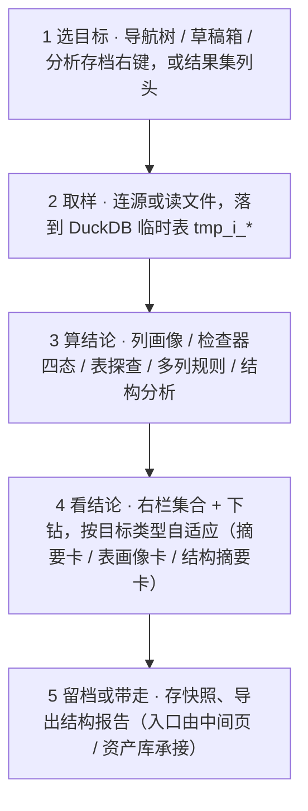
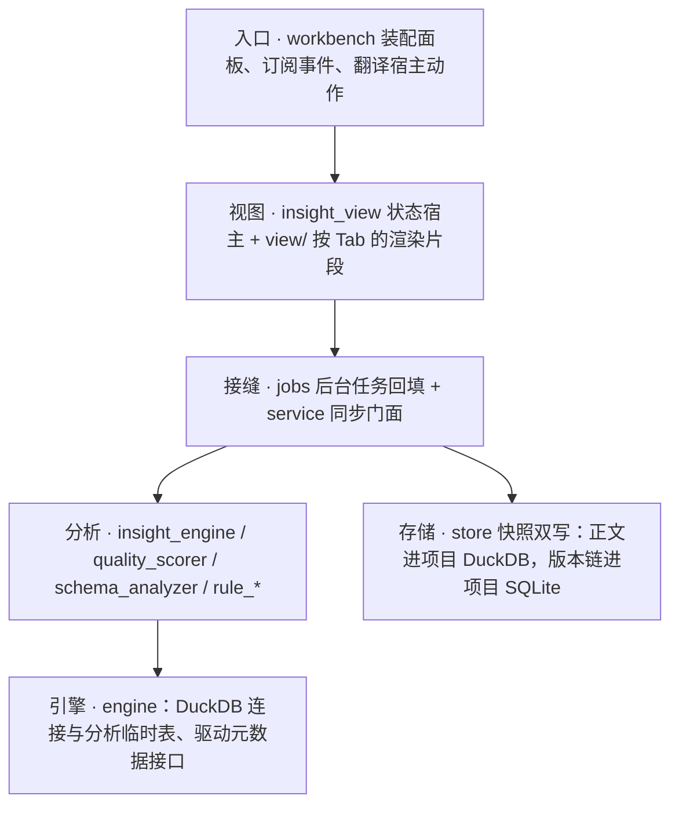

# RdataStation · 洞察（M8）—— 一页看懂

> 右 Dock 里那个**把数据变成画像事实**的地方：点一下表或某一列，画像、检查器命中、结构健康就在右边。
> **集合 + 下钻（对齐 EDA 原型）· 18 条规则 · 检查器四态事实画像 · 一条五步的闭环。**
>
> 本页是**可贴版**（纯文本 + 流程图，适合贴进 PR / wiki）；视觉版见 [`insight-showcase.html`](insight-showcase.html)（自包含、明暗双主题、离线可开，首屏的洞察面板按集合 + 下钻示意）。
> 两版的章节一一对应：视觉版把「集合 + 下钻」的示意放在首屏面板线框里，本页把它排在第 2 节。

---

## 一句话

**右键一张表——画像事实、检查器命中、结构健康就在右边；存一版，下次就知道数据变了什么。**

它不是一个「看一眼数据」的侧边栏：取样、跑规则与检查器、出画像、留档、对比，是一条完整的闭环。
**每个数字都说得出出处——说不出的就不摆。**

### 它替你做到的事

| 你关心的 | 它给什么 |
| --- | --- |
| 这列长什么样 | **四区画像**（基础统计 / 数据分布 / 规则门控提示 / 样本数据）+ **检查器四态**（命中 / 未命中 / 不适用 / 排除）事实计数；不出总分、不出等级 |
| 这张表哪几列要关注 | **表探查**：列清单（主键 / 类型 / 可空 / 缺失率）+「评估全表」逐列串行回填明细与检查器状态，进度一列列推进 |
| 这个库结构有没有坑 | **结构报告**：健康分 + 四区结论（外键候选 / 类型不一致 / 孤立表 / 冗余列）+ 表名下钻 + 导出 JSON / Markdown（结构健康分与等级为 Schema 独立域，不与表 / 列画像混用） |
| 数字可信吗 | 类型族来自**真实元数据**（驱动接口，不靠名字猜）；全空列不出分布与类型专属统计；分布画不出就说明原因；列画像另有与 DuckDB `SUMMARIZE` 的交叉校验（测试级） |
| 会不会把机器吃光 | DuckDB 连接上有**内存闸**（默认 2GB，可在设置 / 环境变量调整）、溢写进 `<RDS_HOME>/tmp`；分析临时表带 `tmp_i_` 前缀、**用完即删**；大表默认取样 500 行，全量需手动两段确认 |
| 我加的规则安全吗 | 规则 SQL 先过**解析期静态门**；项目规则再有**信任门**（未决定不装配、不执行）；如实声明：不是沙箱 |
| 结论能带走吗 | **快照**（正文进项目 DuckDB、版本链进项目 SQLite）+ 结构报告导出 JSON / Markdown |

> 数字口径以模块文档为准；工程数字（测试数量、真机清单）见第 14 节。

---

## 1. 为什么它不是一个「统计面板」

V1 留下七处「看着有、实际是假」的地方，这一版逐条换成了真东西：

| 旧样子（V1） | 现在 |
| --- | --- |
| 底部四个 Tab 容器，多个面板**压根没挂载** | 右 Dock **集合 + 下钻**（对齐 EDA 原型：洞察表集合 `it-list` + 选中目标下钻 `drillzone`，2026-10-30）+ 一个目标模型，每个目标类型都取得到数 |
| 评分卡组件在、**数据恒空** | 检查器四态真跑：命中 / 未命中 / 不适用 / 排除；**全空列不出分布**；表 / 列画像不合成总分、不出等级 |
| 历史能看、**没有保存入口** | 快照保存 / 版本对比能力保留（右栏对齐原型后入口由中间页 / 资产库承接）；双写成对，失败**回滚已写的那一半** |
| 多列分析**从未跑通** | 重新设计并实装：列序即参数序 + 类型族过滤 + 结果与门控提示同屏；数值 / 类别配对出 Pearson、Spearman、Cramér's V 等科研统计 |
| 存储用量是**前端估算** | 后端真实统计；拿不到就**整行不显示**（不编一个 0） |
| 导出 / 规则热加载 / 适用规则标签都没有入口 | 结构报告导出 JSON / Markdown；规则走**目录监听热加载**（⚙ 对话框里启停与新建） |
| `filterByValue`（按值筛选）语义错误 | 删除——洞察只做「结论」，交互式筛选属编辑器（M5） |

---

## 2. 集合 + 下钻 · 一个目标模型

同一套目标、同一套四态（空 / 加载 / 错误 / 数据）；下钻区只决定「展示哪一份载荷」，**载荷按目标类型分开存**——切回同一目标还是上次那份结果。

| 右栏区域 | 看什么 | 给什么结论 | 状态 |
| --- | --- | --- | --- |
| **集合 it-list** | 本次会话已洞察的表 | 行卡（勾选 / 表名 / 行数 + 来源 / 检查器命中 / 对比 / 关系 / 归档）；多选 ≥2 → **质量对比** | 已实装 |
| **下钻 · 表** | 一张表的列与缺失情况 | 摘要环（检查器命中）+ 表画像卡前 8 列 + 评估全表入口（工具栏 ⧉） | 已实装 |
| **下钻 · 列** | 一列的取值与分布 | 列摘要卡（类型 / 行数 / 空值率 / 样本）；完整四区画像在中间页 | 已实装 |
| **下钻 · schema** | 一个 schema 的形状 | 结构摘要卡（健康分环 + 表数 / 列数 / 问题数）；完整报告 + 导出保留待复用 | 已实装 |
| **下钻 · 多列** | 两列以上的关系 | 聚合占位（GROUP BY / 求和 / 均值 / 计数为**后续实现**）；多列规则分析保留待中间页复用 | 占位 |

> **诚实标注**：表级 / Schema 快照与「快照对比」属**二期**（那是资产管理的语义，界面与资产模型归 M6）；分析表型存档等 M6 Phase 4 的本体层。
> 没做的就不摆按钮——这套界面里没有「点了没反应」的入口。

---

## 3. 三个高光

如果只记三件事：

**① 每个数字都说得出出处。**
检查器按四态给出事实命中计数，不合成总分、不划分等级；类型族来自真实元数据；采样口径常驻写明
（「默认取样 500 行；样本值为前 5 行，直方图至少 10 行；全量需手动两段确认」）。
该没有的数字就真的没有：全空列不出分布、分布画不出说明原因、历史读不到就不显示用量。

**② 边界诚实，说不做的就真不做。**
能洞察的只有**能出现在数据库导航树上的对象**（真驱动 + 活连接）、**草稿箱 / 分析存档两块文件**，以及**编辑器里的 select 结果集**；
只能靠 `ATTACH` 或三方扩展到达的远程库不在承诺范围内。
每一句「做不到」都带着原因：无项目时规则管理与快照置灰并写明、历史视图在无项目时说「打开项目后可保存与查看快照」（入口由中间页 / 资产库承接）。

**③ 规则即文件，扩展不用改 Rust。**
18 条内置规则（列 9 · 多列 6 · 表 3）+ 三层作用域（内置 → 全局 → 项目）+ 目录监听热加载；
写一个 `*.rule.toml` 就多一种洞察（第 11 节有完整示例）。
两道安全门：规则 SQL 过解析期静态门，项目规则过信任门。

---

## 4. 四个剧本 · 它替你做什么

每一步都用现有按钮，能照着做。

### 剧本 A · 拿到一张没见过的表 → 先摸清它

| 步 | 动作 | 怎么做 |
| --- | --- | --- |
| 1 | 一眼看完这张表 | 导航树表节点右键 **查看洞察** → 下钻区表画像卡：列清单（前 8 列，含 `PK` / 类型 / 可空 / 缺失率） |
| 2 | 让全部列回填明细 | 工具栏点 **评估全表**：逐列串行，进度行写「正在评估 7/23 列…」，已算出的明细不会被清空（集合行 r2 检查器命中随之更新） |
| 3 | 挑一列细看 | 表画像卡点列名即下钻 → **列摘要卡**（类型 / 行数 / 空值率 / 样本）；完整四区画像在中间洞察工作页 |

### 剧本 B · 想知道两列的关系 → 多列分析（能力保留，入口承接中）

| 步 | 动作 | 怎么做 |
| --- | --- | --- |
| 1 | 多列目标 | 右栏多列目标当前呈现**聚合占位**（GROUP BY / 求和 / 均值 / 计数为后续实现，原型同款） |
| 2 | 规则分析 | 多列规则分析（列序即参数序 + 类型族过滤 + Pearson / Spearman / Cramér's V 等）能力完整保留，渲染入口待中间页复用 |

### 剧本 C · 接手一个不熟的库 → 结构洞察

| 步 | 动作 | 怎么做 |
| --- | --- | --- |
| 1 | 从 schema 上取结论 | 导航树 schema 节点右键 **查看洞察** → 下钻区**结构摘要卡**：健康分环 + 表数 / 列数 / 问题数（取数走驱动元数据，零方言 SQL，SQLite 也支持） |
| 2 | 看完整报告 | 结构完整报告（健康分 + 四个折叠区：外键候选 / 类型不一致 / 孤立表 / 冗余列；**空区照常渲染**——空 = 检查过、没问题）渲染保留待复用，由中间页 / 资产库入口承接 |
| 3 | 顺着表名往下看 | 报告里的表名点一下切到该表的表画像卡（取样走源取样通道，不改动数据库） |
| 4 | 交给同事 | **导出 ▾** → JSON / Markdown（导出的是你屏幕上这份结论），宿主只负责选路径写文件 |

### 剧本 D · 数据变了要交差 → 对比（现行：集合内质量对比；历史快照对比能力保留）

| 步 | 动作 | 怎么做 |
| --- | --- | --- |
| 1 | 多选对比 | 右栏打开「多选」开关 → 勾选 ≥2 张已洞察表 → **质量对比**（对每张勾选表各发一次对比请求） |
| 2 | 行内动作 | 行卡 r2 的**对比 / 关系 / 归档**：关系做跨表值重叠排查（结果区在集合底部）；归档仅已有临时表的行可点 |
| 3 | 历史快照对比 | 快照保存 / 版本对比 / 存储清理能力保留（入口由中间页 / 资产库承接）；双写成对，失败回滚已写的那一半；对比方向固定「选中 → 最新」 |

---

## 5. 一次洞察的旅程



- **入口只发意图**：点一下只改面板状态并发事件，取数在接缝（`jobs` / `service`）里做——渲染路径零 I/O。
- **结果集复用宿主临时表**：编辑器结果集本身已是宿主建的 `tmp_q_` 临时表，洞察直接复用、不重跑 SQL、不另建样本表；库表 / 文件才由洞察侧取样落 `tmp_i_` 样本表，用完即删。
- **取样口径**：库表 / 文件默认取样 500 行落样本表，全量需在工作页手动两段确认；文件类数据源的读取器与工作台共用一套（CSV / Parquet / Excel / JSON）。

---

## 6. 列画像 · 四区与检查器事实

| 区 | 内容 | 一条口径 |
| --- | --- | --- |
| 基础统计 | 总行数 / 非空 / 去重 / 极值等 | 基于当前样本表（默认 500 行；全量需手动确认） |
| 数据分布 | 数值直方图 / 布尔占比 | 样本不足或类型未识别时**说明原因**，不造假分布 |
| 规则门控提示 | 提示列表（Info / Warning 两档） | 只有未过的门控项才被点出来；没有问题就说「未发现需要提示的问题」 |
| 样本数据 | 前 5 行，`NULL` 显式呈现 | 超长值按 200 字符截断（不撑破 17.5rem 的面板） |

**检查器事实区**钉在滚动区之外（这一列的头号结论，不该滚走）：命中 / 未命中 / 不适用 / 排除四态逐条列出，命中与未命中按成功 / 危险色区分；不合成总分、不划分等级。

---

## 7. 表探查 · 列清单与评估全表

- 列清单：`#` / 列名（主键角标）/ 类型 / 可空 / 缺失率（未统计时中性「—」）；点列名即下钻到该列。
- 「评估全表」**逐列串行**（避免撞后端并发上限），按钮在评估中置灰并显示进度条与「正在评估 N/M 列…」。
- 重算**不清空**已回填的列明细（清空会让面板闪一下空白）。
- 表级事实条：检查器适用列数 / 命中列数 + 「N 列需关注」（检查器未命中列去重 ∪ 缺失率 > 20% 的列）+ 一句事实摘要；不出总分与等级。

---

## 8. 多列分析 · 列序就是参数序

- 勾选顺序 = 参数顺序（`col1` / `col2` …）；取消勾选直接从序列里移除。
- 规则可用性按**类型族**判定，不可用的规则行置灰（原因在规则行的类型提示里）。
- 结果为单值 KV 或表格；**规则门控提示只在未过时出现**。
- 失败只挂一条行内提示：表单与已有结果照旧可见（整页转错误态会让人以为表单坏了）。

---

## 9. 结构报告 · 四区与下钻

- 健康条：分数 + 等级 + 「N 表 · M 列 · 需关注 K 项」+ 摘要；**健康分与等级是 Schema 结构独立域**，不参与表 / 列画像的评分口径；右上就是**导出 ▾**。
- 四个折叠区**都渲染**（哪怕为空）：空区的意义是「检查过、没问题」。
- 表名下钻热点最多 4 个（长清单会把面板变成一条链接列表）。
- 取数只走驱动元数据接口：**没有方言分支、没有手写 SQL**——方言差异留在驱动层，所以 SQLite 也照样能用。

---

## 10. 快照与对比 · 变化看得见

- **保存**：正文进项目 DuckDB，版本链与元数据进项目 SQLite；双写失败**回滚已写入的那一半**，错误文案写清「已回滚」。
- **列表顺序**只由存储层的 `ORDER BY` 决定（渲染不再排序）；链被清理剪过的头部如实标「更早的版本已清理」，不谎称首版。
- **对比**方向固定「选中 → 最新」：最新一版不可点（没有更新的版本可比）；差值标方向、不评好坏。
- **清理**按 30 天保留期，正文与版本链成对删；回执里两侧条数对不上时转红——那是半写的信号。
- **存储用量**拿不到就整行不显示（编一个 0 会让人以为历史被清了）。

---

## 11. 规则 · 加一个 TOML 就多一种洞察

**三层作用域**（后者覆盖前者）· **18 条内置**（列 9 · 多列 6 · 表 3）· **正文以文件为唯一真相源**（进 git、可 diff、目录一改即热加载）：

```text
内置（编译期内嵌）→ {系统数据目录}/insight-rules/ → {项目}/.RSmeta/insight-rules/
```

一条规则写三段（下面是内置的「空值率检查」，节选）：

```toml
[meta]
id = "null-check"
name = "空值率检查"
category = "column"
applies_to = ["Any"]            # 任意类型都能跑

[query]
template = """
SELECT COUNT(*) AS total,
       COUNT("{col}") AS non_null,
       ROUND((COUNT(*) - COUNT("{col}")) * 1.0 / NULLIF(COUNT(*), 0), 4) AS null_rate
FROM "{table}"
"""
parameters = ["table", "col"]

[[output]]                      # SQL 列 → 界面字段 + 值类型（解析期校验）
sql_name = "null_rate"
json_name = "null_rate"
value_type = "f64?"             # 空表时 NULL：没有空值率可言

[[quality]]                     # 规则门控：读的就是上面的输出字段
field = "null_rate"
max = 0.1
severity = "warning"
message = "空值率超过 10%"
```

**校验早失败**（都在解析期，报错文案直接告诉你改哪儿）：
输出字段的 `value_type` 在白名单里 · 门控字段必须真实存在（报错会列出该规则已有的输出字段）· 一条规则被拒就是整条不加载，不会「部分生效」。

**两道安全门**：

| 门 | 挡什么 | 定位 |
| --- | --- | --- |
| 解析期静态门 | 只放行单条 `SELECT` / `WITH`；拒分号多语句、DDL 与 `ATTACH` / `COPY` 等、`read_*` 等表函数（校验前先剥字符串与注释） | **防呆**，不是安全边界——DuckDB 没有官方解析沙箱 |
| 项目规则信任门 | 项目层规则在用户做出决定前**不装配、不执行**；决定记在**全局库**（项目碰不到的地方） | 真正的边界：克隆不信任的仓库 + 打开项目是一个真实攻击面。无记录 / 查库失败一律按未决定（fail closed） |

---

## 12. 从哪儿进，能洞察什么

| 入口 | 目标 | 取样口径 | 状态 |
| --- | --- | --- | --- |
| 导航树右键「查看洞察」（2026-10-30 去重后为唯一洞察入口） | 表 / 视图 → 取样画像；schema → 结构洞察；其余节点 → 纯面板 | 连接 → 默认取样 500 行落 `tmp_i_` 样本表（全量需手动两段确认） | 已接 |
| 草稿箱行菜单 | 数据文件 | CSV / Parquet / Excel / JSON 直接读 | 已接 |
| 分析存档行菜单 | 已归档资源 | 经源取样通道（与导航树同口径） | 已接 |
| 编辑器结果集列头「洞察此列」 | 结果集的某一列 | 复用宿主 `tmp_q_` 临时表，不另建样本表 | 已接 |
| 结构报告「导出 ▾」 | 当前报告 | JSON / Markdown，宿主选路径写文件 | 已接 |
| 分析表型存档（M6 本体层） | 分析产出的表 | DuckDB 直接读本体文件 | 等 M6 P4.1 |

---

## 13. 架构 · 依赖只向下



`insight → engine → shared`；洞察不依赖任何业务 Feature crate，工作台只做装配。

| 关注点 | 落点 |
| --- | --- |
| 状态宿主（目标 / 四态 / 各 Tab 载荷 / 选择与折叠） | `crates/insight/src/insight_view.rs` |
| 渲染片段（`mod` / `header` / `overview` / `column` / `table` / `multi` / `schema` / `history` / `set` 九个文件） | `crates/insight/src/view/` |
| 规则管理对话框 · 结构报告视图 | `crates/insight/src/{rule_view,schema_view}.rs` |
| 后台取数与回填 · 同步门面 | `crates/insight/src/jobs.rs`、`service/` |
| 快照存储（双写成对回滚） | `crates/insight/src/store/` |
| 分析临时表生命周期 · 内存闸 | `crates/engine/src/duckdb/{analysis,temp_table}.rs` |
| 面板尺寸常量 | `crates/insight/src/ui.rs`（另有 `workbench_shell/ui.rs` 的通用尺寸） |

**状态只有一个写入者**：点击只改面板自身状态并发事件，数据回填全在接缝那一侧——所以「渲染一次发一次请求」这类问题在这套结构里不会出现。

---

## 14. 测试与证据

| 套件 | 数量 | 守什么 |
| --- | --- | --- |
| 洞察单测（`cargo test -p rds-insight --lib`） | **244** | 规则解析与校验 · 目标分派与状态机 / 事件契约（集合多选 / 质量对比 / 下钻分派） · 渲染冒烟 · 快照存储与版本链 · 结构分析 · 检查器四态事实 |
| 端到端集成（`--test column_profile_e2e`） | **14** | 真 DuckDB 上的列画像 · 表探查评估 · 与 `SUMMARIZE` 的交叉校验 |
| 界面契约（`--test ui_contract`） | **4** | 尺寸常量与设计值一致 · 视图模块登记 · 零裸色值 · 零裸尺寸 |
| insight crate 编译 | 零 error 零 warning | `cargo check -p rds-insight --all-targets` |

**真机**（需要环境变量，缺了就跳过）：

- `insight_schema_real`：结构洞察四库全绿——MySQL **47 表 / 318 列** · PostgreSQL **25 / 144** · SQLite **27 / 125** · DuckDB **10 / 27**
- `insight_source_real`：源取样四库 + **扩展源**（Oracle 经扫描器）的机制回归
- `insight_editor_entry`：编辑器结果集入口端到端（含真机腿）

**真机抓出来的真缺陷**（都已修 / 结案）：

- 洞察取数照 JSON 契约读引擎结果 → 恒得空行（结构洞察与源取样全空；改为进程内直读列与行）
- 洞察门面自建一次性 runtime × 宿主 sqlx 池 → PostgreSQL 下一条语句卡 **30 s**（改进程级单例 runtime 后 30.2 s → **16 ms**）
- MySQL `information_schema` 的元数据**列名全大写**，按小写找列会一个都读不到
- 类型族判定没剥 `UNSIGNED` → 数值列被判成未知

---

## 15. 边界 · 这些事它不做

**明确不做**（把这些交给对应的模块）：

- **不做 SQL 执行与结果集**——那是编辑器（M5）：洞察不画网格、不做交互式筛选（V1 的按值筛选语义错误，已删）。
- **不做对象树与元数据内省**（M4）：导航树上看到什么，取决于导航模块；洞察只管把拿到的元数据变成结论。
- **不做连接与运行态**（M3）：连不上时如实报原因，不自己重连或换库。
- **结果集复用宿主临时表**：编辑器结果集本身已是宿主建的 `tmp_q_` 临时表，洞察直接复用、不重跑 SQL；结果集临时表的生命周期归宿主管理，洞察侧只持有表名引用。
- **不做表级 / Schema 快照与快照对比**（二期）：语义属资产管理，界面与资产模型归 M6；差异计算与存储继续复用洞察这一套。

**如实声明**：

- 解析期静态门是**防呆**不是沙箱；信任门绑定项目**路径**而非内容（`git pull` 带进来的新规则不会重新确认）——这是有意的取舍。
- 只能靠 `ATTACH` 或三方扩展到达的远程库**不在**承诺范围内（扩展能读到的源确实能洞察，但那是机制能力，不是边界口径）。

**还没做的（都记在册，详见 `insight-dev-plan.md` §10）**：解析级 SQL 策略门控（替代关键字黑名单）· Kendall τ 秩相关 · 分组聚合统计面板 · 200+ 列虚拟列表 · 表 / 列表达式规则 · 多列真并发取数对比 · 分析表型存档入口（等 M6 P4.1）· 科研统计扩展层（正态检验 / ANOVA / 效应量，DuckDB 社区扩展选型二期再定）；表级 / Schema 快照归 M6 资产库。

---

## 16. 文档地图

| 文档 | 什么时候读 |
| --- | --- |
| [`README.md`](README.md) | 模块入口：一句话定位 · 边界 · 代码地图 · 硬约束 · 文档地图 |
| [`insight-architecture.md`](insight-architecture.md) | 为什么这样设计：九条不变式 · 分层与归属 · 状态所有权 · 数据流 · **D1–D66 决策表** · 已知问题 K1–K22 |
| [`insight-dev-plan.md`](insight-dev-plan.md) | 做什么、做到哪：§0 进度记录（逐批带验证数字）· Phase 0–5 任务与落点 · **§10 收口清单（权威）** · §11 视图位移 |
| [`insight-user-guide.md`](insight-user-guide.md) | 怎么用：入口 · 界面导览与怎么看数字 · 典型流程 · **§4 规则编写指南（对外契约）** · FAQ |
| [`insight-eda-prototype.html`](insight-eda-prototype.html) | 现行交互原型基准：右栏集合 + 下钻（**2026-10-30 真机已对齐**）、列卡四区、多列配对与对比视图；旧 `insight-prototype-design.md` / `insight-prototype.html` / `insight-workspace-prototype.html` 为早期废弃稿，不再作对齐基准 |
| [`insight-showcase.html`](insight-showcase.html) | 本页的**视觉版**：首屏面板展示右栏集合 + 下钻，卡片化排版 + 吸顶导航 |
| [`insight-extension-notes.md`](insight-extension-notes.md) | 实现手段与第三方扩展调研（含不引扩展也能拿的统计量） |

> 宣传稿的铁律：**数字只为表达服务，口径以模块文档为准**（本页数字快照 2026-10-25）。改了实现请顺手核对本页的关键数字（6 / 18 / 4 与第 14 节基线 244 / 14 / 4）。
