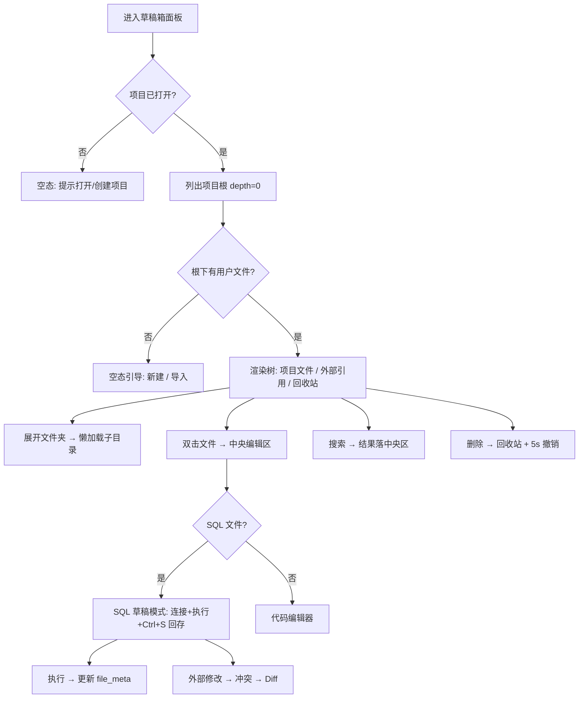
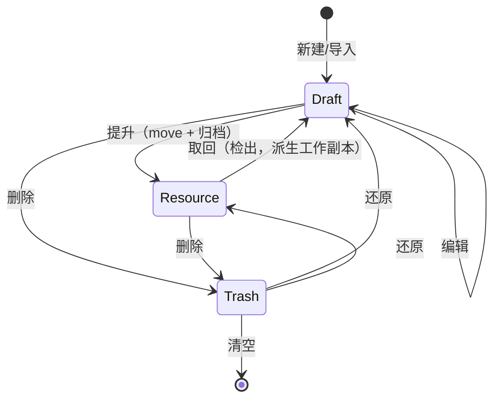

# 草稿箱模块 · 原型设计（项目工作区）

> 状态：**模块根 + 项目级回收站 + 面板自身闭环 + 导入/引用/右键菜单/键盘导航 + 内容搜索（高亮/替换）+ 新建模板 + 文件夹递归复制 + 虚拟列表/空态 已落地**（2026-09-15） · **2026-10-10 批次：文件类型图形图标（微标）、内容搜索抽独立 crate `rds-search`（第二阶段：渲染面板迁入，VSCode 式文件分组+命中数+行号命中行）、替换入口恢复、属性弹窗改 gpui-kit Dialog、树行只显大小、移除新建模板、移除剪贴板工具栏**（详见 §2.1/§3/§4.3/§4.4/§6.3/§7） · 关联文件：`scratchpad-prototype.html`（可交互原型）、`scratchpad-dev-plan.md`（开发方案与进度）、`crates/scratchpad/README.md`（crate 入口与特点提炼）
> 参考基准：v1 实现（`v1/backend/src/core/scratchpad`、`v1/frontend/extensions/builtin/scratchpad`）与设计（`v1/docs/backend/SCRATCHPAD_DESIGN.md`、`SCRATCHPAD_SCHEMA.md`、`v1/docs/frontend/SCRATCHPAD.md`）
> 布局服从 `docs/architecture/layout/layout-design.md`（五段布局，左侧 Dock 240px，`LeftPanel::Draft`）；配色服从 `docs/architecture/theme/theme-design.md`（RDS Light/Dark，`assets/themes/rds-theme.json`）
> 技术栈：GPUI（gpui-kit 0.7.1），组件消费 `cx.theme()` 语义 token，**代码零裸 hex**

## 1. 设计基准与 v2 语义变更

| 维度 | 基准 | 说明 |
| --- | --- | --- |
| 布局 | 五段布局（已定） | 草稿箱 = 左侧 Dock 内容，`LeftPanel::Draft`，起步宽度 240px（可拖拽调宽） |
| 后端 | `crates/scratchpad`（已迁移） | `models` / `state` / `store`，47 个方法（列表/CRUD/回收站/搜索/替换/Diff/外部引用/可分析文件） |
| 交互蓝本 | v1 `ScratchpadPanel.vue` + `TreeNode` | 工具栏 / 分层树 / 内联创建重命名 / 右键菜单 / 回收站 / 搜索上下文 / 多选 / 撤销栏 |
| 配色 | `theme-design.md` | 侧栏 `sidebar`、选中 `list.active` + coral 左边条、弹层 `popover`、主按钮 `primary` |
| 主题 | `rds-theme.json` | 复用标准字段，尽量不新增产品语义 token（见 §6） |

### 1.1 核心模型：模块独立根目录

v1 的草稿箱是项目下的隐藏子目录 `{project}/.scratchpad/`。v2 定稿为 **每个模块在项目根下拥有一个可见的内容目录**（模块中心）：

- **草稿箱根 = `{project}/scratchpad/`**（可见、可编辑），面板只展示此目录内的内容——「在 `scratchpad/` 里的就是草稿」，无需忽略规则、无需扫描整个项目。
- 草稿箱**内部元数据**（配置/文件元数据）落 `.RSmeta/scratchpad/`，不进内容目录。
- **回收站为项目级 `.RSmeta/trash/`**，收录草稿与资源等模块删除的条目（自带来源信息，见 §9）。
- 未来 `resources/`（M6 分析资源）、`mock/`（M7）同样是项目根下的模块目录。

```
{project}/
├── scratchpad/                      ← 草稿箱根（模块内容，可见）
│   ├── data/report.sql
│   ├── 临时订单分析.sql
│   └── sample.csv
├── resources/                       ← M6 分析资源（后续）
├── mock/                            ← M7 Mock 产物（后续）
└── .RSmeta/                         ← 隐藏：项目内部元数据
    ├── project.db / project.json / analytics.duckdb
    ├── session/                     # 编辑器标签/未命名缓冲区（后续）
    ├── scratchpad/config.json       # 草稿文件元数据 + 外部引用
    └── trash/                       # 项目级回收站（草稿 + 资源）
```

> 设计取舍：保留面板名「草稿箱」（活动栏图标 / Quick Open `打开草稿箱` 命令已注册）；「草稿」与「正式资产」由 **`scratchpad/ → resources/` 的提升（存档）机制** 区分（§9.3）。

## 2. 面板布局（240px 左 Dock）

草稿箱面板嵌入左侧边栏，结构自上而下五段：**面板头 / Toolbar / 文件名过滤输入行 / Accordion 主体（项目 · 草稿，内嵌 Tree）/ Accordion 底部（引用 / 垃圾箱）**（2026-10-11 按用户描述重构：主体 Tree 也包 Accordion；搜索框从常驻改为工具栏「⌕ 搜内容」入口 + 工具栏下方新增「⌕ 搜文件」输入行；引用/垃圾箱从树内分组移入底部 Accordion；删除底部统计条）。宽 240px。

```
┌ 左侧边栏 240px（sidebar 底）──────────┐
│ 草稿箱                          [◂]  │  ← 面板头（Dock tab，36px；◂ 折叠侧栏）
├ Toolbar（gpui-kit Toolbar）──────────┤
│ 左：[⌕搜内容][＋][🗀][🔗引用][⬇导入]│
│ 右：[⇅排序][↻刷新][⋯更多设置]        │  ← ⋯：自定义按钮显示与位置（左/右）
├ 文件名过滤输入行（⌕ 搜文件）─────────┤
│ [搜索文件…]                    [⌕]        │  ← 图标在框外右侧；Enter 或点击图标执行
├ Accordion 主体（占满余高，自身滚动）─┤
│ ▾ 营销分析 · 草稿 (6)                │  ← 项目名 · 草稿（或仅「草稿」），标题即根语义
│   ▾ 🟧 data                          │  ← 文件夹：folder 图标 + 展开/折叠箭头
│     ▸ 🟧 raw                        │  ← 缩进对齐、长名截断
│     🗄 sample.csv          1.2 MB    │  ← 文件：按扩展名映射图形图标（微标）
│   🗄 临时订单分析.sql   1.2 MB ●     │  ← 选中左边条 + 脏点；行尾只显大小
│   🐍 transform.py         4 KB      │
│   📄 README.md [guide]    2 KB      │  ← 节点可附加 YAML 标签
├ Accordion 底部───────────────────────┤
│ ▾ 引用 (2)                          │  ← 逻辑引用（软连接）：路径+别名
│ ▾ 垃圾箱 (3)  [清空]                │  ← 逐项可「恢复」
└──────────────────────────────────────┘
```

> 与上一版原型的差异（2026-10-11 按用户描述三次修正）：① **主体 Tree 也包 Accordion**——区块标题「项目 · 草稿」（标题即根语义，树内不再重复 scratchpad 根节点），可折叠；② 搜索图标**统一为 ⌕**（搜内容/搜文件同一图标，靠位置与 tooltip 区分）；③ 文件名过滤输入行的 **⌕ 图标在框外左侧**（不在输入框内），**Enter 或点击图标执行**过滤；④ **草稿 = 主体 Tree**（scratchpad 根层级目录树）；⑤ **导入 = 复制动作**（点击工具栏 ⬇ 弹窗选择文件 → 复制进 scratchpad/），**无独立 Accordion 区块**；⑥ **引用 = 逻辑引用（软连接）**，点击工具栏 🔗 弹窗输入「路径 + 别名」，列表在 Accordion「引用」区块；⑦ 底部 Accordion 仅剩 **引用 / 垃圾箱**；⑧ 删除底部统计条（计数并入状态栏）。

### 2.1 工具栏

| 侧 | 按钮 | 行为 | 对应后端 |
| --- | --- | --- | --- |
| 左 | `⌕` **搜内容** | 进入/退出全文搜索状态（侧栏整体切换为搜索面板：顶部 Toolbar + 垂直表单（Aa/ab/.*、AB 内嵌输入框，全部替换 ⇄ 图标，⋮/▾ 折叠包含/排除字段）+ 结果树（目录/文件节点 hover 替换操作）；结果落中央「搜索: query」独立标签页 | `enqueue_search` / `rds-search` |
| 左 | `＋` 新建文件 | **内联输入文件名**（自动补后缀；2026-10-10 起**无模板 chip**——不再提供 SQL/Markdown/JSON 模板，后续自设计的分析文件类型单独做引导）；落点 = 选中的文件夹（未选中文件夹则模块根，与粘贴一致） | `create_entry` + `save_file` |
| 左 | `🗀` 新建文件夹 | 同上，类型为目录（同样落在选中文件夹内） | `create_entry(is_folder)` |
| 左 | `🔗` **引用入口** | 弹窗输入「路径（文件或目录）+ 别名」→ 只记路径（**不复制**，软连接语义）；列表在 Accordion「引用」区块 | `add_external_reference` |
| 左 | `⬇` **导入入口** | 弹窗选择外部文件（系统文件对话框）→ **复制**进草稿箱（选中文件夹则复制到该文件夹） | `import_external_file` |
| 右 | `⇅` 排序 | 名称/大小/修改时间，点击循环并切换升降序 | 前端计算 |
| 右 | `↻` 刷新 | 重新拉取根目录 | `list_local_entries(0)` |
| 右 | `⋯` **更多设置** | 菜单：自定义**工具栏按钮显示与位置**（每个入口可隐藏或调左/右），持久化到用户配置；含「重置为默认布局」 | 用户配置 |

> 工具栏下方另有「⌕ 搜文件」输入行（非按钮）：**图标在框外右侧**（不在输入框内），输入文件名后 **Enter 或点击图标执行**过滤；与「⌕ 搜内容」统一图标（2026-10-11 用户要求：无更优区分图标时可同一图标），靠位置与 tooltip 区分。
> 剪贴板工具栏（`✂`/`⧉`/`📋`/`🗑` 第 2 行）已于 2026-10-10 按用户要求移除；剪切/复制/粘贴/删除仍可从右键菜单与键盘触发（state 层方法保留，见 §4.4）。

### 2.2 导入 vs 引用（本质差异，务必区分）

| | 导入 | 引用 |
| --- | --- | --- |
| 物理行为 | **复制**进 `{项目}/scratchpad/` | **只记路径 + 别名**，不复制 |
| 归属 | 成为草稿本体 | 源文件仍在外部，草稿箱只是入口 |
| 项目迁移 | 随项目带走 | 可能失效（需可用性探测） |
| 体积 | 计入项目 | 不计入 |
| 失效处理 | — | 置灰 + 「（丢失）」，可重新引用 |
| 典型场景 | 随手写的 SQL / 测试数据 | 「下载目录的临时数据」「外部数据仓」 |

- 引用可指向**文件或目录**；别名可自定义、可后续改名（`rename_external_reference`）；可「在文件管理器中打开」（`open_in_system_explorer`）。
- 导入只导入文件（多选）；目录导入与文件夹递归复制待补。

### 2.3 空态

项目根无任何用户文件时显示引导（大图标 + 标题 + 说明 + 「＋ 新建」「🗀 文件夹」「⬇ 导入」按钮），避免 240px 版面显得空洞；搜索无结果时只显示一行「没有匹配的文件」。

## 3. 树与分组

- **主体 = Accordion「项目 · 草稿」区块内嵌 Tree 树形组件 = 草稿**（2026-10-11 按用户描述：`Tree/TreeItem` 承载项目文件节点，**草稿 = scratchpad 根下的层级目录树**；Accordion 标题即根语义，树内不再重复 scratchpad 根节点）：`ScratchpadEntry` 树；初始 `depth=0` 懒加载，展开文件夹时按需 `list_directory_entries(parent)`（子目录缓存），后端 `MAX_DEPTH=4` 仅作内容搜索 / 递归复制的遍历上限。文件夹节点带展开/折叠箭头，文件节点绑定类型图标（微标）；交互：点击展开/折叠、选中、hover 高亮；节点可附加 YAML 标签（如 `[guide]`）、自定义图标、文件名文本；适配长文件名截断、节点缩进对齐、深色主题。
- **滚动与虚拟化**：文件树是面板**唯一滚动区**（`v_virtual_list`，只渲染可视区行，`item_sizes` 按行高逐行给出，重命名行用控件高、内联新建文件行再加一行模板 chip 块 `SCRATCHPAD_ROW_CHIPS`）。
- **底部 = Accordion 折叠面板**（2026-10-11 新增，gpui-kit `Accordion`）：两个独立折叠区块——**引用**（`ExternalReference{ alias, path }` 平铺列表，标题带计数；**软连接语义：只记路径 + 别名，不复制**）/ **垃圾箱**（回收站，标题带计数；展开后逐项「恢复」+「清空」）。每个区块自带折叠箭头、标题可自定义、点击展开/收起。**草稿 = 主体 Tree（不设区块）；导入 = 复制动作（不设区块）**。
- **外部引用**（在 Accordion「引用」区块）：`external_reference_status()` 探测路径存在性，失效项置灰 + 「（丢失）」+ 「⟲ 重新引用」。
- **行视觉**（Tree 行）：
  - 选中：`list.active` 底 + 左侧 2px `list.active.border`（品牌 coral）条
  - 悬停：`list.hover`，**只在未选中时生效**（不得盖掉选中底色）
  - 展开指示：12px `chevron-right/down` **图标**（与导航树统一，2026-09-20）；文件/文件夹另有**类型图形图标**（微标，`scratchpad_type_icon`，2026-10-10 由色点升级为图形图标，见 §6.3）——两者是两个通道，互不影响
  - 行尾：文件只显示「大小」（相对时间 2026-10-10 移除，时间在属性弹窗看），文件夹显示「N 项」（子项数）
  - 行操作：仅在选中行显示（`↗` 打开位置 / `✎` 重命名 / `✕` 删除）
  - 脏点 `●`：待编辑器宿主（Phase C）提供

> 实现状态（2026-09-20）：行态与导航侧**已统一**——选中底改取 `list.active`（与 `sidebar.accent` 在主题里同值，纯语义统一）、悬停只在未选中时生效、展开指示改 12px chevron 图标（类型图标不变：它是另一条通道，见 §6.3）。
> 实现状态（2026-10-10）：文件行 meta 只显大小（如 `1.2 MB` / `92 B`）；文件/文件夹类型图标按 `scratchpad_type_icon` 映射（sql→database、log→file-terminal、py/js/rs→file-code、md→file-text、json→braces、csv→table、toml→settings、html/css→对应、无扩展名→file；文件夹→folder），图标资产在 `assets/icons/`。

## 4. 核心交互

### 4.1 新建 / 重命名（内联，非模态）

- 新建：选中文件夹 → 工具按钮（或 `Ctrl+N`）→ 树中该目录下插入输入框（并自动展开），Enter 提交、`✓`/`Escape` 取消；未选中文件夹则建在模块根。
- 模板：**2026-10-10 起移除**——不再提供 `SQL / JSON / Markdown / Python` 模板（用户明确不需要）；新建只输入文件名（自动补后缀）。后续自设计的分析文件类型落地后再做简单引导。
- 重命名：右键「重命名」或 `F2` → 行内输入框；提交时输入禁用 + 旋转指示，防重复提交；空值不提交。

### 4.2 打开文件（已接：双击 / `Enter` / 右键「打开」）

```
双击文件（或 Enter、右键「打开」）
  → 置位 Shared::open_file_request = 绝对路径
  → 宿主消费 → editor::persist::open_file → 中央编辑区新标签
        · 同路径已打开：只激活该标签，**不重读**（重读会冲掉未保存的编辑）
        · 模式与只读等级由编辑器按路径自行判定（编辑器无根）
        · 打开失败 → 通知栏提示
```

**待补**：SQL 草稿模式绑定连接（`file_meta.last_connection_id` 回填）——属性弹窗已预留「数据库连接」行（现显示 `—`，分析文件类型落地后回填）；系统文件拖入树导入（无 OS 拖放入口，暂用工具栏 `⬇`）。

目标形态（按后缀分派的工作项，当前由编辑器自行判定）：

```
.sql  → SQL 编辑器草稿模式：标题 = 文件名；Ctrl+S 回存 `scratchpad/`（原子写）
        保留连接选择与完整执行引擎；自动恢复 file_meta.last_connection_id
.py/.json/.md/.txt → 代码编辑器（语法高亮）
其他 → 交系统默认程序（当前仍由编辑器判定）
```

> 同一文件不重复开 Tab，已存在则聚焦（已实现）。

### 4.3 搜索（两种模式，重结果落中央区）

- **搜索状态布局（2026-10-11 用户详细描述 + 当日修正，原型已实现可交互演示）**：点击工具栏「⌕ 搜内容」→ **侧栏整体切换为搜索面板**（工具栏 + 目录树消失；← 返回文件树。用户原话「工具栏和目录树整体消失，或者是另一个 tab 都可以」，原型采用前者）：
  - **顶部 Toolbar**：最左 **← 返回**（退出搜索状态）+ 右侧 IconButton 组——刷新 ↻、清除结果 ✕、**新建编辑器查询 ⤢**（打开中央「搜索: query」独立 Tab）、**▸ 展开/折叠下方匹配明细**（2026-10-11 修正：复制 ⧉ 与「展开选项 ▾」已移除；「展开/隐藏」语义 = 匹配明细显隐；包含/排除字段折叠仅由替换行 ⋮ 控制）。
  - **垂直表单（4 个 TextField；Label 即输入框 placeholder——「搜索/替换/包含的文件/排除的文件」）**：
    - **搜索**输入框：**Aa 区分大小写 / ab 全字匹配 / .\* 正则三个 ToggleButton 在输入框内部右侧**（VSCode 式内嵌图标）；
    - **替换**输入框：**AB 保留大小写 Toggle 在输入框内部右侧** + **「全部替换」用图标 ⇄**（tooltip 提示）+ **⋮ 三个竖点**（展开/隐藏包含/排除字段开关）；
    - **包含的文件** glob 输入框（右侧 IconButton：✎ 编辑 / 👁 查看）、**排除的文件** glob 输入框（右侧 IconButton：⚙ 设置）——两行收在 ⋮ 控制的折叠区（**默认隐藏**，2026-10-11 用户补充；点击 ⋮ 展开）；**点击 glob 输入框即显示样例行**（包含 = `样例：*.sql, src/**/include（空 = 全部）`；排除 = `样例：*.log, .git/（空 = 不排除）`），失焦隐藏。
  - **统计行**：`3 文件中有 5 个结果 · 扫描 16 个文件` + 操作链接「在编辑器中打开」（Hyperlink，跳首个命中）。
  - **结果树（复用 Tree/TreeItem，树状结构；命中片段不带行号）**：目录节点（▾ 目录名）→ 文件节点（类型微标 + 文件名 + 圆形数字 Badge 命中数）→ 命中代码片段预览行（匹配关键字 **Highlight** 背景高亮；点击跳编辑器对应行）；**hover 行尾操作图标（2026-10-11 修正：文字按钮改图标按钮）**——文件节点 **⇄ 替换 / ✕ 取消**（替换该文件内匹配）、文件夹节点 **⇄ 全部替换 / ✕ 取消**（替换该目录下全部匹配），均可点击应用；整体 **ScrollArea** 滚动。
- **编辑器内全局搜索结果预览视图（2026-10-11 用户描述，独立 EditorTab 全屏形态）**：外层 EditorTab 标签容器（「搜索: created_at」，与文档 tab 并列），主体 ScrollArea；顶部搜索栏 = TextField（回显关键词，**可直接改词实时重搜**）+ ToggleButton（Aa / ab / .*）+ **Badge 当前匹配项序号** + IconButton 列表菜单（切换视图布局 / 导出结果）；统计 Label `5 个结果 - 3 文件`；内容 = 文件标题 **Hyperlink**（点击直接打开目标文件并定位首个匹配）+ **CodeBlock 代码预览块**（内置行号 Label + 代码文本 + Highlight 命中着色 + SyntaxLabel 语法着色：关键字/字符串/数字分色）；点击任意代码行 → 打开文件精准定位至当前行；Toggle 切换规则动态刷新结果。同一搜索能力的两种展示形态（侧栏面板 = 输入+树上折叠浏览；编辑器 Tab = 大面积浏览命中片段、不占侧栏空间）。
- **文件名模式**（默认）：输入实时过滤树（匹配名称；命中子树自动展开）。
- **内容模式**：`.*` 切正则、`Aa` 切大小写敏感、`⏎`（或输入框 Enter）运行；调 `search_directory`（`rds_search`，严格白名单正则循环外编译一次；`BufReader` 逐行 / 30s 单文件超时 / 500 条截断 / 深度 ≤4 / 跳隐藏）。
- 结果（匹配行 + 上下文 + `match_spans`）写入 `Shared::scratchpad_search`，由**中央「搜索: query」独立标签页**渲染——**2026-10-10 起渲染面板迁入独立 crate `rds_search::view`**，并在同日升为**中央 Dock 独立 tab**（`SearchResultsHostPanel`，仿属性面板 `PropertyHostPanel` 模式：面板单实例 + 弱句柄 + `WorkbenchView::render` 检测 `scratchpad_search` 有值且面板未建 → `cx.defer_in` 建面板聚焦；与打开的文档 tab 并列，VSCode 全局搜索形态），侧栏只承载输入与开关。
- **VSCode 对齐（2026-10-10，用户截图 a9538a48）**：侧栏 = 搜索框 + **替换行**（`替换为 [输入] [全部替换]`）+ **高级选项**（**默认展开**：**包含的文件 / 排除的文件** glob 输入，**每项一行 = label 左 + 输入框右**（VSCode「包含的文件 [输入框]」同行形态；修复上轮 label 上/input 下的上下排列）；空 = 不限定；`glob_matches`：`*` 跨目录、`?` 不匹配分隔符、相对路径全串匹配、扫描即过滤）；搜索框下方**统计行** `N 个文件中有 M 个结果 · 扫描 X 个文件`（VSCode「6 文件中有 2092 个结果」；M = 命中行数，N = 去重文件数）；中央标签页 = **去卡片平铺**：tab 标题 = `搜索: query`，内容区头部**不再重复大标题**（2026-10-10 VSCode 对齐）——首行 = 统计行 + `在编辑器中打开`（跳首命中）+ `关闭` 按钮，文件头 = **类型图形微标 + 完整相对路径 + 命中数角标**（点击跳该文件首个命中），命中明细行缩进（行号 + 命中行高亮，点击跳行）。
- **Dock tab 栏常显（2026-10-10 用户截图：搜索 tab 单独存在时"没有展开页面"）**：默认 `PanelStyle::Auto` 单面板只画简单标题、不画 tab 栏；`WorkbenchView::init_workspace` 改设 **`PanelStyle::TabBar`**——**总是显示 tab 栏**（单 tab 也显示「搜索: query」标签 + ✕，VSCode 编辑区/搜索结果恒有标签页形态；编辑区/左侧面板同步受益）。
- **关闭语义（2026-10-10 用户拍板）**：搜索标签页 tab ✕ = **只关标签页、保留结果**（`Shared::scratchpad_search` 不清空，`search_results_dismissed` 标志置位，`WorkbenchView::render` 不再自动重建）；**再次搜索**（新结果到达）自动清标志 → 重建标签页并聚焦；面板内「关闭」按钮仍 = 清空结果（显示空态）。
- **动作按钮图标化（2026-10-10 用户点名，已写入前端 skill）**：查找/替换/正则/大小写/运行这类动作按钮**用图标**（`IconName::Search / Replace / CaseSensitive`）**配 tooltip 悬浮提示**（gpui-kit 组件）代替文字标签；「全部替换」「在编辑器中打开」等按钮带 tooltip 提示等效快捷键。
- **过滤态联动**（已实现）：文件名过滤命中时树行显示命中数角标；点击命中文件 → 打开该文件的命中明细（结果落中央「搜索: query」标签页）。
- **替换**（入口在**侧栏搜索面板**，2026-10-10 起替换栏不在中央结果视图）：搜索框下方 `替换为 [输入] [全部替换]`（或替换输入 Enter）；逐文件 `replace_in_file`（正则模式支持 `$1` 分组，字面量模式不解析 `$`）→ 原子写回 → 任务内自动重搜刷新结果；只读项目拒绝；空替换内容拒绝。替换入口于 2026-10-10 恢复（误删后找回）。

### 4.4 文件与引用操作

| 操作 | 行为 | 后端 |
| --- | --- | --- |
| 新建 / 重命名 | 内联输入（✓/✕，Enter 提交）；不选中文件夹时建在模块根 | `create_entry` / `rename_entry` |
| 删除 | 多选批量→**项目级**回收站 `.RSmeta/trash/`；底部撤销栏（5s 自动消失） | `delete_entry` / `restore_from_trash` |
| 剪切移动 | ✂ 后 📋 → 移入选中文件夹（未选文件夹则根） | `move_entry` |
| 复制 | ⧉ 后 📋 → 生成 `_copy` 副本（文件与**文件夹递归**均支持；复制到自身子树被拒） | `copy_entry` |
| **导入** | 系统文件对话框（多选）→ **复制**进草稿箱 | `import_external_file` |
| **引用** | 选文件或目录 → 自定义别名 → **只记路径**；可改名 / 打开 / 移除；失效项置灰 + 「（丢失）」+ `⟲` **重新引用**（只改路径） | `add` / `rename` / `remove` / `update_external_reference_path`、`external_reference_status` |
| 打开所在位置 | 系统文件管理器定位（草稿项与引用项均可） | `open_in_system_explorer` |
| 用系统应用打开 | 调系统默认程序打开（`ShellExecuteW`；2026-10-10 语义澄清后保留） | 宿主命令 |
| **属性** | 右键「属性…」→ **gpui-kit Dialog**（6 行键值：类型 / 路径 / 大小 / 修改时间 / 创建时间 / 数据库连接，信息量小不用右侧 panel；遮罩点击 / Esc 关闭） | `fs::metadata` + `Shared::scratchpad_file_info` |
| 多选 | Ctrl 点选 / Shift 范围 / Ctrl+A 全选 | 前端 |

> 导入与引用的区别见 §2.2（复制 vs 链接）。

### 4.5 编辑态与冲突

- `Ctrl+S` 原子写回项目文件；文件监控（`notify`）发现外部修改 → 冲突对话框（重新加载 / 忽略），并置脏点。
  - 实现口径（2026-09-17）：冲突以**冲突条**（侧栅，差异 / 重载 / 忽略）+ **中央编辑区 Diff 面板**（左=磁盘 / 右=编辑器，行号 + 红/绿）呈现，与「重结果落中央编辑区」同一分工；要改成真模态对话框需挂宿主 `open_dialog` 层（待拍板）。
- 拖拽文件节点到中央编辑区 → 插入文件内容到光标处。✅ 已接（2026-09-17，载荷 `shared::InsertFileDrag`；只带路径，落点现读）。
- **Diff 对比**：冲突时「查看差异」→ `diff_with_content`（`similar` 行级）→ 弹窗红/绿标记 → 接受右侧。✅ 已接（差异落中央编辑区；「重载」= 接受磁盘侧）。
- **搜索替换**：入口在**侧栏搜索面板**（替换行 + 高级选项，见 §4.3；2026-10-10 起中央结果视图不含替换栏）；替换任务 = 先搜 → 逐文件写回 → 重搜一次完成（`replace_in_file`，支持正则与大小写）→ 刷新结果。

> 实现状态（2026-09-17）：替换栏、脏点、冲突 Diff、拖入编辑器均已落地；
> 仍待补：**系统文件拖入树导入**（无 OS 拖放入口，暂用工具栏 `⬇`）、命中跳转到具体行。

### 4.6 提升为分析资源（存档）

右键「提升为分析资源」→ **移动**到 `resources/` 并**归档锁定（只读）**；数据源绑定/来源随文件归档。想修改只能从资源管理处**取回**（检出）为草稿工作副本（§9.3）。跨模块协作走 **command / event**，草稿箱不直接依赖分析资源模块的视图。

### 4.7 键盘与右键

| 输入 | 行为 | 状态 |
| --- | --- | --- |
| `Ctrl+A` | 全选已加载条目（`scratchpad` key context） | ✅ |
| `F2` | 重命名唯一选中项 | ✅ |
| `Delete` | 删除选中（批量，含撤销栏） | ✅ |
| `Escape` | 取消内联编辑 | ✅ |
| 双击 | 文件：在编辑器中打开（同路径只激活、不重读）；文件夹：展开折叠 | ✅ |
| 右键 | 行上下文菜单：**打开** / **在文件管理器中显示** / **用系统应用打开** / **属性…** / 重命名 / 剪切 / 复制 / 删除 | ✅ |
| `↑↓` / `Enter` / `Ctrl+N` | 树内键盘导航（选中项自动滚入视口）/ **Enter：文件→编辑器，文件夹→展开折叠** / 新建文件 | ✅ |

> 快捷键绑定在 `scratchpad` key context（`crates/workbench/src/commands.rs` + `crates/app/src/main.rs`）；点击行会聚焦面板，使快捷键生效。

## 5. 关键帧与状态流



## 6. 主题映射（token → 视觉）

> 实现时色值只存在于 `assets/themes/rds-theme.json`，GPUI 组件经 `cx.theme()` 读取，**禁止写裸 hex**（`theme-design.md` §5）。

### 6.1 容器与导航

| 元素 | Token | RDS Light | RDS Dark |
| --- | --- | --- | --- |
| 面板底 | `sidebar.background` | `#F3F3F3` | `#252526` |
| 面板头 | `tab_bar.background` / `sidebar.background` | `#F3F3F3` | `#252526` |
| 分隔线 / 边框 | `sidebar.border` / `border` | `#E7E7E7` / `#D4D4D4` | `#3C3C3C` |
| 正文 / 弱文字 | `sidebar.foreground` / `muted.foreground` | `#616161` / `#8E8E8E` | `#CCCCCC` / `#8A8A8A` |
| 行悬停 | `list.hover.background` | `#F0F0F0` | `#2A2D2E` |
| 行选中底 | `list.active.background` | `#E4E4E4` | `#37373D` |
| 选中左边条 | `list.active.border`（品牌 coral） | `#C25B46` | `#E8846F` |
| 工具图标（常态/悬停） | `muted.foreground` / `foreground` | `#8E8E8E` / `#333333` | `#8A8A8A` / `#CCCCCC` |
| 搜索输入框 | `background` + `input.border`；聚焦 `caret`/`primary` | `#FFFFFF` / `#D4D4D4` | `#1E1E1E` / `#3C3C3C` |
| 脏点 `●` | `primary.background` | `#C25B46` | `#E8846F` |
| 右键菜单 | `popover.background` / `popover.foreground` + `border` | `#FFFFFF` / `#333333` | `#252526` / `#CCCCCC` |
| 撤销栏 | `popover.background` + `border`；按钮 `primary` | — | — |
| 危险项（清空回收站/删除） | `danger` | `#DC2626` | `#F14C4C` |
| 成功（导入/提升） | `success` | `#16A34A` | `#89D185` |

### 6.2 分组头与徽标

| 元素 | Token | 说明 |
| --- | --- | --- |
| 分组标题（项目文件/外部引用/回收站） | `muted.foreground` + 字号 11px | 全大写/加粗由样式决定 |
| 计数徽标 | `muted.background` 底 + `muted.foreground` 字 | 胶囊样式 |
| 外部引用图标 | `info` | 路径引用语义 |
| 回收站图标 | `muted.foreground` | 非危险常态 |

### 6.3 文件类型图形图标（微标，`scratchpad_type_icon`；复用标准字段，零 hex）

2026-10-10 由「类型色点」升级为**图形图标**（gpui-kit `Icon`，SVG 资产在 `assets/icons/`；树行用 `Icon::empty().path("icons/<stem>.svg")`），图标着色跟随主题 token：

| 类型 | 后缀 | 图标 stem（`assets/icons/`） | 着色 token（实现口径） |
| --- | --- | --- | --- |
| 文件夹 | — | `folder.svg` | `warning`（琥珀） |
| SQL | `.sql` | `database.svg` | `info` |
| 日志 | `.log` | `file-terminal.svg` | `warning` |
| 脚本 | `.py .js .rs .ts` | `file-code.svg` | `success` |
| 文档 | `.md` | `file-text.svg` | `muted_foreground` |
| 结构化数据 | `.json` | `braces.svg` | `primary`（品牌色） |
| 表格数据 | `.csv .tsv .parquet .xlsx` | `table.svg` | `primary` |
| 配置 | `.toml .ini .yaml` | `settings.svg` | `info` |
| 网页 | `.html` | `code.css` 等价（`html` 映射） | `info` |
| 样式 | `.css` | `palette.svg` | `info` |
| 无扩展名 / 其他 | — | `file.svg` | `muted_foreground` |

> 以上为**实现口径**（`crates/scratchpad/src/scratchpad_view/primitives.rs::scratchpad_type_icon`）：早期设计曾用色点且把 `.json` 归入文档类，实测同尺寸下对比度偏低、且 `.json` 多为数据，已升级为图形图标并归入结构化数据；`rds-search::view::render_search_pane` 的 `type_icon` 也由调用方注入同一映射（命令面板复用）。

### 6.4 搜索高亮

产品语义 token `search.match.background`（Light `#FFF3C4` / Dark `#4A3F00`，注册于 `crates/workbench_shell/src/product_tokens.rs` + `assets/themes/product-tokens.json`）已落地并消费于内容搜索结果面板（命中段底色；2026-10-10 起在 `rds_search::view::render_search_pane` 的命中行切段渲染）。

## 7. GPUI 落点映射

| 原型元素 | GPUI 落点 |
| --- | --- |
| 面板容器（草稿箱） | `crates/scratchpad/src/scratchpad_view.rs`（`ScratchpadView` / `render_scratchpad`；宿主能力经 `host.rs::ScratchpadHost`） |
| 左 Dock 内容装配 | `crates/workbench/src/panels/mod.rs`（`SidebarPanel` 持 `Entity<ScratchpadView>`，`LeftPanel::Draft` 分支转发渲染） |
| 面板头 / 工具栏 | gpui-kit `Button`（`.icon().ghost()` 小尺寸） |
| 搜索输入 | `Input` + `InputState`（`cx.new(InputState::new)`） |
| 内容搜索结果 + 替换栏 | **`crates/rds-search/src/view.rs::render_search_pane`**（2026-10-10 起迁入独立 crate：文件分组 + 命中数 + 行号命中行 + 替换栏；`type_icon` 注入）+ `crates/workbench/src/panels/editor.rs::replace_scratchpad_all`（替换入口与后台任务；结果展示在编辑区） |
| 文件属性弹窗 | **gpui-kit `Dialog`**（`crates/workbench/src/view.rs::render_scratchpad_file_info_popover`；载荷经 `Shared::scratchpad_file_info`，键值行在 `crates/scratchpad/src/scratchpad_view/search.rs::render_scratchpad_file_info_pane`） |
| 空态引导 | `ScratchpadView::render_scratchpad_empty_state`（大图标 + 分组 `Button`） |
| 树 / 分组 / 折叠 | 草稿树用 `v_virtual_list`（`item_sizes` + 可视区渲染，`track_scroll` 支持键盘导航滚入）；分组头为自绘标签行 |
| 右键菜单 | gpui-kit 弹层（`PopupMenu`/自绘 overlay），`popover` token 取色 |
| 导入 / 引用 / 冲突 / Diff 弹窗 | `Dialog` / 模态覆盖层 |
| 撤销栏 | 面板底部自绘条（`popover` + `primary`） |
| 域模型与存储 | `crates/scratchpad`（`models` / `store` / `trash` / `watch` / `jobs` / `scratchpad_view` / `host`），workbench 通过 workspace 依赖 `scratchpad` |
| 文件监控 | `notify`（v2 尚未接入，见 `scratchpad-dev-plan.md` Phase A） |
| SQL 草稿模式 | `crates/scratchpad/src/scratchpad_view.rs` 发「打开」请求 → `crates/workbench/src/view.rs::open_in_editor`（新建文档时按 `file_meta` 预选连接） |
| 提升为分析资源 | `analytics_resource` 服务，经 command/event 协作 |

## 8. 已确认决策

| # | 决策 |
| --- | --- |
| 1 | **模块独立根目录**：草稿箱根 = `{project}/scratchpad/`（项目根下可见目录），每个模块（草稿箱/资源/Mock）各有一个 |
| 2 | 内容目录用**可见英文名**（`scratchpad/`、`resources/`、`mock/`）；模块内部态（config/session/trash）统一放 `.RSmeta/<模块>/` |
| 3 | **回收站为项目级** `.RSmeta/trash/`，收录草稿 + 资源删除的条目，条目自带来源信息 |
| 4 | 编辑器采用**无根 + `OpenFile(绝对路径)` 命令**方式（编辑器不假设项目根） |
| 5 | 草稿**提升为资源 = 存档、锁定只读**；要修改只能从资源管理处**取回**（检出）后再提升为新版本 |
| 6 | **侧栏结构（2026-10-11 用户描述 + 三次修正）**：顶部 Toolbar（左 = ⌕搜内容/新建文件/新建目录/引用/导入入口，右 = 排序/刷新/⋯更多设置，⋯ 可自定义按钮显示与位置）+ 工具栏下方「⌕ 搜文件」输入行（**图标在框外右侧，Enter 或点击图标执行**；与 ⌕ 搜内容统一图标，靠位置区分）+ **主体 Accordion「营销分析 · 草稿」内嵌 Tree 树形组件 = 草稿**（scratchpad 根层级目录树，标题即根语义；「项目名 · 草稿」或仅「草稿」）+ 底部 Accordion（**引用 / 垃圾箱**）；**导入 = 复制动作（弹窗选择文件，无 Accordion 区块）**，**引用 = 逻辑引用/软连接（弹窗输入路径+别名）**，导入/引用入口点击弹窗输入；**搜索状态 = 点击工具栏 ⌕ 侧栏整体切换为搜索面板**（工具栏+目录树消失，← 返回；Label 即 placeholder，Aa/ab/.* 与 AB **内嵌输入框右侧**，全部替换 = ⇄ 图标，替换行 ⋮ **折叠包含/排除字段（默认隐藏，⋮ 展开）**，**点击 glob 输入框显示样例**，工具栏 = ←/↻/✕/⤢/▸（复制与展开选项已移除，▸ = 折叠匹配明细），结果树**与草稿箱树结构一致**（类型微标、节点缩进偏移、命中片段缩进对齐文件节点；目录节点 hover「⇄ 全部替换/✕ 取消」、文件节点 hover「⇄ 替换/✕ 取消」（图标+tooltip）、命中片段不带行号），**编辑器内独立「搜索: query」Tab 为全屏结果视图**（顶部搜索栏可改词重搜 + 序号 Badge + 文件 Hyperlink + CodeBlock 行号/语法着色/高亮） |
| 6 | **内容搜索抽独立 crate `rds-search`**（2026-10-10）：后端 `search_directory` + 视图 `view::render_search_pane`（文件分组/命中数/行号行/替换栏，`type_icon` 注入）——草稿箱与命令面板复用同一渲染 |
| 7 | **属性用 gpui-kit `Dialog` 而非右侧 panel**（2026-10-10）：信息量小（6 行键值）；SQL 文件预留「数据库连接」行（分析文件类型落地后回填） |

## 9. 元数据、回收站与提升

### 9.1 项目级回收站（已落地）

位置 `.RSmeta/trash/`，条目自包含：

```
.RSmeta/trash/<id>/
├── payload        # 被删的文件/目录（原样移入）
└── manifest.json  # { id, name, origin, original_rel_path, kind, deleted_at, size }
```

- `origin`：来源模块（`scratchpad` / `resources` / `mock` …）；`original_rel_path`：相对来源模块根的原路径。
- 还原按 `origin + original_rel_path` 放回；同名自动改名（`_1`），不覆盖。
- 草稿箱的还原入口只接受 `origin == scratchpad` 的条目；其他来源报错并提示在其模块中还原。
- 旧 `.scratchpad/.trash` 与上一版 `.RSmeta/scratchpad/.trash` 均一次性并入。
- 代码：`crates/engine/src/persistence/trash.rs`（`ProjectTrash` / `TrashEntry` / `TrashManifest`；P0.8 上提中性化）。

### 9.2 文件元数据 / 数据源引用 / 外部引用路径

原则：**只存 ID / 路径，绝不存凭据**（凭据仍在 `auth_store` AES 加密）。存于 `.RSmeta/scratchpad/config.json`：

```json
{
  "files": {
    "queries/order.sql": {
      "last_connection_id": "P_xxx",
      "last_executed_at": "2026-09-11T…",
      "bound_connections": ["P_xxx"]
    }
  },
  "external_references": [
    { "alias": "下载数据", "path": "D:\\data", "created_at": "…" }
  ]
}
```

- `files` 的 key = **相对 `scratchpad/` 的路径**（项目整体迁移不失效）。
- 数据源引用存连接 ID（`G_/P_/GP_`），打开文件时解析；执行后回写 `last_connection_id`；`bound_connections` 支持显式多数据源绑定（`ScratchpadStore::bind_connections`）。
- 外部引用存**绝对路径** + 别名（项目外的东西无法用相对路径）；`external_reference_status()` 加载时探测存在性，失效项置灰并提示「丢失」。
- 提升为资源时，数据源绑定/来源信息随文件归档（否则资源成为“孤儿 SQL”）。

### 9.3 提升 / 存档 / 取回



- **提升 = move**：`scratchpad/ → resources/`，草稿不残留（避免存档后还能改一份的分裂）。
- **锁定**：文件系统只读属性 + 应用级守卫（`resources/` 节点带锁标记，禁重命名/移动，编辑器只读打开）。
- **取回（检出）**：从资源**复制**一份到 `scratchpad/`（新名），资源本体不动、仍只读；修改后再提升为**新版本**（稳定 `resource_id` + `version`/`hash`），不覆盖旧版。
- 资源登记（`resource_id/version/hash/promoted_from/readonly`）建议落 `project.db`（可查询、供后续跨项目共享）；`resources/` 只存内容。

### 9.4 编辑器与会话边界

- 树只发 `OpenFile(绝对路径)`；编辑器无根，按**路径所属模块**决定模式：`resources/` 下→只读 + 锁标记；`scratchpad/` 下→可编辑 + 脏点 + `Ctrl+S` 回存。
- 未命名缓冲区归**窗口**，落 `.RSmeta/session/untitled/`；打开标签/游标按项目恢复。
- 同一文件的脏点/冲突由编辑器宿主（文档模型 + watcher）提供，树只做只读投影。
- 多窗口 = 多项目；项目态**不得**放进程单例（`ScratchpadState` 须由窗口/会话持有）。
